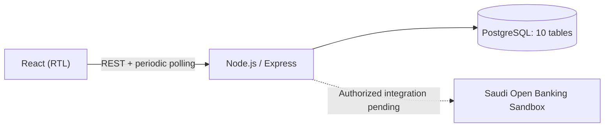

# Mezyad | مِزياد

**Mezyad** is a proposed multi-category digital auction platform for high-value and rare assets. This repository is the **team's design and technical documentation**; the architecture and flows below are planned requirements, not proof of a deployed MVP.

## Project documentation

| Stage | Document | Scope |
|---|---|---|
| 1 — Idea Development | [Stage 1 Report](Stage_1/Report.MD) | Problem, idea and feasibility |
| 2 — Project Charter | [Stage 2 Report](Stage_2/Report.MD) | Objectives, stakeholders, scope, risks and milestones |
| 3 — Technical Documentation | [Stage 3 Report](Stage_3/Report.MD) | Architecture, ERD, sequence diagrams, API contracts, SCM and QA |

## Approved MVP scope (Stage 3)

- Register, log in and manage sessions; roles: **USER** and **ADMIN**.
- One User account can list their own assets and bid on **other users'** auctions.
- Category-specific listing details, images and administrator approval/rejection.
- Public and code-protected private auctions; private access granted server-side.
- Bid commitment step requiring **genuinely verified** Saudi Open Banking sandbox integration. Provider/operation/credentials are **not yet confirmed**.
- Bid validation, PostgreSQL row locking, minimum increments, idempotent request IDs, bid history and auction closure with stable winner/no-winner result.
- Basic React pages with periodic REST polling and a client-side description assistant.

**Not part of the current MVP:** real payments, escrow, real KYC, handover management, blockchain, Redis, WebSockets and anti-sniping. Auction closure records the winner; it does **not** represent a completed real-world payment or delivery.

## Architecture

- PostgreSQL is authoritative for auction state and monetary amounts.
- Bids and closure use `SELECT ... FOR UPDATE` inside database transactions.
- Server time, not the React countdown, controls bidding deadlines.
- Private access is enforced by the API; codes are hashed and attempts must be rate-limited.

## Auction categories

Camels; newly built unsold properties; high-end handbags and rare collectibles; distinctive vehicle registration plates; rare/limited/discontinued vehicle models.

## Team

| Member | Responsibility |
|---|---|
| Abeer Al-Saiari | Database with Tala; backend with Ghadi |
| Tala Al-Hudaibi | Database with Abeer; QA and integration review with Aseel |
| Ghadi Al-Zahrani | Backend with Abeer; frontend with Aseel |
| Aseel Al-Zahrani | Frontend with Ghadi; QA and integration review with Tala |

## Status and technical constraints

**Stage 3:** technical design documented; actual integration/test results are not claimed in this documentation repository. **Bank sandbox:** unverified external dependency. The implementation must follow the [Stage 3 technical baseline](Stage_3/Report.MD), not outdated transaction/hand-over descriptions.

No secrets, production URLs or successful sandbox calls are claimed here.
