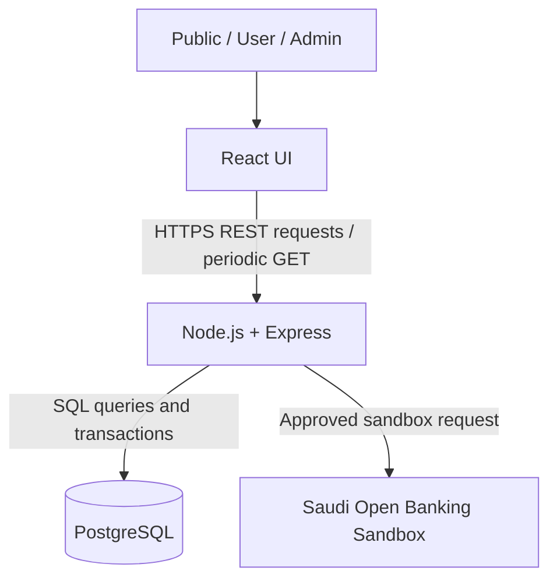
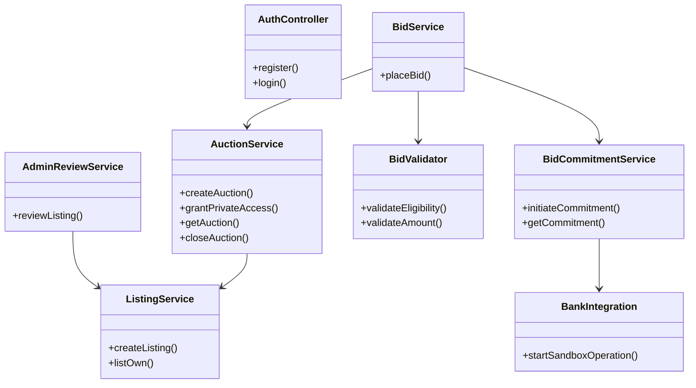
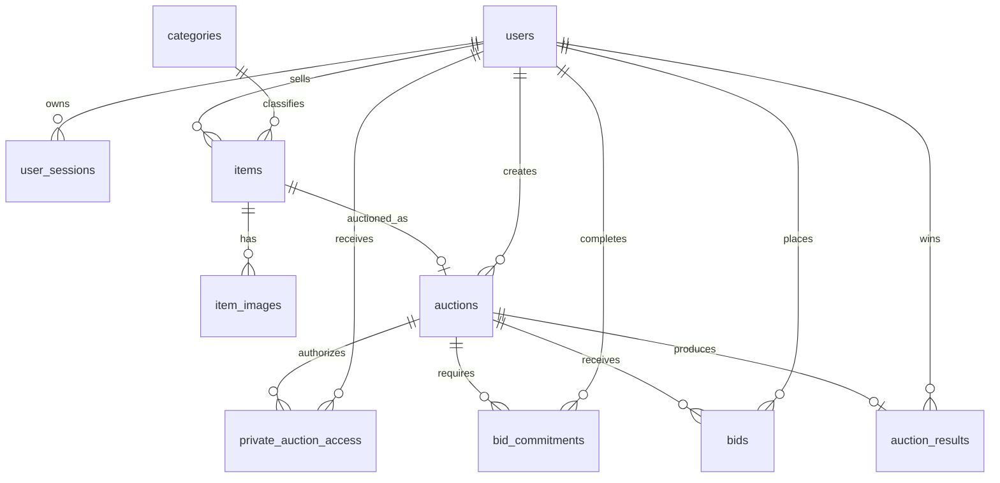
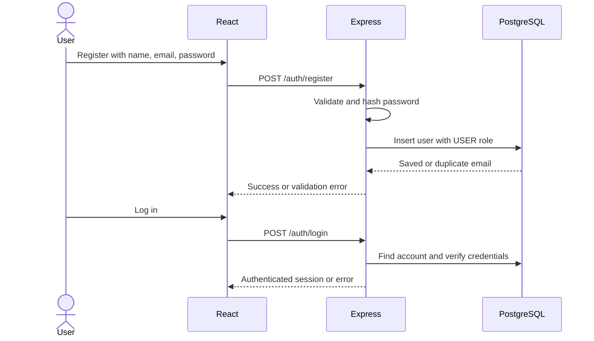
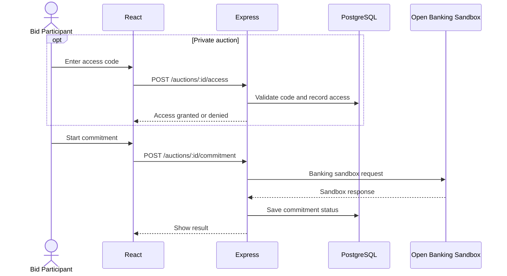
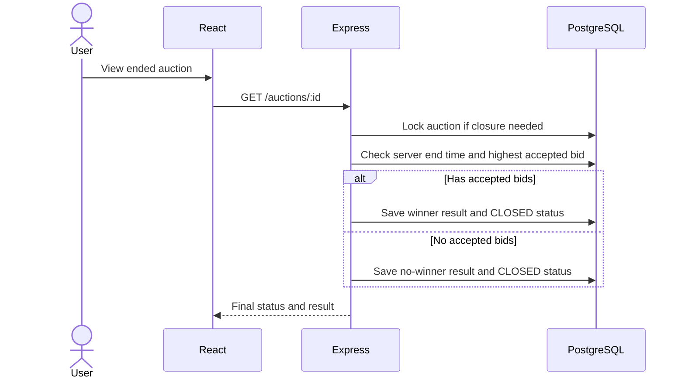

# Mezyad — Stage 3 Technical Documentation

**A High-Value Asset Auction Platform**  
Graduation Capstone Project

---

## 1. Preface

Mezyad is a web-based auction platform for high-value assets. It provides a clear process for sellers to list assets, for administrators to review submitted listings, and for bidders to participate in public or private auctions.

A seller creates a listing with the asset details and images. After administrator approval, the seller can create an auction by setting its starting price, minimum bid increment, start time, end time, and visibility. Public auctions can be discovered through the platform. Private auctions are shared by their sellers and require an access code before a bidder can participate.

Bidders can browse auction details, complete the bid commitment step, submit bids, follow the current price and bidding history, and view the auction result. The system validates each bid on the server to prevent invalid prices, bids after the deadline, and unauthorized participation. A Saudi Open Banking sandbox integration supports the project's banking-related participation flow without transferring real money.

Mezyad uses **React** for the user interface, **Node.js and Express** for backend requests, and **PostgreSQL** for data storage. The auction page requests updated information from the server at regular intervals. PostgreSQL transactions keep bid records and auction prices consistent when multiple users submit bids close together.

The platform also includes small usability features such as clear form errors, bid confirmation, auction status labels, and a description suggestion button that formats seller-provided asset information into an editable paragraph.

The project focuses on a complete and understandable auction workflow, from listing submission to the final auction result.

---

## 2. User Stories & Mockups

### 2.1 Prioritized User Stories (MoSCoW)

Mezyad provides a single standard account for both selling and bidding. A registered user can submit an asset, create an auction after approval, and participate in auctions created by other users. An administrator reviews submitted listings. The stories below describe the platform's main features, required behavior, and related interface screens.

| ID | Priority | Feature | Actor | User Story / Main Action | System Behavior and Acceptance Criteria | Expected Result | Screen |
|---|---|---|---|---|---|---|---|
| US-01 | Must Have | Register | User | Create an account with name, email and password. | Validate fields and unique email; hash password; assign USER automatically. | Account created; duplicate email rejected. | Register |
| US-02 | Must Have | Login | User / Admin | Sign in with registered credentials and log out securely. | Verify password and session; use account role to authorize features. | Authenticated session or clear error. | Login |
| US-03 | Must Have | Submit listing | User (owner) | Create an asset listing with category, description and images. | Save owner ID and PENDING_REVIEW; validate required information. | Listing appears in My Activity. | Create Listing |
| US-04 | Must Have | Review listing | Admin | Approve or reject submitted asset listings. | Only ADMIN reviews; save decision and rejection reason. | Approved listings can be auctioned. | Admin Review |
| US-05 | Must Have | Create auction | User (owner) | Create a public or private auction for an approved asset. | Validate ownership, approval, dates, prices and visibility; generate private access code. | Auction created with correct visibility. | Create Auction |
| US-06 | Must Have | Browse auctions | Public / User | Find and view public auctions. | List public auctions with current price, status and item details; exclude private listings. | Public auction details are visible. | Home |
| US-07 | Must Have | Private access | User | Enter the invitation code to join a private auction. | Validate code on server; grant access only to signed-in user. | Authorized user can view private auction. | Private Access |
| US-08 | Must Have | Bid commitment | User | Complete the required banking-related commitment before bidding. | Process Saudi Open Banking sandbox interaction and store outcome; no real-money transfer. | Eligible commitment is recorded. | Commitment |
| US-09 | Must Have | Place bid | User | Bid on another user's active auction. | Check not owner, auction time, access, commitment and minimum increment; save atomically. | Accepted bid changes price; invalid bid rejected. | Auction Details |
| US-10 | Must Have | Track auction | Public / User | See auction price, bid history and remaining time. | Refresh authorized auction details every few seconds; use server state for bid validity. | Auction view shows latest accepted data. | Auction Details |
| US-11 | Must Have | Auction result | User | See the final winning bid or no-bid outcome. | Close auction consistently and reject late bids. | Final result appears. | Auction Result |
| US-12 | Should Have | My Activity | User | See listings and auctions I created alongside auctions I bid in. | Filter listings and bids by signed-in user; show both activities in one account. | User can manage selling and bidding together. | My Activity |
| US-13 | Could Have | Description suggestion | User | Generate an editable listing description from entered asset details. | Use existing form values; no external AI service or invented claims. | Editable description appears in form. | Create Listing |

### 2.2 Account Types

| Account | Description |
|---|---|
| **User** | A registered member who can create asset listings, publish auctions for approved assets, and bid in auctions owned by other members. Selling and bidding are activities within the same account. |
| **Admin** | An authorized administrator who reviews submitted listings and manages administrative auction oversight. Admin accounts are not created through public registration. |

Anyone can browse public auctions before signing in. Registration or login is required for protected actions. Browsing without an account is not a separate database role. The backend prevents users from bidding on auctions they own.

### 2.3 UI Mockups & Design Approach

Mezyad uses React and an Arabic right-to-left interface with a vintage-inspired visual style, consistent typography, readable auction cards and clear navigation. The main screens are Home, Register/Login, Create Listing, Admin Review, Create Auction, Private Access, Commitment, Auction Details, Auction Result and My Activity.

**Account access:** A new member registers with a name, email and password. The system creates a standard USER account. The same login screen is used by users and administrators; the available functions depend on the authenticated role.

**Listing and review:** A signed-in user submits asset details and images. The listing appears under My Activity as Pending Review. An administrator examines the listing and records approval or rejection. Approved listings become available for auction creation.

**Auction creation:** The asset owner selects an approved listing, sets the starting price, minimum bid increment, start and end times, and chooses Public or Private. Public auctions appear in the general auction list. Private auctions use an invitation code that the owner can copy and share.

**Private auction participation:** A signed-in user enters the access code. The backend verifies the code and records the access grant before showing protected auction details.

**Commitment and bidding:** The user completes the required banking sandbox step, then enters a bid amount on an eligible auction owned by someone else. A confirmation dialog displays the amount. The backend validates the user, auction deadline, commitment, access and bid increment before accepting it.

**Results and activity:** Auction pages show current price, bid history and remaining time. When an auction ends, the final result shows the winning bid or a no-bids outcome. My Activity combines My Listings, My Auctions and My Bids for the same account.

**Interface feedback:** Loading indicators, validation messages, auction status labels, empty states and success/error notifications provide clear feedback throughout these screens.

### 2.4 Listing Description Suggestion

The Create Listing form includes a Suggest Description button. It combines information entered by the asset owner into a readable paragraph that can be edited before submission. For vehicles, the suggestion can use make, model, year, mileage and condition. The feature uses a simple React template and does not require a separate service or external AI model.

---

## 3. System Architecture



**One backend:** Express handles authentication, role checks, listings, admin review, auctions, bidding, and the sandbox integration. PostgreSQL is the authoritative source for bid prices, eligibility, access and closure state. The React countdown is informational; server time determines acceptance.

**Concurrency:** Lock the auction row using `SELECT ... FOR UPDATE` inside a PostgreSQL transaction; check the auction deadline and latest accepted price under that lock, then insert bid and update current price atomically. Do not use Redis or distributed locks.

**Updates:** React polls active auction details via GET every few seconds. Polling is not true push-based real-time. No Socket.io until a mentor requirement makes it necessary.

Asset image references are stored in `item_images`. The listing form sends image files to the backend upload handler.

### 3.1 Development environment

Local development can use React dev server, Express server and PostgreSQL. Use environment variables for DB connection and sandbox credentials. Do not commit secrets. Docker/Compose is optional pending official course requirements and team familiarity.

---

## 4. Backend Components & Class Design

### 4.1 Responsibilities

| Component | Responsibility | Main methods (illustrative) |
|---|---|---|
| AuthController | Register/login and session validation | register, login, authenticate |
| ListingService | Seller listing and images | createListing, listOwn, getListing |
| AdminReviewService | Approve/reject submitted listings | reviewListing |
| AuctionService | Create, access, view and close auctions | createAuction, grantPrivateAccess, getAuction, closeAuction |
| BidValidator | Validate bid rules | validateEligibility, validateAmount |
| BidService | Transactional bid acceptance | placeBid |
| BidCommitmentService | Record participation outcome | initiateCommitment, getCommitment |
| BankIntegration | Isolated sandbox calls | startSandboxOperation, handleSandboxResponse |

These components organize the Express routes and service functions. The description suggestion is handled directly in the React listing form.

### 4.2 Simplified class/component diagram



BidService handles database transactions for bid acceptance, while BidValidator contains eligibility and amount checks.

---

## 5. Database Design (PostgreSQL Only)

### 5.1 Entity Relationship Diagram



### 5.2 Tables and essential fields

| Table | Essential fields | Purpose |
|---|---|---|
| `users` | id, role (USER or ADMIN), name, email UNIQUE, password_hash, created_at | Standard and administrator accounts |
| `user_sessions` | id, user_id, token_hash, expires_at | Session tracking; may simplify if secure auth approach differs |
| `categories` | id, name UNIQUE | Initial categories e.g. vehicles, real_estate |
| `items` | id, seller_id, category_id, title, description, category_fields JSONB, status, review_reason, reviewed_by, reviewed_at | Listing and one current review decision |
| `item_images` | id, item_id, image_url | Image references |
| `auctions` | id, item_id UNIQUE, seller_id, visibility, access_code_hash NULLABLE, starting_price, current_price, minimum_increment, start_time, end_time, status | Auction rules/state in one table |
| `private_auction_access` | auction_id, bidder_id, granted_at, UNIQUE(auction_id,bidder_id) | Access grants |
| `bid_commitments` | id, auction_id, bidder_id, status, sandbox_reference, created_at, UNIQUE(auction_id,bidder_id) | Sandbox-related participation record; exact fields pending provider |
| `bids` | id, auction_id, bidder_id, amount, request_id UNIQUE, created_at | Accepted bids and idempotency |
| `auction_results` | auction_id UNIQUE, winner_bid_id NULLABLE, closed_at | Final result; NULL when no bids |

**Total: 10 tables.** The schema stores account details, listings, auctions, access permissions, commitments, accepted bids and results.

### 5.3 Constraints and integrity

| Rule | Database/backend enforcement |
|---|---|
| Email unique | UNIQUE(email) |
| One auction per asset | UNIQUE(auctions.item_id) |
| One access grant per bidder and private auction | Composite UNIQUE |
| One commitment record per bidder/auction | Composite UNIQUE |
| Duplicate bid request | UNIQUE(request_id) |
| Valid positive money values | NUMERIC/DECIMAL with CHECK amount > 0; avoid floating point |
| Valid time range | CHECK end_time > start_time |
| Allowed states | CHECK or validated enum values |
| Owner/role checks | Express authorization + referenced seller ID |
| Private auction access | Server check on **every** protected detail/bid request |
| Bid race condition | PostgreSQL transaction and auction row lock |
| Closed auction | Reject bids when server time >= end_time, even if status has not yet been refreshed |

**State model:** SCHEDULED / ACTIVE / CLOSED. Define ACTIVE based on server time and stored status consistently; closure can be finalized idempotently when the auction is accessed or by a simple scheduled job if the course requires proactive closure. A React timer must never determine the winner.

The auction's minimum increment is stored in `auctions`, and review information is stored with the asset listing. Bid history is maintained in the `bids` table.

---

## 6. Sequence Diagrams

### Flow 1 — Registration and Login



### Flow 2 — Listing, Admin Review, Auction Creation

```mermaid
sequenceDiagram
  actor User as Asset Owner
  actor Admin
  participant UI as React
  participant API as Express
  participant DB as PostgreSQL
  User->>UI: Submit listing
  UI->>API: POST /items
  API->>DB: Save PENDING_REVIEW listing
  API-->>UI: Listing submitted
  Admin->>UI: Review listing
  UI->>API: POST /admin/items/:id/review
  API->>DB: Save APPROVED or REJECTED
  API-->>UI: Review recorded
  User->>UI: Create auction for approved listing
  UI->>API: POST /auctions
  API->>DB: Check owner and approval; save auction
  API-->>UI: Auction created; private code if selected
```

### Flow 3 — Private Access and Bid Commitment



The banking interaction uses the sandbox service and stores the resulting commitment status without transferring real funds.

### Flow 4 — Place Bid (Atomic PostgreSQL Transaction)

```mermaid
sequenceDiagram
  actor User as Bid Participant
  participant UI as React
  participant API as Express
  participant DB as PostgreSQL
  User->>UI: Confirm bid amount
  UI->>API: POST /auctions/:id/bids
  API->>DB: BEGIN; SELECT auction FOR UPDATE
  DB-->>API: Locked auction state
  API->>DB: Read access, owner, commitment and current bid
  DB-->>API: Eligibility and auction data
  API->>API: Validate not owner, access, commitment, time and amount
  alt Valid bid
    API->>DB: INSERT bid; UPDATE current_price; COMMIT
    API-->>UI: 201 Bid accepted
  else Invalid bid
    API->>DB: ROLLBACK
    API-->>UI: 4xx Rejected with reason
  end
  UI-->>User: Display success or error
```

### Flow 5 — Auction Closure and Result



**Concurrency note:** Closure and bid acceptance must lock the same auction row, so they cannot both commit contradictory outcomes. Closure must be idempotent (repeated calls produce one result).

---

## 7. API Specifications

### 7.1 Conventions

- Base prefix: `/api/v1`. Requests/responses use JSON except image upload, if applicable.
- Authentication: secure session or verified token, consistently implemented.
- All sensitive routes require server-side role and ownership checks.
- Responses use consistent `{ "data": ... }` or `{ "error": { "code": "...", "message": "..." } }`.
- Typical status codes: 200 OK, 201 Created, 400 Bad Request, 401 Unauthorized, 403 Forbidden, 404 Not Found, 409 Conflict.
- For private auctions, avoid leaking existence or private details to unauthorized clients.

### 7.2 Endpoint contracts

| Method | Path | Role | Key request | Success response | Key failures |
|---|---|---|---|---|---|
| POST | /auth/register | Public | name,email,password | 201 user summary | 400,409 |
| POST | /auth/login | Public | email,password | 200 session/account | 401 |
| POST | /auth/logout | Signed in | — | 200 signed out | 401 |
| POST | /items | User | category,title,description,category_fields,images | 201 listing | 400,403 |
| GET | /items | User/Admin | filter by own or pending | 200 list | 401,403 |
| GET | /items/:id | Owner/Admin | item ID | 200 listing | 403,404 |
| POST | /admin/items/:id/review | Admin | decision,reason? | 200 updated status | 403,409 |
| POST | /auctions | User (owner) | itemId,visibility,prices,times | 201 auction; private code to owner | 400,403,409 |
| GET | /auctions | Public | public filters/status | 200 public list | 400 |
| GET | /auctions/:id | Authorized | auction ID | 200 details/result | 403/404 |
| POST | /auctions/:id/access | User | accessCode | 200 access granted | 403/404,429 |
| POST | /auctions/:id/commitment | User | provider-specific validated fields | 200/201 commitment status | 400,403,502 |
| GET | /auctions/:id/commitment | User | — | 200 own status | 403,404 |
| POST | /auctions/:id/bids | User (not owner) | amount,requestId | 201 accepted bid | 400,403,409 |
| GET | /auctions/:id/bids | Authorized | paging params | 200 accepted bid history | 403/404 |
| GET | /me/auctions | User | — | 200 own participation/owned auctions | 401 |

The endpoints are grouped by user-facing functionality and share one Express backend. The Description Builder is client-side and needs **no endpoint**.

### 7.3 Sample requests and responses

**Create auction:**
```json
{
  "itemId": "item-uuid",
  "visibility": "PRIVATE",
  "startingPrice": 50000,
  "minimumIncrement": 500,
  "startTime": "2026-11-01T10:00:00Z",
  "endTime": "2026-11-02T10:00:00Z"
}
```

**Successful private-auction creation:** `201`
```json
{
  "data": {
    "id": "auction-uuid",
    "status": "SCHEDULED",
    "visibility": "PRIVATE",
    "accessCode": "one-time-code-shown-to-owner"
  }
}
```

**Place bid:**
```json
{ "amount": 51000, "requestId": "unique-client-request-id" }
```

**Accepted:** `201`
```json
{ "data": { "bidId": "bid-uuid", "amount": 51000, "currentPrice": 51000 } }
```

**Rejected:** `409`
```json
{ "error": { "code": "BID_TOO_LOW", "message": "The amount must exceed the current bid by the minimum increment." } }
```

**Private access:** `POST /auctions/:id/access`
```json
{ "accessCode": "code-from-seller" }
```

**Admin review:** `POST /admin/items/:id/review`
```json
{ "decision": "REJECTED", "reason": "Please add a clear asset photo." }
```

### 7.4 Saudi Open Banking Sandbox Integration

| Item | Status |
|---|---|
| Provider and official documentation | To be specified in the integration contract |
| Available sandbox operation | To be specified in the integration contract |
| Test credentials / access | To be specified in the integration contract |
| Consent or authorization flow | To be specified in the integration contract |
| Callback or redirect requirements | To be specified in the integration contract |
| Exact commitment-to-bid rule | Defined by the approved integration requirements |
| Success/error sample payloads | To be specified in the integration contract |

**Implementation rule:** Do not invent a `proofOfFunds`, `holdFunds`, `transfer`, or `sendSMS` endpoint. Once the real sandbox operation is selected, replace the abstract sequence and add precise request/response examples.

---

## 8. SCM and QA Plans

### 8.1 Four-week execution plan (remaining implementation window)

| Week | Deliverables | Acceptance checkpoint |
|---|---|---|
| 1 | Project setup; database schema; auth; initial listing form; sandbox access proof | Team can sign in, save listing, and demonstrate a genuine sandbox test call |
| 2 | Admin review; auction creation; public/private access; basic screens | Seller-to-admin-to-private-auction journey works |
| 3 | Commitment integration; transactional bidding; closure; results | Concurrent bid and end-time tests pass |
| 4 | End-to-end testing; UX polish; bug fixes; mentor demo rehearsal | Full public and private flows work without manual database edits |

This four-week schedule organizes the implementation tasks while the team follows the course milestones.

### 8.2 Source control

- `main`: reviewed stable code.
- `feature/*`: short-lived feature branches.
- Pull request before merge; at least one teammate reviews changes.
- Small commits with clear messages; no credentials in repository.
- One issue/task owner and one reviewer for each major feature.
- `develop` branch only if the team genuinely needs it.

### 8.3 Team Responsibilities

| Area | Primary team members | Review/support |
|---|---|---|
| Database schema and SQL | Abeer, Tala | Ghadi |
| Express backend, auth, auctions, bids | Abeer, Ghadi | Tala |
| React screens and UX | Aseel, Ghadi | Tala |
| QA, documentation, integration review | Tala, Aseel | Entire team |
| Sandbox proof-of-concept | Backend pair | Entire team verifies actual flow |

### 8.4 Test plan

| ID | Area | Test case | Expected result | Status |
|---|---|---|---|---|
| QA-01 | Auth | Duplicate email registration | 409, no duplicate user | Planned |
| QA-02 | Auth | Wrong password | 401, no session | Planned |
| QA-03 | Roles | User attempts admin review | 403 | Planned |
| QA-03A | Ownership | User bids on their own auction | Rejected | Planned |
| QA-03B | Accounts | User creates an auction and bids on another user's auction | Both allowed | Planned |
| QA-04 | Listing | Auction from unapproved item | Rejected | Planned |
| QA-05 | Private access | Invalid code | Access denied | Planned |
| QA-06 | Private access | Direct GET/bid without grant | No private data or bid | Planned |
| QA-07 | Commitment | Sandbox fails or times out | Clear error; no false approval | Planned |
| QA-08 | Bidding | Bid below minimum | Rejected; price unchanged | Planned |
| QA-09 | Bidding | Same requestId submitted twice | At most one accepted bid | Planned |
| QA-10 | Concurrency | Two bids at once | Serial, consistent accepted prices | Planned |
| QA-11 | Time | Bid at/after endTime | Rejected by server | Planned |
| QA-12 | Closure | End with no bids | CLOSED, no winner | Planned |
| QA-13 | Closure | Repeated closure request | One consistent result | Planned |
| QA-14 | UX | Empty list/loading/errors | Appropriate clear states | Planned |
| QA-15 | E2E | Public auction complete journey | Correct final outcome | Planned |
| QA-16 | E2E | Private auction complete journey | Access and bidding rules respected | Planned |

The test plan covers account permissions, private auction access, bid integrity and auction closure.

---

## 9. Future Enhancements

These are explicitly **not** MVP commitments:
- Push-based live updates with Socket.io, if justified.
- Anti-sniping (extend auction time on late bids).
- Advanced user notifications.
- Additional auction formats and analytics.

**Not future promises:** Escrow, real-money settlement, complex KYC, distributed infrastructure, predictive pricing, or a chatbot. They require separate requirements, security review, and resources.

---
