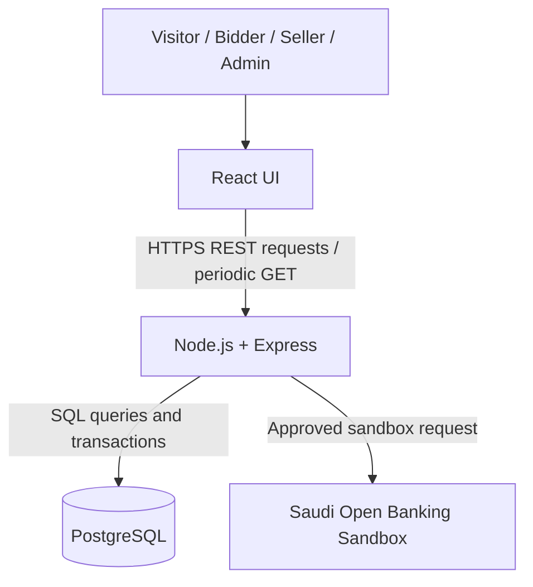
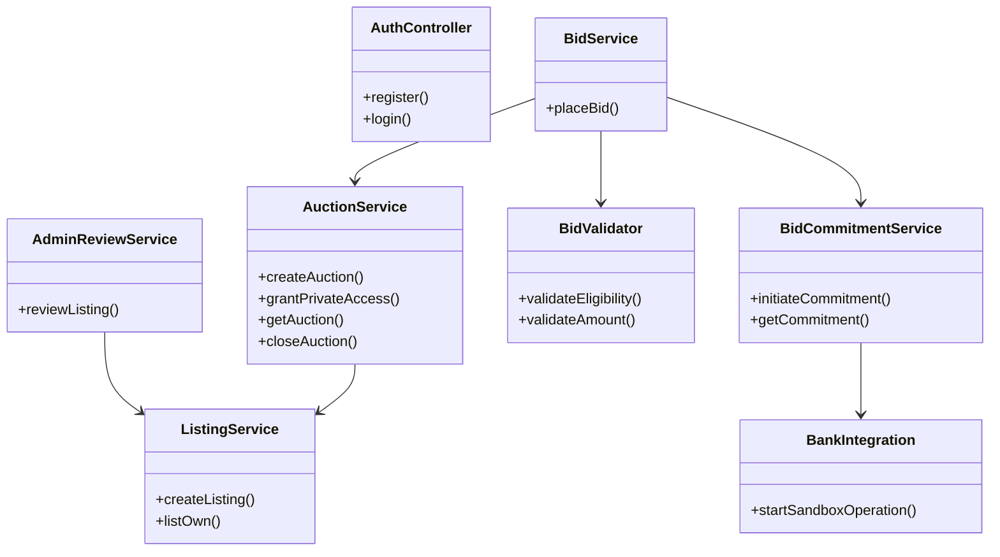
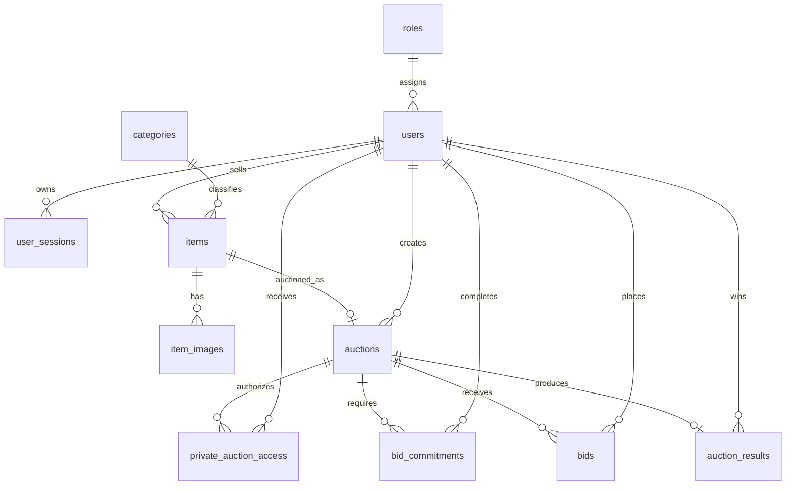
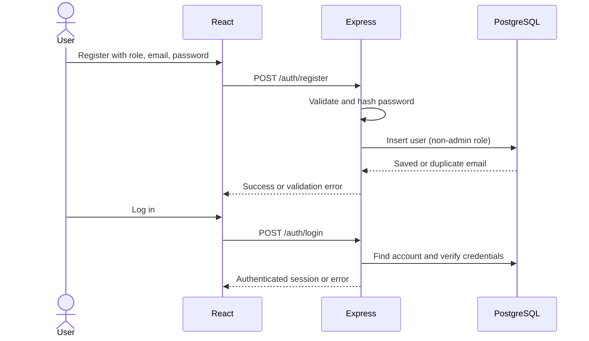
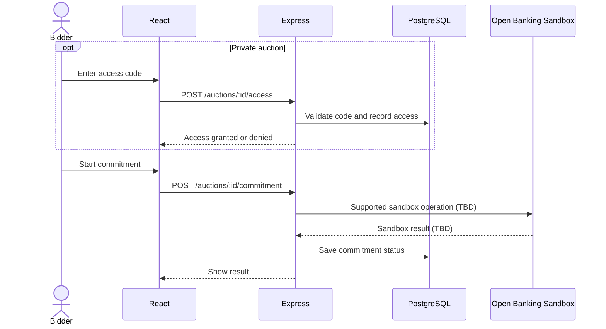
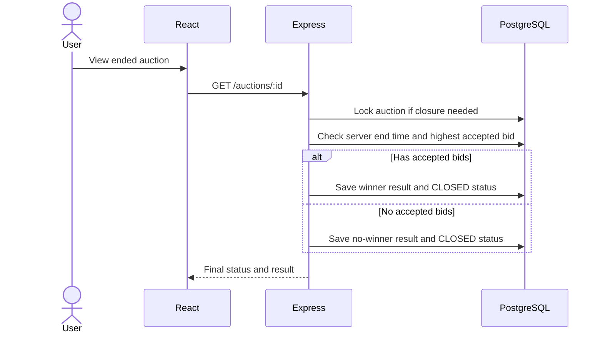

# Mezyad — Stage 3 Technical Documentation

**A High-Value Asset Auction Platform**  
Graduation Capstone Project

---

## 1. Preface

Mezyad is a web-based auction platform for high-value assets. It provides a clear process for sellers to list assets, for administrators to review submitted listings, and for bidders to participate in public or private auctions.

A seller creates a listing with the asset details and images. After administrator approval, the seller can create an auction by setting its starting price, minimum bid increment, start time, end time, and visibility. Public auctions can be discovered through the platform. Private auctions are shared by their sellers and require an access code before a bidder can participate.

Bidders can browse auction details, complete the bid commitment step, submit bids, follow the current price and bidding history, and view the auction result. The system validates each bid on the server to prevent invalid prices, bids after the deadline, and unauthorized participation. A Saudi Open Banking sandbox integration supports the project's banking-related participation flow without transferring real money.

Mezyad uses **React** for the user interface, **Node.js and Express** for backend requests, and **PostgreSQL** for data storage. The auction page requests updated information from the server at regular intervals. PostgreSQL transactions keep bid records and auction prices consistent when multiple users submit bids close together.

The platform also includes small usability features such as clear form errors, bid confirmation, auction status labels, and a description suggestion button that formats seller-provided asset information into an editable paragraph.

The project focuses on a complete and understandable auction workflow, from listing submission to the final auction result.

---

## 2. User Stories & Mockups

### 2.1 Prioritized User Stories (MoSCoW)

The user stories describe the main actions supported by Mezyad. **Must Have** stories cover the complete auction process. **Should Have** stories improve account navigation, while **Could Have** stories provide additional convenience without affecting the main workflow.

| ID | Feature | Priority | Role | User Story | Acceptance Criteria |
|---|---|---|---|---|---|
| US-01 | Register an account | Must Have | Visitor | As a visitor, I want to register as a bidder or seller so that I can use the platform. | A valid account is created with a unique email; the password is stored securely; admin cannot be selected at registration. |
| US-02 | Log in | Must Have | Bidder / Seller / Admin | As a registered user, I want to log in so that I can access the features available to my account. | Correct credentials open the account; incorrect credentials show an error without granting access. |
| US-03 | Submit a listing | Must Have | Seller | As a seller, I want to submit an asset with its details and images so that it can be reviewed before auctioning. | Required information is validated; the listing is saved as pending review and belongs to the seller. |
| US-04 | Review a listing | Must Have | Admin | As an administrator, I want to approve or reject submitted listings so that only approved assets can be auctioned. | Only an administrator can make a review decision; the seller can see the outcome and any rejection reason. |
| US-05 | Create an auction | Must Have | Seller | As a seller, I want to create a public or private auction for an approved asset so that I can choose how bidders participate. | Only the owner can auction an approved asset; price and dates are valid; a private auction has an access code. |
| US-06 | Browse public auctions | Must Have | Visitor / Bidder | As a user, I want to browse public auctions and open their details so that I can find an asset I am interested in. | Public auctions are listed with accurate status and pricing; private auctions do not appear in public search results. |
| US-07 | Join a private auction | Must Have | Bidder | As a bidder, I want to enter an invitation code so that I can access a private auction. | The server checks the code and the user's permission; an incorrect code does not reveal private details. |
| US-08 | Complete bid commitment | Must Have | Bidder | As a bidder, I want to complete the required commitment process so that I can participate in an eligible auction. | The system records the commitment outcome and handles the Saudi Open Banking sandbox response without real-money transfers. |
| US-09 | Place a bid | Must Have | Bidder | As an eligible bidder, I want to submit a bid and know whether it was accepted so that I can participate confidently. | The bid is accepted only when the auction is active, access is valid, and the amount meets the required increase; simultaneous bids do not corrupt the price. |
| US-10 | Follow auction progress | Must Have | Bidder / Seller | As a participant, I want to see the latest price, bid history, and remaining time so that I can follow the auction. | The page refreshes auction data regularly; the server remains responsible for bid deadlines and accepted prices. |
| US-11 | View auction results | Must Have | Bidder / Seller | As a participant, I want to see the final result when an auction ends so that I know whether it has a winner. | An ended auction no longer accepts bids and shows the correct winning bid or a no-bids result. |
| US-12 | Manage my auctions | Should Have | Bidder / Seller | As a user, I want to view auctions related to my account so that I can find my activity easily. | A seller sees owned listings and auctions; a bidder sees auctions they have participated in. |
| US-13 | Suggest a listing description | Could Have | Seller | As a seller, I want a suggested description based on the asset information I entered so that I can write my listing more easily. | The suggestion uses the existing fields, can be edited, and does not invent information about the asset. |

#### User Roles and Permissions

Mezyad has three registered roles: **Bidder**, **Seller**, and **Admin**. Visitors can browse public auctions without registering. The table below shows which actions are available to each role.

| Action | Visitor | Bidder | Seller | Admin |
|---|---|---|---|---|
| Register or log in | Yes | Yes | Yes | Login only |
| Browse public auctions | Yes | Yes | Yes | Yes |
| Submit an asset listing | No | No | Yes | No |
| Review submitted listings | No | No | No | Yes |
| Create public/private auctions | No | No | Own approved assets | No |
| Access private auctions | No | With valid code | Own auctions | For administration |
| Complete bid commitment | No | Yes | No | No |
| Submit a bid | No | Yes, if eligible | No | No |
| View auction results | Public only | Authorized auctions | Own/public auctions | Yes |
| View personal auction activity | No | Own participation | Own listings/auctions | Administrative view |
| Suggest listing description | No | No | Yes | No |

All protected actions are checked by the backend. A private auction's code is not a substitute for verifying the signed-in bidder's access.

### 2.2 UI Mockups & Design Approach

The interface uses **React** with an Arabic right-to-left layout. The visual direction combines a vintage-inspired style with readable typography, clear spacing, and straightforward navigation. Shared components are used for auction cards, forms, status labels, buttons, and feedback messages.

The main user flows are described below. Each flow follows the actions shown in the interface and the response expected from the system.

#### Flow A — Registration and Login

| Step | User Action | System Response | Screen |
|---|---|---|---|
| 1 | Open registration and choose Bidder or Seller | Displays the appropriate form | Register |
| 2 | Enter name, email and password | Checks required fields and email format | Register |
| 3 | Submit the form | Creates the account or explains the error | Register |
| 4 | Enter email and password | Verifies credentials and opens the account | Login |

#### Flow B — Seller Listing and Admin Review

| Step | User Action | System Response | Screen |
|---|---|---|---|
| 1 | Seller selects Create Listing | Opens the asset form | Create Listing |
| 2 | Seller enters asset details and adds images | Checks required fields and displays the entered information | Create Listing |
| 3 | Seller submits the listing | Saves it as Pending Review | Seller Dashboard |
| 4 | Admin opens the review queue | Displays pending listings | Admin Review |
| 5 | Admin approves or rejects the listing | Saves the decision and any rejection reason | Admin Review |
| 6 | Seller checks the listing status | Shows Approved or Rejected with feedback | Seller Dashboard |

#### Flow C — Create a Public or Private Auction

| Step | User Action | System Response | Screen |
|---|---|---|---|
| 1 | Seller selects an approved asset | Opens auction settings | Create Auction |
| 2 | Seller enters price, bid increment and schedule | Validates the auction settings | Create Auction |
| 3 | Seller chooses Public or Private | Displays the selected visibility | Create Auction |
| 4 | Seller confirms | Creates the auction | Auction Details |
| 5 | If private, seller copies the access code | Shows the code to the owner with a copy action | Private Auction Details |

#### Flow D — Join and Participate in a Private Auction

| Step | User Action | System Response | Screen |
|---|---|---|---|
| 1 | Bidder opens a private auction invitation | Requests sign-in and access code as needed | Private Access |
| 2 | Bidder enters the code | Checks the code and grants or rejects access | Private Access |
| 3 | Bidder starts the commitment step | Processes the supported banking sandbox interaction and displays its result | Commitment |
| 4 | Bidder opens auction details | Displays price, bid history and remaining time | Auction Details |
| 5 | Bidder enters an amount and confirms | Validates and accepts or rejects the bid with a clear message | Bid Confirmation |

#### Flow E — Auction Closure and Results

| Step | User Action | System Response | Screen |
|---|---|---|---|
| 1 | User opens an auction near its end | Displays the latest server-backed information | Auction Details |
| 2 | Auction end time passes | Server stops accepting new bids | Auction Details |
| 3 | User views the result | Displays the winning bid or No Bids | Auction Result |
| 4 | Bidder or seller opens My Auctions | Displays auctions associated with their account | My Auctions |

#### Interface Feedback

| Element | Behavior |
|---|---|
| Loading state | Shows progress while a request is being processed |
| Success/error messages | Explains the result of registration, listing review, access, and bidding |
| Bid confirmation | Displays the amount before submitting a bid |
| Auction status | Displays Scheduled, Active or Closed with a text label and color |
| Empty state | Explains when no listings, auctions, or search results are available |
| Copy private code | Copies the seller's private auction invitation code |
| Creation steps | Shows progress through the existing auction form |
| My Auctions | Lists a user's relevant auctions without a separate database table |

### 2.3 Listing Description Suggestion

The listing form includes a small **Suggest Description** action. The seller first enters the asset category and relevant details. The interface combines these values into a short, editable description. The seller can change the text before submitting the listing.

For example, vehicle information such as make, model, year, mileage, and condition can be arranged into a readable paragraph. The suggestion uses only the values provided by the seller. It does not estimate prices, verify asset condition, or call an external AI service.

This feature is implemented within the listing form and does not require a separate backend component, API endpoint, or database table.

---

## 3. System Architecture



**One backend:** Express handles authentication, role checks, listings, admin review, auctions, bidding, and the sandbox integration. PostgreSQL is the authoritative source for bid prices, eligibility, access and closure state. The React countdown is informational; server time determines acceptance.

**Concurrency:** Lock the auction row using `SELECT ... FOR UPDATE` inside a PostgreSQL transaction; check the auction deadline and latest accepted price under that lock, then insert bid and update current price atomically. Do not use Redis or distributed locks.

**Updates:** React polls active auction details via GET every few seconds. Polling is not true push-based real-time. No Socket.io until a mentor requirement makes it necessary.

**Image storage — pending implementation decision:** `item_images.image_url` stores references, not image bytes. Confirm a working upload/storage approach before describing upload as complete.

### 3.1 Development environment

Local development can use React dev server, Express server and PostgreSQL. Use environment variables for DB connection and sandbox credentials. Do not commit secrets. Docker/Compose is optional pending official course requirements and team familiarity.

---

## 4. Backend Components & Class Design

### 4.1 Responsibilities

| Component | Responsibility | Main methods (illustrative) |
|---|---|---|
| AuthController | Register/login and session validation | register, login, authenticate |
| ListingService | Seller listing and images | createListing, listOwn, getListing |
| AdminReviewService | Approve/reject submitted listings | reviewListing |
| AuctionService | Create, access, view and close auctions | createAuction, grantPrivateAccess, getAuction, closeAuction |
| BidValidator | Validate bid rules | validateEligibility, validateAmount |
| BidService | Transactional bid acceptance | placeBid |
| BidCommitmentService | Record participation outcome | initiateCommitment, getCommitment |
| BankIntegration | Isolated sandbox calls | startSandboxOperation, handleSandboxResponse |

These are **logical responsibilities**, not a mandate to implement eight elaborate OOP classes. Simple Express routes plus small service functions are acceptable. No separate NotificationService, SmartAuctionAssistant, Redis coordinator, or WebSocket handler.

### 4.2 Simplified class/component diagram



**Why keep BidService separate?** Bid acceptance has the highest concurrency risk and deserves a focused, testable transaction. The validator can be a plain helper module if a class feels excessive.

---

## 5. Database Design (PostgreSQL Only)

### 5.1 Proposed ER diagram



### 5.2 Tables and essential fields

| Table | Essential fields | Purpose |
|---|---|---|
| `roles` | id, name UNIQUE | BIDDER, SELLER, ADMIN |
| `users` | id, role_id, name, email UNIQUE, password_hash, created_at | Accounts |
| `user_sessions` | id, user_id, token_hash, expires_at | Session tracking; may simplify if secure auth approach differs |
| `categories` | id, name UNIQUE | Initial categories e.g. vehicles, real_estate |
| `items` | id, seller_id, category_id, title, description, category_fields JSONB, status, review_reason, reviewed_by, reviewed_at | Listing and one current review decision |
| `item_images` | id, item_id, image_url | Image references |
| `auctions` | id, item_id UNIQUE, seller_id, visibility, access_code_hash NULLABLE, starting_price, current_price, minimum_increment, start_time, end_time, status | Auction rules/state in one table |
| `private_auction_access` | auction_id, bidder_id, granted_at, UNIQUE(auction_id,bidder_id) | Access grants |
| `bid_commitments` | id, auction_id, bidder_id, status, sandbox_reference, created_at, UNIQUE(auction_id,bidder_id) | Sandbox-related participation record; exact fields pending provider |
| `bids` | id, auction_id, bidder_id, amount, request_id UNIQUE, created_at | Accepted bids and idempotency |
| `auction_results` | auction_id UNIQUE, winner_bid_id NULLABLE, closed_at | Final result; NULL when no bids |

**Total: 11 tables.** A separate event log is not included unless official requirements demand audit history.

### 5.3 Constraints and integrity

| Rule | Database/backend enforcement |
|---|---|
| Email unique | UNIQUE(email) |
| One auction per asset | UNIQUE(auctions.item_id) |
| One access grant per bidder and private auction | Composite UNIQUE |
| One commitment record per bidder/auction | Composite UNIQUE |
| Duplicate bid request | UNIQUE(request_id) |
| Valid positive money values | NUMERIC/DECIMAL with CHECK amount > 0; avoid floating point |
| Valid time range | CHECK end_time > start_time |
| Allowed states | CHECK or validated enum values |
| Owner/role checks | Express authorization + referenced seller ID |
| Private auction access | Server check on **every** protected detail/bid request |
| Bid race condition | PostgreSQL transaction and auction row lock |
| Closed auction | Reject bids when server time >= end_time, even if status has not yet been refreshed |

**State model:** SCHEDULED / ACTIVE / CLOSED. Define ACTIVE based on server time and stored status consistently; closure can be finalized idempotently when the auction is accessed or by a simple scheduled job if the course requires proactive closure. A React timer must never determine the winner.

**Simplifications:** Remove `auction_rules` (put minimum increment in auctions), `auction_extensions`, `assistant_interactions`, and Redis design. Remove `asset_verifications` only if the mentor does not require multiple verification histories; store current review fields on items. Remove `event_store` unless audit history is required.

---

## 6. Sequence Diagrams

### Flow 1 — Registration and Login



### Flow 2 — Listing, Admin Review, Auction Creation

```mermaid
sequenceDiagram
  actor Seller
  actor Admin
  participant UI as React
  participant API as Express
  participant DB as PostgreSQL
  Seller->>UI: Submit listing
  UI->>API: POST /items
  API->>DB: Save PENDING_REVIEW listing
  API-->>UI: Listing submitted
  Admin->>UI: Review listing
  UI->>API: POST /admin/items/:id/review
  API->>DB: Save APPROVED or REJECTED
  API-->>UI: Review recorded
  Seller->>UI: Create auction for approved listing
  UI->>API: POST /auctions
  API->>DB: Check owner and approval; save auction
  API-->>UI: Auction created; private code if selected
```

### Flow 3 — Private Access and Bid Commitment



**Dependency:** The banking exchange is intentionally abstract until the team verifies actual sandbox endpoints and required user consent. Do not claim proof-of-funds, account hold, transfer, or SMS verification without evidence.

### Flow 4 — Place Bid (Atomic PostgreSQL Transaction)

```mermaid
sequenceDiagram
  actor Bidder
  participant UI as React
  participant API as Express
  participant DB as PostgreSQL
  Bidder->>UI: Confirm bid amount
  UI->>API: POST /auctions/:id/bids
  API->>DB: BEGIN; SELECT auction FOR UPDATE
  DB-->>API: Locked auction state
  API->>DB: Check role, access, commitment, server time and amount
  alt Valid bid
    API->>DB: INSERT bid; UPDATE current_price; COMMIT
    API-->>UI: 201 Bid accepted
  else Invalid bid
    API->>DB: ROLLBACK
    API-->>UI: 4xx Rejected with reason
  end
  UI-->>Bidder: Display success or error
```

### Flow 5 — Auction Closure and Result



**Concurrency note:** Closure and bid acceptance must lock the same auction row, so they cannot both commit contradictory outcomes. Closure must be idempotent (repeated calls produce one result).

---

## 7. API Specifications

### 7.1 Conventions

- Base prefix: `/api/v1`. Requests/responses use JSON except image upload, if applicable.
- Authentication: secure session or verified token, consistently implemented.
- All sensitive routes require server-side role and ownership checks.
- Responses use consistent `{ "data": ... }` or `{ "error": { "code": "...", "message": "..." } }`.
- Typical status codes: 200 OK, 201 Created, 400 Bad Request, 401 Unauthorized, 403 Forbidden, 404 Not Found, 409 Conflict.
- For private auctions, avoid leaking existence or private details to unauthorized clients.

### 7.2 Endpoint contracts

| Method | Path | Role | Key request | Success response | Key failures |
|---|---|---|---|---|---|
| POST | /auth/register | Visitor | name,email,password,role | 201 user summary | 400,409 |
| POST | /auth/login | Visitor | email,password | 200 session/account | 401 |
| POST | /auth/logout | Signed in | — | 200 signed out | 401 |
| POST | /items | Seller | category,title,description,category_fields,images | 201 listing | 400,403 |
| GET | /items | Seller/Admin | filter by own or pending | 200 list | 401,403 |
| GET | /items/:id | Owner/Admin | item ID | 200 listing | 403,404 |
| POST | /admin/items/:id/review | Admin | decision,reason? | 200 updated status | 403,409 |
| POST | /auctions | Seller | itemId,visibility,prices,times | 201 auction; private code to owner | 400,403,409 |
| GET | /auctions | Public | public filters/status | 200 public list | 400 |
| GET | /auctions/:id | Authorized | auction ID | 200 details/result | 403/404 |
| POST | /auctions/:id/access | Bidder | accessCode | 200 access granted | 403/404,429 |
| POST | /auctions/:id/commitment | Bidder | provider-specific validated fields | 200/201 commitment status | 400,403,502 |
| GET | /auctions/:id/commitment | Bidder | — | 200 own status | 403,404 |
| POST | /auctions/:id/bids | Bidder | amount,requestId | 201 accepted bid | 400,403,409 |
| GET | /auctions/:id/bids | Authorized | paging params | 200 accepted bid history | 403/404 |
| GET | /me/auctions | Bidder/Seller | — | 200 own participation/owned auctions | 401 |

The endpoints are grouped by user-facing functionality and share one Express backend. The Description Builder is client-side and needs **no endpoint**.

### 7.3 Sample requests and responses

**Create auction:**
```json
{
  "itemId": "item-uuid",
  "visibility": "PRIVATE",
  "startingPrice": 50000,
  "minimumIncrement": 500,
  "startTime": "2026-11-01T10:00:00Z",
  "endTime": "2026-11-02T10:00:00Z"
}
```

**Successful private-auction creation:** `201`
```json
{
  "data": {
    "id": "auction-uuid",
    "status": "SCHEDULED",
    "visibility": "PRIVATE",
    "accessCode": "one-time-code-shown-to-owner"
  }
}
```

**Place bid:**
```json
{ "amount": 51000, "requestId": "unique-client-request-id" }
```

**Accepted:** `201`
```json
{ "data": { "bidId": "bid-uuid", "amount": 51000, "currentPrice": 51000 } }
```

**Rejected:** `409`
```json
{ "error": { "code": "BID_TOO_LOW", "message": "The amount must exceed the current bid by the minimum increment." } }
```

**Private access:** `POST /auctions/:id/access`
```json
{ "accessCode": "code-from-seller" }
```

**Admin review:** `POST /admin/items/:id/review`
```json
{ "decision": "REJECTED", "reason": "Please add a clear asset photo." }
```

### 7.4 Saudi Open Banking Sandbox Integration

| Item | Status |
|---|---|
| Provider and official documentation | To be specified in the integration contract |
| Available sandbox operation | To be specified in the integration contract |
| Test credentials / access | To be specified in the integration contract |
| Consent or authorization flow | To be specified in the integration contract |
| Callback or redirect requirements | To be specified in the integration contract |
| Exact commitment-to-bid rule | Defined by the approved integration requirements |
| Success/error sample payloads | To be specified in the integration contract |

**Implementation rule:** Do not invent a `proofOfFunds`, `holdFunds`, `transfer`, or `sendSMS` endpoint. Once the real sandbox operation is selected, replace the abstract sequence and add precise request/response examples.

---

## 8. SCM and QA Plans

### 8.1 Four-week execution plan (remaining implementation window)

| Week | Deliverables | Acceptance checkpoint |
|---|---|---|
| 1 | Project setup; database schema; auth; initial listing form; sandbox access proof | Team can sign in, save listing, and demonstrate a genuine sandbox test call |
| 2 | Admin review; auction creation; public/private access; basic screens | Seller-to-admin-to-private-auction journey works |
| 3 | Commitment integration; transactional bidding; closure; results | Concurrent bid and end-time tests pass |
| 4 | End-to-end testing; UX polish; bug fixes; mentor demo rehearsal | Full public and private flows work without manual database edits |

This four-week schedule organizes the implementation tasks while the team follows the course milestones.

### 8.2 Source control

- `main`: reviewed stable code.
- `feature/*`: short-lived feature branches.
- Pull request before merge; at least one teammate reviews changes.
- Small commits with clear messages; no credentials in repository.
- One issue/task owner and one reviewer for each major feature.
- `develop` branch only if the team genuinely needs it.

### 8.3 Team ownership (adjust if members agree)

| Area | Primary team members | Review/support |
|---|---|---|
| Database schema and SQL | Abeer, Tala | Ghadi |
| Express backend, auth, auctions, bids | Abeer, Ghadi | Tala |
| React screens and UX | Aseel, Ghadi | Tala |
| QA, documentation, integration review | Tala, Aseel | Entire team |
| Sandbox proof-of-concept | Backend pair | Entire team verifies actual flow |

### 8.4 Test plan

| ID | Area | Test case | Expected result | Status |
|---|---|---|---|---|
| QA-01 | Auth | Duplicate email registration | 409, no duplicate user | Planned |
| QA-02 | Auth | Wrong password | 401, no session | Planned |
| QA-03 | Roles | Seller attempts admin review | 403 | Planned |
| QA-04 | Listing | Auction from unapproved item | Rejected | Planned |
| QA-05 | Private access | Invalid code | Access denied | Planned |
| QA-06 | Private access | Direct GET/bid without grant | No private data or bid | Planned |
| QA-07 | Commitment | Sandbox fails or times out | Clear error; no false approval | Planned |
| QA-08 | Bidding | Bid below minimum | Rejected; price unchanged | Planned |
| QA-09 | Bidding | Same requestId submitted twice | At most one accepted bid | Planned |
| QA-10 | Concurrency | Two bids at once | Serial, consistent accepted prices | Planned |
| QA-11 | Time | Bid at/after endTime | Rejected by server | Planned |
| QA-12 | Closure | End with no bids | CLOSED, no winner | Planned |
| QA-13 | Closure | Repeated closure request | One consistent result | Planned |
| QA-14 | UX | Empty list/loading/errors | Appropriate clear states | Planned |
| QA-15 | E2E | Public auction complete journey | Correct final outcome | Planned |
| QA-16 | E2E | Private auction complete journey | Access and bidding rules respected | Planned |

**No test is marked Passed before execution.** Prioritize QA-05 through QA-13 because authorization, money-related sandbox handling, and concurrency are the highest-risk parts.

---

## 9. Future Enhancements

These are explicitly **not** MVP commitments:
- Push-based live updates with Socket.io, if justified.
- Anti-sniping (extend auction time on late bids).
- Advanced user notifications.
- Additional auction formats and analytics.

**Not future promises:** Escrow, real-money settlement, complex KYC, distributed infrastructure, predictive pricing, or a chatbot. They require separate requirements, security review, and resources.

---

## 10. Project Scope Summary

| Question | Current decision |
|---|---|
| Can each team member explain every technology? | React / Express / PostgreSQL; verify sandbox |
| Is Redis necessary? | No |
| Is Socket.io necessary now? | No, unless required |
| Are private auctions core? | Yes |
| Is banking integration real rather than mocked? | Real supported sandbox call required; details unverified |
| Is the Description Builder AI? | No; template-based optional UX feature |
| Are bids safe under concurrency? | Design uses a PostgreSQL row lock; must be implemented and tested |
| Are images truly uploadable? | Pending image-storage decision |
| Does documentation claim tests passed? | No |
| Is the implementation fully complete? | Not claimed |

**ng this draft into the team's main repository, resolve the sandbox operation, exact bid commitment rule, image handling, and any mentor-mandated Socket.io/Docker requirement. Validate all Mermaid diagrams and endpoints against the eventual code.
