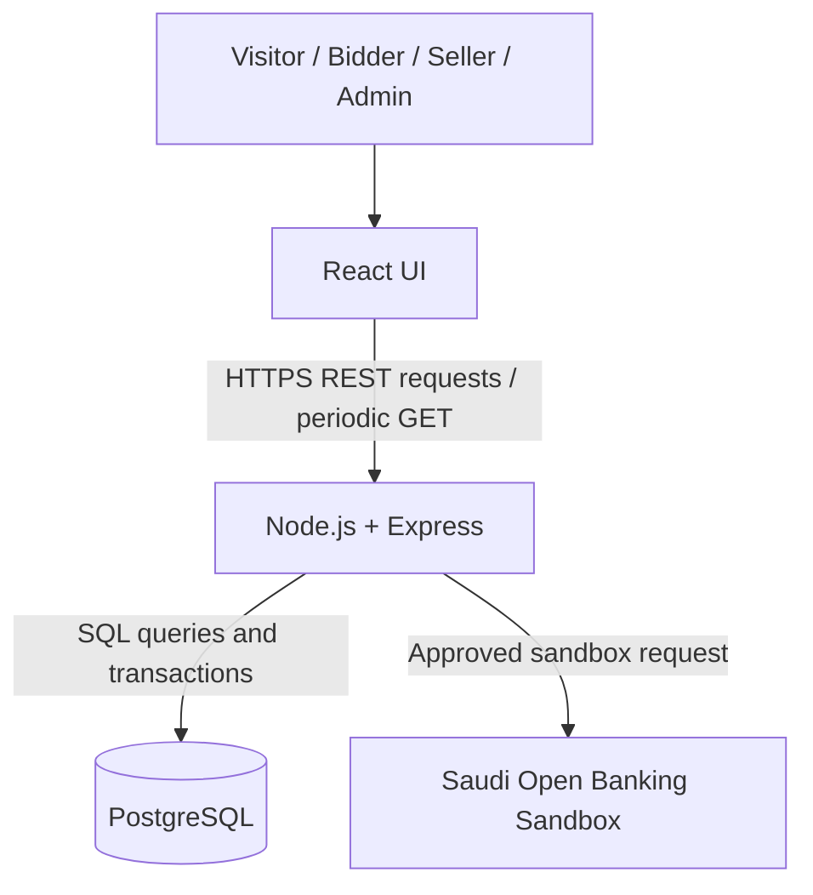
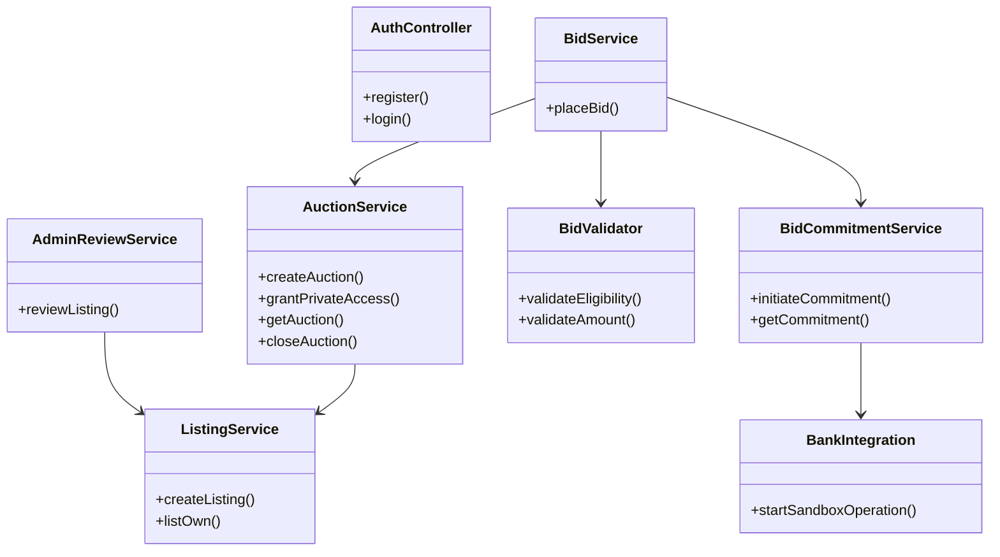
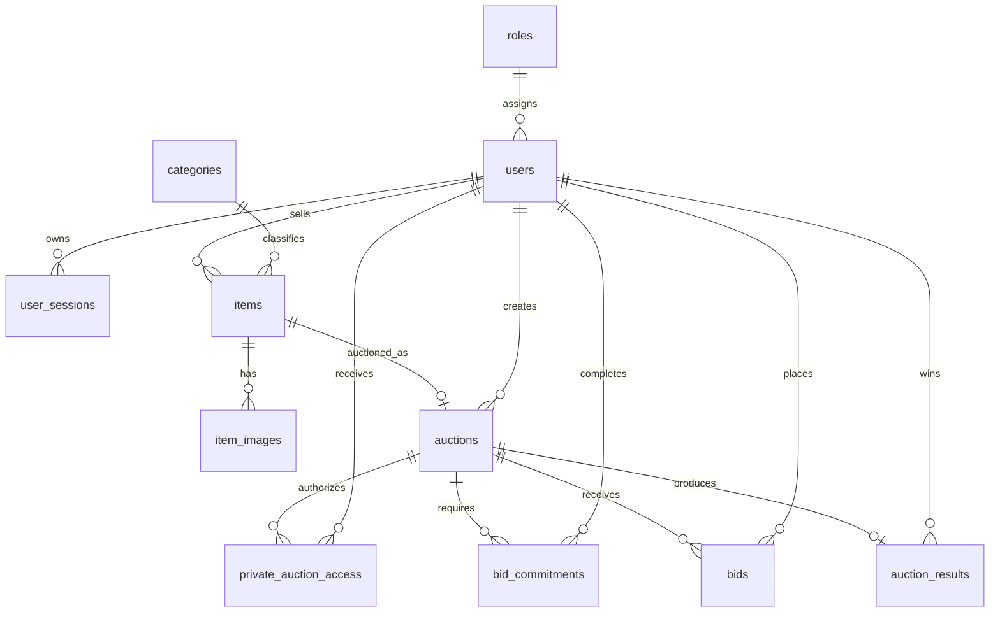
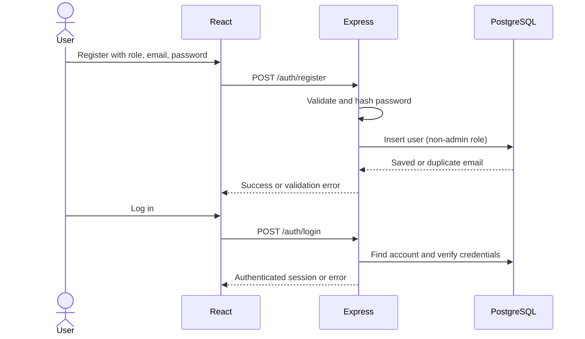
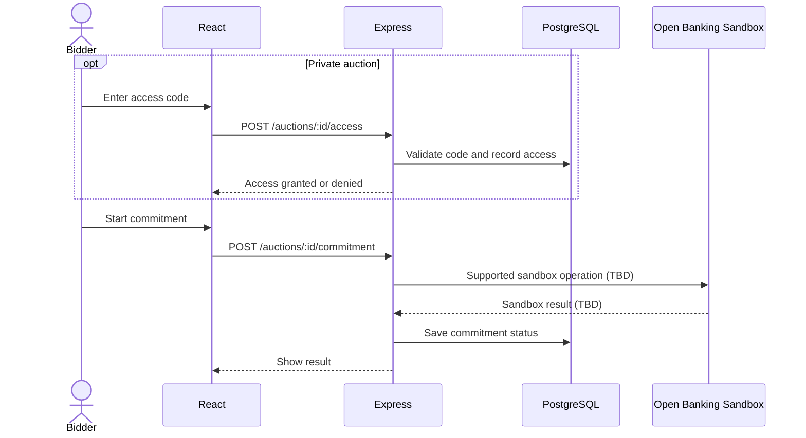
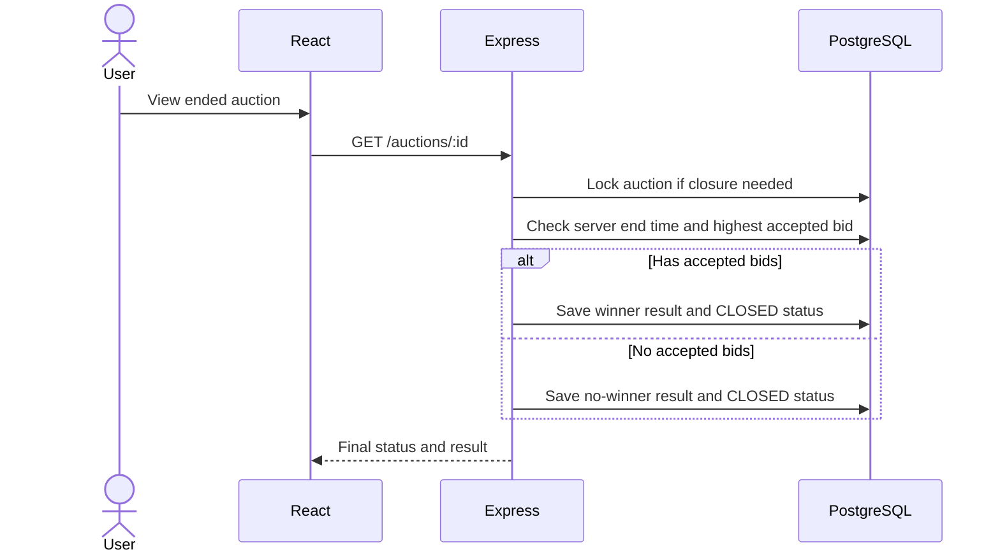

# Mezyad — Stage 3 Technical Documentation
**A High-Value Asset Auction Platform | Simplified MVP Draft**
**Status:** Review draft for the team's separate repository. Not approved for merging into the main project.

> **Documentation rule:** This report describes the proposed MVP, not completed functionality. Items labeled **Pending verification** require team/mentor confirmation. Do not mark tests as passed until executed. The Stage 2 official requirements take precedence over any simplification here.

---

## 1. Preface

Mezyad is a web-based platform for auctions of high-value assets. Sellers submit asset listings for administrator review and create **public or private auctions** after approval. Bidders browse eligible auctions, complete the required participation/commitment process, submit bids, and view results. Private auctions use an access code and server-enforced permissions.

The MVP prioritizes correct bidding, clear roles, private-auction access, and **a genuine Saudi Open Banking sandbox integration** required by the mentor. No real-money transfers, escrow, financial settlement, real KYC, disputes, or complex financial infrastructure are included.

**Approved baseline:** React (frontend), Node.js + Express (single backend), PostgreSQL (database), and the mandated Open Banking sandbox (external integration). The UI retrieves auction updates using ordinary HTTP polling; Socket.io is deferred pending requirements confirmation. No Redis, distributed locking, Pub/Sub, microservices, or AI model is required.

**Optional UX differentiator:** A *Description Builder* turns seller-entered fields into a suggested listing description using simple templates. It is **not artificial intelligence**, uses no external AI API, and requires no assistant-interaction database table. The seller can edit the result.

**Success definition:** A complete demonstrable journey for both public and private auctions: register → submit listing → admin review → create auction → meet access/commitment requirements → place validated bids → close auction → show winner or no-bid result.

### Scope decisions and open questions

| Area | MVP decision | Note |
|---|---|---|
| Private auctions | Required | Seller shares code; server verifies and records bidder access |
| Bid commitment | Retained | Exact bank-related rule **pending mentor confirmation** |
| Open Banking | Required | Provider, sandbox credentials, available operation **pending verification** |
| Live prices | HTTP polling | Not instant push; refresh approximately every 3–5 seconds while viewing active auctions |
| Anti-sniping | Deferred | No timer extensions or extension history |
| Smart assistant | Simple description template only | Optional after core features |
| Docker | Conditional | Include only if formally required or already comfortable for team |
| Notifications | In-page status messages | No separate notification infrastructure |
| Payment settlement | Excluded | No real financial movement |

---

## 2. User Stories & Mockups

### 2.1 Roles and access model

| Role | Meaning | Main permissions |
|---|---|---|
| Visitor | Not signed in | Browse public auction summaries; cannot bid or enter private auctions |
| Bidder | Registered buyer | Browse public auctions, join private auctions with valid code, complete commitment, bid, view participation/results |
| Seller | Registered asset owner | Submit listings, view review status, create auctions from approved assets, view own auction activity |
| Admin | Authorized administrator | Review/reject listings and inspect auction status; no bidding on behalf of users |

A **User** is the general account record, not a separate fifth role. A person has one selected role in this MVP. Permissions are enforced on the server, not only by hiding UI buttons.

### 2.2 Detailed user stories (MoSCoW)

Each story has a dedicated specification table followed by its role/access table. Acceptance criteria are observable and testable.

#### US-01 — Register and log in

| Field | Specification |
|---|---|
| Priority | Must Have |
| Primary actor | Visitor → Bidder or Seller |
| User story | As a visitor, I want to create an account and sign in to use the appropriate auction features. |
| Preconditions | Valid email; registration page available |
| Main steps | 1. Select Bidder or Seller. 2. Enter name, email, password. 3. Submit. 4. Server validates and hashes password. 5. User signs in. |
| Alternative/error | Duplicate email, invalid fields, or wrong credentials return clear errors |
| Result | Authorized session/account access |
| Acceptance criteria | Unique email; password never stored as plain text; admin role cannot be self-selected; unauthorized requests rejected |
| Mockup | Register / Login |

| Role | Allowed in this flow |
|---|---|
| Visitor | Register and sign in |
| Bidder | Sign in and use bidder pages |
| Seller | Sign in and use seller pages |
| Admin | Sign in using pre-provisioned admin account |

#### US-02 — Submit an asset listing

| Field | Specification |
|---|---|
| Priority | Must Have |
| Primary actor | Seller |
| User story | As a seller, I want to describe an asset and add images so an admin can review it. |
| Preconditions | Seller signed in |
| Main steps | 1. Select category. 2. Enter title, description and category fields. 3. Add images using the team's confirmed image-handling method. 4. Submit. |
| Alternative/error | Missing required data or invalid image input blocks submission |
| Result | Listing saved as PENDING_REVIEW |
| Acceptance criteria | Seller owns listing; unapproved listing cannot be auctioned; actual image storage method is implemented and documented |
| Mockup | Create Listing |

| Role | Allowed in this flow |
|---|---|
| Visitor | No |
| Bidder | View approved public auction details only |
| Seller | Create and view own listings |
| Admin | Review submitted listings |

#### US-03 — Review a listing

| Field | Specification |
|---|---|
| Priority | Must Have |
| Primary actor | Admin |
| User story | As an admin, I want to approve or reject listings before they become auctionable. |
| Preconditions | Listing is PENDING_REVIEW |
| Main steps | 1. Open pending listings. 2. Inspect details. 3. Approve or reject with reason. 4. Save decision. |
| Alternative/error | Non-admin request rejected; invalid transition rejected |
| Result | APPROVED or REJECTED listing; seller can see decision |
| Acceptance criteria | Only admin can review; rejection reason is stored; no auction for unapproved listing |
| Mockup | Admin Review |

| Role | Allowed in this flow |
|---|---|
| Visitor | No |
| Bidder | No |
| Seller | See own review result |
| Admin | Approve/reject |

#### US-04 — Create a public or private auction

| Field | Specification |
|---|---|
| Priority | Must Have |
| Primary actor | Seller |
| User story | As a seller, I want to auction an approved asset publicly or privately. |
| Preconditions | Approved listing owned by seller; no existing auction for it |
| Main steps | 1. Select approved asset. 2. Set starting price, minimum bid increment, start and end time. 3. Choose PUBLIC or PRIVATE. 4. Confirm. 5. If private, system generates a shareable access code. |
| Alternative/error | Invalid dates/prices or unauthorized asset rejected |
| Result | Auction created as SCHEDULED or ACTIVE according to time |
| Acceptance criteria | Valid end > start; only owner creates; private code not returned to unrelated users; no duplicate auction for one item |
| Mockup | Auction Setup / Private Code |

| Role | Allowed in this flow |
|---|---|
| Visitor | No |
| Bidder | Browse public auctions; cannot create |
| Seller | Create from own approved listing and copy private code |
| Admin | Inspect auction status |

#### US-05 — Join a private auction

| Field | Specification |
|---|---|
| Priority | Must Have |
| Primary actor | Bidder |
| User story | As a bidder, I want to enter a code to join a private auction. |
| Preconditions | Signed-in bidder; private auction exists |
| Main steps | 1. Open private invitation link. 2. Enter code. 3. Server validates code. 4. Server records access for this bidder. 5. Auction details become available. |
| Alternative/error | Incorrect code or unauthorized user receives generic access error; attempts should be rate-limited |
| Result | Bidder authorized for that private auction |
| Acceptance criteria | Direct API requests cannot bypass authorization; code is stored as a hash; access scoped to user and auction |
| Mockup | Private Auction Access |

| Role | Allowed in this flow |
|---|---|
| Visitor | Cannot join |
| Bidder | Enter code and gain authorized access |
| Seller | Share own code; cannot bid on own auction |
| Admin | Inspect according to admin permission |

#### US-06 — Complete bid commitment / sandbox step

| Field | Specification |
|---|---|
| Priority | Must Have |
| Primary actor | Bidder |
| User story | As a bidder, I want to complete the required commitment before placing bids. |
| Preconditions | Signed-in bidder; eligible auction access |
| Main steps | 1. Start commitment. 2. Backend requests the **verified supported** sandbox operation. 3. Process sandbox response. 4. Record commitment outcome. |
| Alternative/error | Timeout, failed authorization, or rejected sandbox response → no approved commitment |
| Result | Commitment status recorded |
| Acceptance criteria | Server checks commitment before accepting bids **if this is the mentor-required rule**; no real money; no invented bank operations |
| Mockup | Commitment Status |
| Dependency | **Pending verification:** provider, endpoint, sandbox access, consent/authorization process, and whether the commitment gates bidding |

| Role | Allowed in this flow |
|---|---|
| Visitor | No |
| Bidder | Initiate and view own commitment |
| Seller | Cannot initiate for others |
| Admin | View necessary status only if authorized |

#### US-07 — Place and validate a bid

| Field | Specification |
|---|---|
| Priority | Must Have |
| Primary actor | Bidder |
| User story | As an eligible bidder, I want to place a valid bid and receive a clear result. |
| Preconditions | Signed-in bidder; authorized auction access; commitment if required; auction active |
| Main steps | 1. Enter amount. 2. Confirm amount. 3. React POSTs bid with unique request ID. 4. Express opens transaction and locks auction row. 5. Validate actor, time, amount, and eligibility. 6. Insert bid and update current price. 7. Commit. |
| Alternative/error | Too-low amount, expired auction, duplicate request, self-bidding, or no access → rejected without price change |
| Result | Bid accepted and displayed on next refresh |
| Acceptance criteria | No conflicting accepted prices under concurrent requests; duplicate request cannot create duplicate bid; rejected bid leaves price unchanged |
| Mockup | Auction Detail / Confirm Bid / Result Message |

| Role | Allowed in this flow |
|---|---|
| Visitor | Cannot bid |
| Bidder | Bid if eligible |
| Seller | Cannot bid on own auction |
| Admin | Cannot place bids as admin |

#### US-08 — View auction progress and results

| Field | Specification |
|---|---|
| Priority | Must Have |
| Primary actor | Bidder / Seller |
| User story | As a participant, I want to see price, history, countdown, and final result. |
| Preconditions | Public auction or authorized private access |
| Main steps | 1. Open auction. 2. React polls server every 3–5 seconds while active. 3. Display latest server price, history, and time. 4. After end, display winner or no-bid result. |
| Alternative/error | Network failure shows retry state; UI countdown does not determine server validity |
| Result | Accurate server-backed auction view |
| Acceptance criteria | Private data not leaked; final status consistent with accepted bids; closed auctions reject bids |
| Mockup | Auction Detail / Auction Result |

| Role | Allowed in this flow |
|---|---|
| Visitor | Public summaries only |
| Bidder | Public and authorized private details; own participation |
| Seller | Own auctions and outcomes |
| Admin | Review permitted auction status |

#### US-09 — My Auctions and seller dashboard

| Field | Specification |
|---|---|
| Priority | Should Have |
| Primary actor | Bidder / Seller |
| User story | As a participant, I want to find auctions relevant to my account. |
| Preconditions | Signed in |
| Main steps | 1. Open dashboard. 2. Backend filters by authenticated user. 3. Display own listings/auctions (seller) or auctions with own bids (bidder). |
| Alternative/error | Empty state provides a helpful next action |
| Result | Simple account overview |
| Acceptance criteria | No cross-user data leakage; no new database table required |
| Mockup | My Auctions / Seller Dashboard |

| Role | Allowed in this flow |
|---|---|
| Visitor | No |
| Bidder | Own bid participation |
| Seller | Own listings and auctions |
| Admin | Admin review screen, not another user's personal dashboard |

#### US-10 — Description Builder (optional)

| Field | Specification |
|---|---|
| Priority | Could Have — only after core MVP works |
| Primary actor | Seller |
| User story | As a seller, I want a suggested description generated from fields I enter, which I can edit. |
| Preconditions | Seller has entered listing fields |
| Main steps | 1. Click Suggest Description. 2. React formats supplied values using a fixed template. 3. Seller edits and confirms text. |
| Alternative/error | Missing fields show guidance; no invented vehicle condition or price |
| Result | Editable draft in existing description field |
| Acceptance criteria | No AI API, chatbot, prediction, or assistant interaction table; not advertised as generative AI |
| Mockup | Inline Suggest Description action |

| Role | Allowed in this flow |
|---|---|
| Visitor | No |
| Bidder | No |
| Seller | Generate and edit suggested description |
| Admin | Review final submitted text only |

### 2.3 UI mockups and design approach

**Design direction:** Premium Arabic RTL, vintage-inspired editorial styling with accessible contrast, responsive layouts, and consistent typography. The frontend may look sophisticated while business logic remains simple.

**Screens:** Home / Public Auctions, Login/Register, Listing Form, Seller Dashboard, Admin Review, Auction Creation, Private Access, Auction Details, Commitment Status, Bid Confirmation, My Auctions, and Auction Result. These can share components rather than become separate complex applications.

**UX improvements integrated into existing screens:** loading states, clear success/error messages, empty states, color-coded statuses with text labels, one-click copy for private code, confirmation before bid, a visual creation-progress indicator, and My Auctions.

**Mockup references:** Insert actual Figma frame links only after verification. Do not claim prototypes are connected or implemented without checking them.

---

## 3. System Architecture



**One backend:** Express handles authentication, role checks, listings, admin review, auctions, bidding, and the sandbox integration. PostgreSQL is the authoritative source for bid prices, eligibility, access and closure state. The React countdown is informational; server time determines acceptance.

**Concurrency:** Lock the auction row using `SELECT ... FOR UPDATE` inside a PostgreSQL transaction; check the auction deadline and latest accepted price under that lock, then insert bid and update current price atomically. Do not use Redis or distributed locks.

**Updates:** React polls active auction details via GET every few seconds. Polling is not true push-based real-time. No Socket.io until a mentor requirement makes it necessary.

**Image storage — pending implementation decision:** `item_images.image_url` stores references, not image bytes. Confirm a working upload/storage approach before describing upload as complete.

### 3.1 Development environment

Local development can use React dev server, Express server and PostgreSQL. Use environment variables for DB connection and sandbox credentials. Do not commit secrets. Docker/Compose is optional pending official course requirements and team familiarity.

---

## 4. Backend Components & Class Design

### 4.1 Responsibilities

| Component | Responsibility | Main methods (illustrative) |
|---|---|---|
| AuthController | Register/login and session validation | register, login, authenticate |
| ListingService | Seller listing and images | createListing, listOwn, getListing |
| AdminReviewService | Approve/reject submitted listings | reviewListing |
| AuctionService | Create, access, view and close auctions | createAuction, grantPrivateAccess, getAuction, closeAuction |
| BidValidator | Validate bid rules | validateEligibility, validateAmount |
| BidService | Transactional bid acceptance | placeBid |
| BidCommitmentService | Record participation outcome | initiateCommitment, getCommitment |
| BankIntegration | Isolated sandbox calls | startSandboxOperation, handleSandboxResponse |

These are **logical responsibilities**, not a mandate to implement eight elaborate OOP classes. Simple Express routes plus small service functions are acceptable. No separate NotificationService, SmartAuctionAssistant, Redis coordinator, or WebSocket handler.

### 4.2 Simplified class/component diagram



**Why keep BidService separate?** Bid acceptance has the highest concurrency risk and deserves a focused, testable transaction. The validator can be a plain helper module if a class feels excessive.

---

## 5. Database Design (PostgreSQL Only)

### 5.1 Proposed ER diagram



### 5.2 Tables and essential fields

| Table | Essential fields | Purpose |
|---|---|---|
| `roles` | id, name UNIQUE | BIDDER, SELLER, ADMIN |
| `users` | id, role_id, name, email UNIQUE, password_hash, created_at | Accounts |
| `user_sessions` | id, user_id, token_hash, expires_at | Session tracking; may simplify if secure auth approach differs |
| `categories` | id, name UNIQUE | Initial categories e.g. vehicles, real_estate |
| `items` | id, seller_id, category_id, title, description, category_fields JSONB, status, review_reason, reviewed_by, reviewed_at | Listing and one current review decision |
| `item_images` | id, item_id, image_url | Image references |
| `auctions` | id, item_id UNIQUE, seller_id, visibility, access_code_hash NULLABLE, starting_price, current_price, minimum_increment, start_time, end_time, status | Auction rules/state in one table |
| `private_auction_access` | auction_id, bidder_id, granted_at, UNIQUE(auction_id,bidder_id) | Access grants |
| `bid_commitments` | id, auction_id, bidder_id, status, sandbox_reference, created_at, UNIQUE(auction_id,bidder_id) | Sandbox-related participation record; exact fields pending provider |
| `bids` | id, auction_id, bidder_id, amount, request_id UNIQUE, created_at | Accepted bids and idempotency |
| `auction_results` | auction_id UNIQUE, winner_bid_id NULLABLE, closed_at | Final result; NULL when no bids |

**Total: 11 proposed tables.** This is a proposal, not an instruction to delete useful existing data. A separate event log is not included unless official requirements demand audit history.

### 5.3 Constraints and integrity

| Rule | Database/backend enforcement |
|---|---|
| Email unique | UNIQUE(email) |
| One auction per asset | UNIQUE(auctions.item_id) |
| One access grant per bidder and private auction | Composite UNIQUE |
| One commitment record per bidder/auction | Composite UNIQUE |
| Duplicate bid request | UNIQUE(request_id) |
| Valid positive money values | NUMERIC/DECIMAL with CHECK amount > 0; avoid floating point |
| Valid time range | CHECK end_time > start_time |
| Allowed states | CHECK or validated enum values |
| Owner/role checks | Express authorization + referenced seller ID |
| Private auction access | Server check on **every** protected detail/bid request |
| Bid race condition | PostgreSQL transaction and auction row lock |
| Closed auction | Reject bids when server time >= end_time, even if status has not yet been refreshed |

**State model:** SCHEDULED / ACTIVE / CLOSED. Define ACTIVE based on server time and stored status consistently; closure can be finalized idempotently when the auction is accessed or by a simple scheduled job if the course requires proactive closure. A React timer must never determine the winner.

**Simplifications:** Remove `auction_rules` (put minimum increment in auctions), `auction_extensions`, `assistant_interactions`, and Redis design. Remove `asset_verifications` only if the mentor does not require multiple verification histories; store current review fields on items. Remove `event_store` unless audit history is required.

---

## 6. Sequence Diagrams

### Flow 1 — Registration and Login



### Flow 2 — Listing, Admin Review, Auction Creation

```mermaid
sequenceDiagram
  actor Seller
  actor Admin
  participant UI as React
  participant API as Express
  participant DB as PostgreSQL
  Seller->>UI: Submit listing
  UI->>API: POST /items
  API->>DB: Save PENDING_REVIEW listing
  API-->>UI: Listing submitted
  Admin->>UI: Review listing
  UI->>API: POST /admin/items/:id/review
  API->>DB: Save APPROVED or REJECTED
  API-->>UI: Review recorded
  Seller->>UI: Create auction for approved listing
  UI->>API: POST /auctions
  API->>DB: Check owner and approval; save auction
  API-->>UI: Auction created; private code if selected
```

### Flow 3 — Private Access and Bid Commitment



**Dependency:** The banking exchange is intentionally abstract until the team verifies actual sandbox endpoints and required user consent. Do not claim proof-of-funds, account hold, transfer, or SMS verification without evidence.

### Flow 4 — Place Bid (Atomic PostgreSQL Transaction)

```mermaid
sequenceDiagram
  actor Bidder
  participant UI as React
  participant API as Express
  participant DB as PostgreSQL
  Bidder->>UI: Confirm bid amount
  UI->>API: POST /auctions/:id/bids
  API->>DB: BEGIN; SELECT auction FOR UPDATE
  DB-->>API: Locked auction state
  API->>DB: Check role, access, commitment, server time and amount
  alt Valid bid
    API->>DB: INSERT bid; UPDATE current_price; COMMIT
    API-->>UI: 201 Bid accepted
  else Invalid bid
    API->>DB: ROLLBACK
    API-->>UI: 4xx Rejected with reason
  end
  UI-->>Bidder: Display success or error
```

### Flow 5 — Auction Closure and Result



**Concurrency note:** Closure and bid acceptance must lock the same auction row, so they cannot both commit contradictory outcomes. Closure must be idempotent (repeated calls produce one result).

---

## 7. API Specifications

### 7.1 Conventions

- Base prefix: `/api/v1`. Requests/responses use JSON except image upload, if applicable.
- Authentication: secure session or verified token, consistently implemented.
- All sensitive routes require server-side role and ownership checks.
- Responses use consistent `{ "data": ... }` or `{ "error": { "code": "...", "message": "..." } }`.
- Typical status codes: 200 OK, 201 Created, 400 Bad Request, 401 Unauthorized, 403 Forbidden, 404 Not Found, 409 Conflict.
- For private auctions, avoid leaking existence or private details to unauthorized clients.

### 7.2 Endpoint contracts

| Method | Path | Role | Key request | Success response | Key failures |
|---|---|---|---|---|---|
| POST | /auth/register | Visitor | name,email,password,role | 201 user summary | 400,409 |
| POST | /auth/login | Visitor | email,password | 200 session/account | 401 |
| POST | /auth/logout | Signed in | — | 200 signed out | 401 |
| POST | /items | Seller | category,title,description,category_fields,images | 201 listing | 400,403 |
| GET | /items | Seller/Admin | filter by own or pending | 200 list | 401,403 |
| GET | /items/:id | Owner/Admin | item ID | 200 listing | 403,404 |
| POST | /admin/items/:id/review | Admin | decision,reason? | 200 updated status | 403,409 |
| POST | /auctions | Seller | itemId,visibility,prices,times | 201 auction; private code to owner | 400,403,409 |
| GET | /auctions | Public | public filters/status | 200 public list | 400 |
| GET | /auctions/:id | Authorized | auction ID | 200 details/result | 403/404 |
| POST | /auctions/:id/access | Bidder | accessCode | 200 access granted | 403/404,429 |
| POST | /auctions/:id/commitment | Bidder | provider-specific validated fields | 200/201 commitment status | 400,403,502 |
| GET | /auctions/:id/commitment | Bidder | — | 200 own status | 403,404 |
| POST | /auctions/:id/bids | Bidder | amount,requestId | 201 accepted bid | 400,403,409 |
| GET | /auctions/:id/bids | Authorized | paging params | 200 accepted bid history | 403/404 |
| GET | /me/auctions | Bidder/Seller | — | 200 own participation/owned auctions | 401 |

**Scope note:** 16 ordinary endpoints are a working proposal, not a quota. Merge endpoints only if the same security and behavior remain clear. The Description Builder is client-side and needs **no endpoint**.

### 7.3 Sample requests and responses

**Create auction:**
```json
{
  "itemId": "item-uuid",
  "visibility": "PRIVATE",
  "startingPrice": 50000,
  "minimumIncrement": 500,
  "startTime": "2026-11-01T10:00:00Z",
  "endTime": "2026-11-02T10:00:00Z"
}
```

**Successful private-auction creation:** `201`
```json
{
  "data": {
    "id": "auction-uuid",
    "status": "SCHEDULED",
    "visibility": "PRIVATE",
    "accessCode": "one-time-code-shown-to-owner"
  }
}
```

**Place bid:**
```json
{ "amount": 51000, "requestId": "unique-client-request-id" }
```

**Accepted:** `201`
```json
{ "data": { "bidId": "bid-uuid", "amount": 51000, "currentPrice": 51000 } }
```

**Rejected:** `409`
```json
{ "error": { "code": "BID_TOO_LOW", "message": "The amount must exceed the current bid by the minimum increment." } }
```

**Private access:** `POST /auctions/:id/access`
```json
{ "accessCode": "code-from-seller" }
```

**Admin review:** `POST /admin/items/:id/review`
```json
{ "decision": "REJECTED", "reason": "Please add a clear asset photo." }
```

### 7.4 Open Banking sandbox — mandatory verification checklist

| Item | Status |
|---|---|
| Provider and official documentation | Pending verification |
| Available sandbox operation | Pending verification |
| Test credentials / access | Pending verification |
| Consent or authorization flow | Pending verification |
| Callback or redirect requirements | Pending verification |
| Exact commitment-to-bid rule | Pending mentor confirmation |
| Success/error sample payloads | Pending verification |

**Implementation rule:** Do not invent a `proofOfFunds`, `holdFunds`, `transfer`, or `sendSMS` endpoint. Once the real sandbox operation is selected, replace the abstract sequence and add precise request/response examples.

---

## 8. SCM and QA Plans

### 8.1 Four-week execution plan (remaining implementation window)

| Week | Deliverables | Acceptance checkpoint |
|---|---|---|
| 1 | Project setup; database schema; auth; initial listing form; sandbox access proof | Team can sign in, save listing, and demonstrate a genuine sandbox test call |
| 2 | Admin review; auction creation; public/private access; basic screens | Seller-to-admin-to-private-auction journey works |
| 3 | Commitment integration; transactional bidding; closure; results | Concurrent bid and end-time tests pass |
| 4 | End-to-end testing; UX polish; bug fixes; mentor demo rehearsal | Full public and private flows work without manual database edits |

**Official milestone caveat:** This is a remaining-month implementation plan, not a replacement for the official Stage 2 timetable if it specifies different weeks.

### 8.2 Source control

- `main`: reviewed stable code.
- `feature/*`: short-lived feature branches.
- Pull request before merge; at least one teammate reviews changes.
- Small commits with clear messages; no credentials in repository.
- One issue/task owner and one reviewer for each major feature.
- `develop` branch only if the team genuinely needs it.

### 8.3 Team ownership (adjust if members agree)

| Area | Primary team members | Review/support |
|---|---|---|
| Database schema and SQL | Abeer, Tala | Ghadi |
| Express backend, auth, auctions, bids | Abeer, Ghadi | Tala |
| React screens and UX | Aseel, Ghadi | Tala |
| QA, documentation, integration review | Tala, Aseel | Entire team |
| Sandbox proof-of-concept | Backend pair | Entire team verifies actual flow |

### 8.4 Test plan

| ID | Area | Test case | Expected result | Status |
|---|---|---|---|---|
| QA-01 | Auth | Duplicate email registration | 409, no duplicate user | Planned |
| QA-02 | Auth | Wrong password | 401, no session | Planned |
| QA-03 | Roles | Seller attempts admin review | 403 | Planned |
| QA-04 | Listing | Auction from unapproved item | Rejected | Planned |
| QA-05 | Private access | Invalid code | Access denied | Planned |
| QA-06 | Private access | Direct GET/bid without grant | No private data or bid | Planned |
| QA-07 | Commitment | Sandbox fails or times out | Clear error; no false approval | Planned |
| QA-08 | Bidding | Bid below minimum | Rejected; price unchanged | Planned |
| QA-09 | Bidding | Same requestId submitted twice | At most one accepted bid | Planned |
| QA-10 | Concurrency | Two bids at once | Serial, consistent accepted prices | Planned |
| QA-11 | Time | Bid at/after endTime | Rejected by server | Planned |
| QA-12 | Closure | End with no bids | CLOSED, no winner | Planned |
| QA-13 | Closure | Repeated closure request | One consistent result | Planned |
| QA-14 | UX | Empty list/loading/errors | Appropriate clear states | Planned |
| QA-15 | E2E | Public auction complete journey | Correct final outcome | Planned |
| QA-16 | E2E | Private auction complete journey | Access and bidding rules respected | Planned |

**No test is marked Passed before execution.** Prioritize QA-05 through QA-13 because authorization, money-related sandbox handling, and concurrency are the highest-risk parts.

---

## 9. Future Enhancements

These are explicitly **not** MVP commitments:
- Push-based live updates with Socket.io, if justified.
- Anti-sniping (extend auction time on late bids).
- Advanced user notifications.
- Additional auction formats and analytics.

**Not future promises:** Escrow, real-money settlement, complex KYC, distributed infrastructure, predictive pricing, or a chatbot. They require separate requirements, security review, and resources.

---

## Final Scope Audit — Mentor Review Checklist

| Question | Current decision |
|---|---|
| Can each team member explain every technology? | React / Express / PostgreSQL; verify sandbox |
| Is Redis necessary? | No |
| Is Socket.io necessary now? | No, unless required |
| Are private auctions core? | Yes |
| Is banking integration real rather than mocked? | Real supported sandbox call required; details unverified |
| Is the Description Builder AI? | No; template-based optional UX feature |
| Are bids safe under concurrency? | Design uses a PostgreSQL row lock; must be implemented and tested |
| Are images truly uploadable? | Pending image-storage decision |
| Does documentation claim tests passed? | No |
| Is the implementation fully complete? | Not claimed |

**Review gate:** Before merging this draft into the team's main repository, resolve the sandbox operation, exact bid commitment rule, image handling, and any mentor-mandated Socket.io/Docker requirement. Validate all Mermaid diagrams and endpoints against the eventual code.
