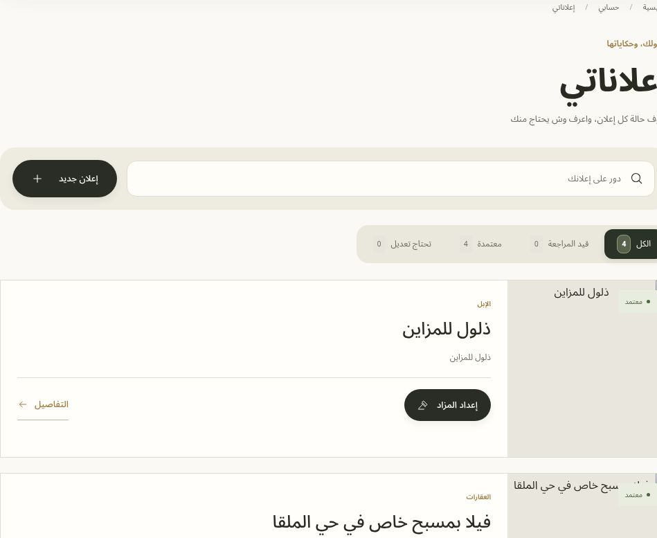

# AS-08 — Loading, Error and Empty States

**Owner:** Abeer Al-Saiari (عبير)  
**Notion status:** Completed · **Due:** 28 October 2026 · **Area:** Frontend  
**Evidence status:** Recorded React/jsdom checks on an earlier frontend revision; a merged-branch visual regression is not established by this report.

## 1. Scope

Complete and verify loading, error, and empty states in the agreed frontend screens. A **network failure must not be displayed as an empty list**. [Stage 4 task requirements in Notion](https://app.notion.com/p/4020bc42a08081198a73f34924d1cb71).

## 2. Implementation

The existing [AS-08 execution report](../AS08_States.md) records coverage of auction browsing, My Listings, admin review, and category data states, plus feedback while submitting listings, creating auctions, and checking an access code. The recorded additional changes include:

- A waiting state for sign-out, with repeat clicks prevented while the request is pending.
- Buttons becoming interactive again after success or failure.
- Arabic network-error feedback for account and auction details.
- Distinct loading, empty, and request-failure feedback in the tested React screens.

Relevant frontend implementation paths:
- [Auction data / refresh hook](../../../frontend/src/features/auctions/hooks/useMarket.js)
- [My Listings page](../../../frontend/src/features/listings/pages/MyListings/MyListings.jsx)
- [Account workspace hook](../../../frontend/src/features/account/hooks/useWorkspace.js)
- [Admin review view](../../../frontend/src/features/admin/review/AdminReview.jsx)
- [Shared interaction UI](../../../frontend/src/shared/components/InteractionUI.jsx)

## 3. UI/UX

| State | Meaning | Expected interface behavior |
| --- | --- | --- |
| Loading | A request is in progress | Display a clear waiting indicator, prevent unintended duplicate submissions. |
| Empty | The request succeeded but returned no records | Explain that no matching data exists. |
| Error | A request failed | Show useful Arabic feedback, rather than implying the list is empty. |

This helps the user understand the difference between **no results** and **unable to load results**.

## 4. Screenshots — Original Mezyad UI (No Arrows / Pointers)

The screenshots below already exist in the repository. They show the **screen context**, not proof that a simulated error or loading state appeared. No arrow, pointer, or annotation has been added.

*Figure 1 — Auction catalogue. AS-08 checks the loading, empty, and failed-request states of this type of listing view; this image shows the normal catalogue view.*

*Figure 2 — My Listings page. This is the user-facing area for which distinct data states are relevant; the image does not itself document a failure state.*

## 5. Testing & Evidence

**Method:** React component checks in jsdom with simulated network responses, as reported for the tested revision.

| Recorded check | Result |
| --- | --- |
| Auction catalogue: loading, empty, network error | PASS |
| My Listings: loading, empty, network error | PASS |
| Admin and categories: loading, empty, network error | PASS |
| Account: Arabic error, sign-out waiting, recovery | PASS |
| Auction details: loading and Arabic network error | PASS |
| Frontend build and whitespace check | PASS |

- [Original AS-08 report](../AS08_States.md)
- [AS-08 test output](../evidence/as08-states.txt)
- [Related frontend integration report, FE-13](FE-13.md)

**Limitations:** These are historically recorded tests. This report does not claim a new execution on the latest merged `Development` branch or a manual browser screenshot of each state. A fresh browser regression and state-specific screenshots are suitable follow-up evidence.
