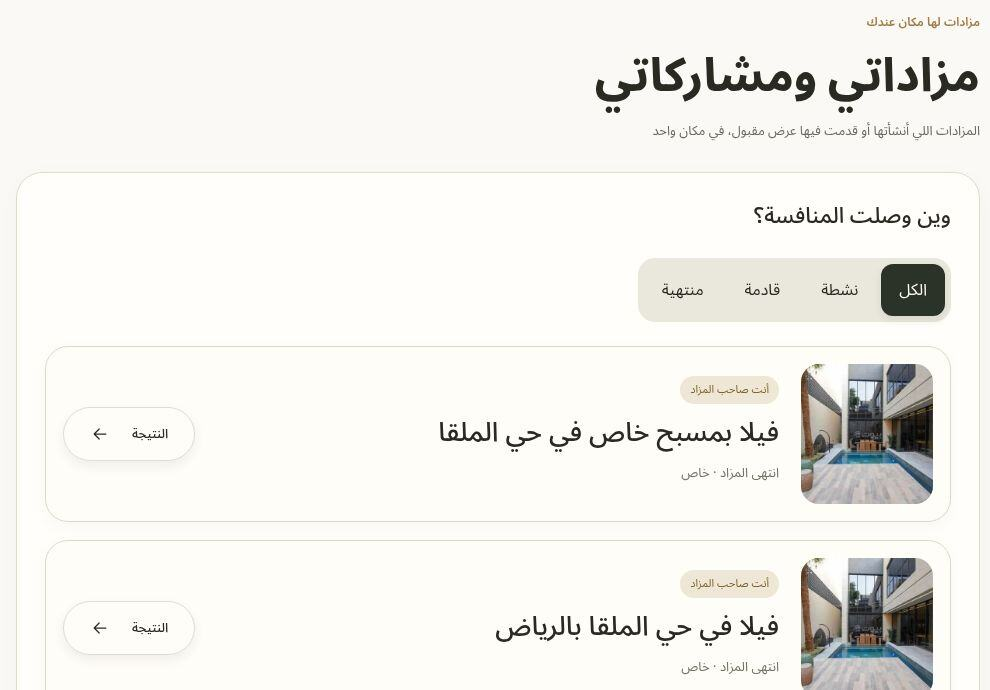

# AS-09 — Frontend Navigation and Role-Based Access Testing

**Owner:** Abeer Al-Saiari (عبير)  
**Notion status:** Completed · **Due:** 11 November 2026 · **Area:** Testing  
**Evidence status:** Frontend navigation logic inspected; related login/role/logout scenarios have historical jsdom/API evidence. A distinct latest-branch AS-09 browser test is not documented here.

## 1. Scope

Test navigation after **sign-in and sign-out**, and verify that the admin navigation link and dashboard are shown to an authorized administrator and hidden from ordinary users. [Stage 4 task requirements in Notion](https://app.notion.com/p/4020bc42a08081198a73f34924d1cb71).

## 2. Implementation & Verified Files

| File | Why it matters |
| --- | --- |
| [`admin-access.js`](../../../frontend/src/features/admin/admin-access.js) | Exposes `isAdminRole` and role-based visibility/access helpers. |
| [`admin-navigation.js`](../../../frontend/src/features/admin/admin-navigation.js) | Defines the administrator route and `accountDestination`. |
| [`App.jsx`](../../../frontend/src/app/App.jsx) | Uses the role helpers to select routes, display account pages, and redirect blocked admin-context actions. |
| [`SiteHeader.jsx`](../../../frontend/src/shared/layout/SiteHeader.jsx) | Adjusts the account label and available actions according to the signed-in user's role. |
| [`useWorkspace.js`](../../../frontend/src/features/account/hooks/useWorkspace.js) | Provides the user/session state used by the interface. |

An ordinary user should not see administrator controls. The `ADMIN` role enables the admin-specific navigation and dashboard. On logout, account-only interface content should disappear or return to the signed-out state.

**Security boundary:** Hiding a link in React is a usability/visibility check, **not** an authorization guarantee. The backend must also reject unauthorized admin API requests.

## 3. UI/UX

- Show navigation appropriate to the current user role.
- Direct an administrator to the admin destination instead of regular user activity.
- Remove privileged navigation after logout.
- Make role-restricted sections understandable without showing misleading actions.

## 4. Screenshots — Original Mezyad UI (No Arrows / Pointers)

These are existing, unannotated product screenshots. They demonstrate the login and ordinary-user screen context; **they are not screenshots of an administrator session or proof of role enforcement**.

*Figure 1 — Sign-in screen used before account-specific navigation is available.*

*Figure 2 — Ordinary user activity screen, relevant to the distinction between user navigation and administrator navigation.*

## 5. Testing & Evidence

The existing FE-13 run log records the following tests on a **previous isolated revision**, rather than a new AS-09 run:

| Test case | Historical evidence / status |
| --- | --- |
| Ordinary `USER` hides the admin panel | PASS in FE-13 run log |
| `ADMIN` shows the admin panel | PASS in FE-13 run log |
| Logging out removes account panels | PASS in FE-13 run log |
| Logout invalidates the stored session | PASS in FE-13 run log |
| Direct URL access to the admin screen by an ordinary user in the latest merged browser build | Not separately verified |
| Rechecking admin visibility after refresh on the latest merged build | Not separately verified |

- [FE-13 testing report](../FE13_Aseel_Testing.md)
- [FE-13 recorded test output](../evidence/fe13-abeer.txt)
- [Abeer's FE-13 task report](FE-13.md)

**Follow-up:** Repeat these journeys using a regular user and a real admin test account in the current `Development` build; capture separate normal-user and administrator screenshots and a logout result. Confirm backend authorization independently. Do not claim these extra checks passed until executed.
