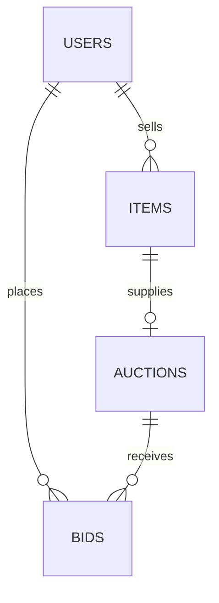

# Verify account, seller and bidder relationships (DB-02)

## Scope

Review the keys and rules that let a user sell listings and submit bids from the same account.

## Schema & Constraints

| Table or relationship | Key columns | Rule |
| --- | --- | --- |
| `users` | `id`, `email`, `role` | UUID PK, unique email, role limited to USER or ADMIN. |
| `items` | `seller_id`, `reviewed_by` | Required seller FK and optional reviewer FK to `users`. |
| `bids` | `bidder_id`, `auction_id`, `request_id` | Required FKs, with a unique request UUID. |
| `auctions` | `item_id` | Unique listing FK. The auction’s owner comes from the listing. |

## Implementation

### 1. Trace account ownership

The seller and bidder references point to the same users table. Stage 3 defines ownership through the item linked to the auction. [Report.MD 314–329](https://github.com/Abeerr0/mezyad/blob/e4fc24953b75d37f2f905df454fe82ecd1e65103/Stage_3/Report.MD#L314-L329) · [001_schema.sql 4–9](https://github.com/Abeerr0/mezyad/blob/e4fc24953b75d37f2f905df454fe82ecd1e65103/database/migrations/001_schema.sql#L4-L9) · [001_schema.sql 19–27](https://github.com/Abeerr0/mezyad/blob/e4fc24953b75d37f2f905df454fe82ecd1e65103/database/migrations/001_schema.sql#L19-L27) · [001_schema.sql 61–66](https://github.com/Abeerr0/mezyad/blob/e4fc24953b75d37f2f905df454fe82ecd1e65103/database/migrations/001_schema.sql#L61-L66)

### 2. Check the owner rule

The bid handler joins the auction to the item and uses the seller ID to reject the owner’s bid. Foreign keys separately enforce the existence of the related records. [app.js 1346–1374](https://github.com/Abeerr0/mezyad/blob/e4fc24953b75d37f2f905df454fe82ecd1e65103/backend/src/app.js#L1346-L1374)

## Testing & Evidence

| Scenario | Expected result | Actual result | Evidence |
| --- | --- | --- | --- |
| Register a duplicate email | Reject duplicate registration | Recorded API result: `409 DUPLICATE_EMAIL`. | [BE06_Testing.md 17–23](https://github.com/Abeerr0/mezyad/blob/e4fc24953b75d37f2f905df454fe82ecd1e65103/Stage_4/BE06_Testing.md#L17-L23) |
| Write a listing or bid with an unknown user ID | PostgreSQL rejects the orphan FK | Not run. Direct SQL assertions exist. | [database.test.js 109–149](https://github.com/Abeerr0/mezyad/blob/e4fc24953b75d37f2f905df454fe82ecd1e65103/backend/tests/database.test.js#L109-L149) |
| Seller bids on their own auction | Reject the bid | Recorded API result: `403 OWNER`. | [BE04_Testing.md 15–19](https://github.com/Abeerr0/mezyad/blob/e4fc24953b75d37f2f905df454fe82ecd1e65103/Stage_4/BE04_Testing.md#L15-L19) |

## Findings & Follow-up

Run the orphan, role and uniqueness checks in isolated PostgreSQL. Self-bidding is prevented by the application rule.

[Stage 4 task requirements](https://app.notion.com/p/90d3ecedbaba461cbe3ce7933a409788?v=f0ebf28bea9144329e41627e5631ff57)
