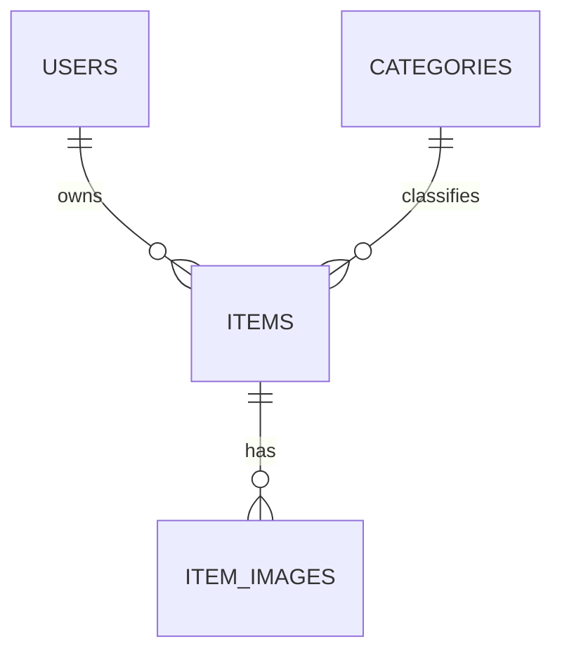

# Verify listing and image records (DB-03)

## Scope

Check listing ownership, image references, retrieval and replacement.

## Schema & Constraints

| Table or relationship | Key columns | Rule |
| --- | --- | --- |
| `items` | `seller_id`, `category_id`, `category_fields`, `status` | Required FKs, JSONB details and a checked review status. |
| `item_images` | `id`, `item_id`, `image_url` | UUID PK, required URL and cascading FK to `items`. |
| Image retrieval | `item_id` | Read one item for details or batch image reads for a list. |

## Implementation

### 1. Read images with the listing

The listing queries read stored image references and turn them into links. List results group them by item and return an empty array when needed. [001_schema.sql 19–32](https://github.com/Abeerr0/mezyad/blob/e4fc24953b75d37f2f905df454fe82ecd1e65103/database/migrations/001_schema.sql#L19-L32) · [listings.js 24–55](https://github.com/Abeerr0/mezyad/blob/e4fc24953b75d37f2f905df454fe82ecd1e65103/backend/src/listings.js#L24-L55)

### 2. Replace references with the item update

The transaction replaces image rows when new files are submitted. It commits before removing old files. An uncommitted failure removes newly saved files. [listings.js 211–245](https://github.com/Abeerr0/mezyad/blob/e4fc24953b75d37f2f905df454fe82ecd1e65103/backend/src/listings.js#L211-L245)

## Testing & Evidence

| Scenario | Expected result | Actual result | Evidence |
| --- | --- | --- | --- |
| Read a listing with two image rows | Return both links on that listing | Recorded API case returned both image references. | [BE09_Testing.md 23–29](https://github.com/Abeerr0/mezyad/blob/e4fc24953b75d37f2f905df454fe82ecd1e65103/Stage_4/BE09_Testing.md#L23-L29) |
| Insert an orphan image and delete an item with images | Reject the orphan and remove child rows on delete | Not run. SQL assertions exist. | [database.test.js 129–134](https://github.com/Abeerr0/mezyad/blob/e4fc24953b75d37f2f905df454fe82ecd1e65103/backend/tests/database.test.js#L129-L134) · [database.test.js 372–389](https://github.com/Abeerr0/mezyad/blob/e4fc24953b75d37f2f905df454fe82ecd1e65103/backend/tests/database.test.js#L372-L389) |
| Fail a second image during upload | Roll back the listing and clean up the partial file | Not run. Integration test covers this case. | [listing-images.test.js 143–155](https://github.com/Abeerr0/mezyad/blob/e4fc24953b75d37f2f905df454fe82ecd1e65103/backend/tests/listing-images.test.js#L143-L155) |

## Findings & Follow-up

The cascade covers database references. Verify physical file cleanup for any deletion path outside the listing write flow.

[Stage 4 task requirements](https://app.notion.com/p/90d3ecedbaba461cbe3ce7933a409788?v=f0ebf28bea9144329e41627e5631ff57)
