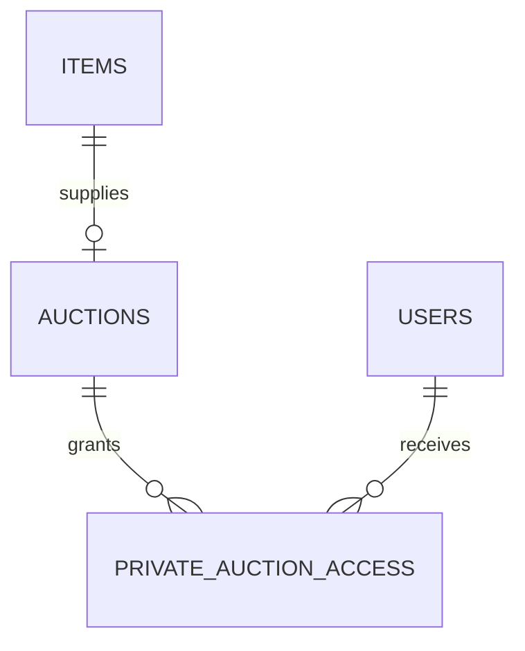

# Verify public and private auction tables (DB-04)

## Scope

Review the listing relationship, visibility, time and status checks, private codes and user grants.

## Schema & Constraints

| Table or relationship | Key columns | Rule |
| --- | --- | --- |
| `auctions` | `item_id`, `visibility`, `status`, start/end and prices | Unique listing FK; checked status, visibility, time order and positive prices. |
| Code fields | `access_code_hash`, `access_code_lookup` | Private requires a hash; public requires null. Non-null lookup values are unique. |
| `private_auction_access` | `auction_id`, `user_id`, `granted_at` | Required FKs and a composite PK to prevent duplicate grants. |
| Status index | `status`, `end_time` | Groups state with end time. |

## Implementation

### 1. Check auction and grant constraints

The base schema limits each item to one auction, checks its settings and stores grants as an auction/user pair. [001_schema.sql 33–51](https://github.com/Abeerr0/mezyad/blob/e4fc24953b75d37f2f905df454fe82ecd1e65103/database/migrations/001_schema.sql#L33-L51) · [001_schema.sql 73–77](https://github.com/Abeerr0/mezyad/blob/e4fc24953b75d37f2f905df454fe82ecd1e65103/database/migrations/001_schema.sql#L73-L77) · [Report.MD 333–335](https://github.com/Abeerr0/mezyad/blob/e4fc24953b75d37f2f905df454fe82ecd1e65103/Stage_3/Report.MD#L333-L335)

### 2. Trace private code lookup

Migration 002 adds the lookup field and partial unique index. The invitation route uses the lookup; the access helper checks the user’s grant. [002_private_auction_code_lookup.sql 2–11](https://github.com/Abeerr0/mezyad/blob/e4fc24953b75d37f2f905df454fe82ecd1e65103/database/migrations/002_private_auction_code_lookup.sql#L2-L11) · [app.js 1280–1308](https://github.com/Abeerr0/mezyad/blob/e4fc24953b75d37f2f905df454fe82ecd1e65103/backend/src/app.js#L1280-L1308) · [auctions.js 8–22](https://github.com/Abeerr0/mezyad/blob/e4fc24953b75d37f2f905df454fe82ecd1e65103/backend/src/auctions.js#L8-L22)

## Testing & Evidence

| Scenario | Expected result | Actual result | Evidence |
| --- | --- | --- | --- |
| Create public and private auctions | Create both and store a hash for the private auction | Recorded API and SQL checks passed, including the stored bcrypt hash. | [BE11_Testing.md 25–35](https://github.com/Abeerr0/mezyad/blob/e4fc24953b75d37f2f905df454fe82ecd1e65103/Stage_4/BE11_Testing.md#L25-L35) |
| Try valid and invalid invite codes | Grant only the valid request | Recorded `200 accessGranted` and `403 INVALID_CODE`. | [BE13_Testing.md 15–18](https://github.com/Abeerr0/mezyad/blob/e4fc24953b75d37f2f905df454fe82ecd1e65103/Stage_4/BE13_Testing.md#L15-L18) |
| Repeat a grant or write invalid schedule/hash data | SQL constraints reject the write | Not run. Direct cases exist. | [database.test.js 184–245](https://github.com/Abeerr0/mezyad/blob/e4fc24953b75d37f2f905df454fe82ecd1e65103/backend/tests/database.test.js#L184-L245) · [database.test.js 256–285](https://github.com/Abeerr0/mezyad/blob/e4fc24953b75d37f2f905df454fe82ecd1e65103/backend/tests/database.test.js#L256-L285) |

## Findings & Follow-up

The hash rule is enforced in SQL. The lookup column is nullable, and its consistency with visibility depends on the application.

[Stage 4 task requirements](https://app.notion.com/p/90d3ecedbaba461cbe3ce7933a409788?v=f0ebf28bea9144329e41627e5631ff57)
