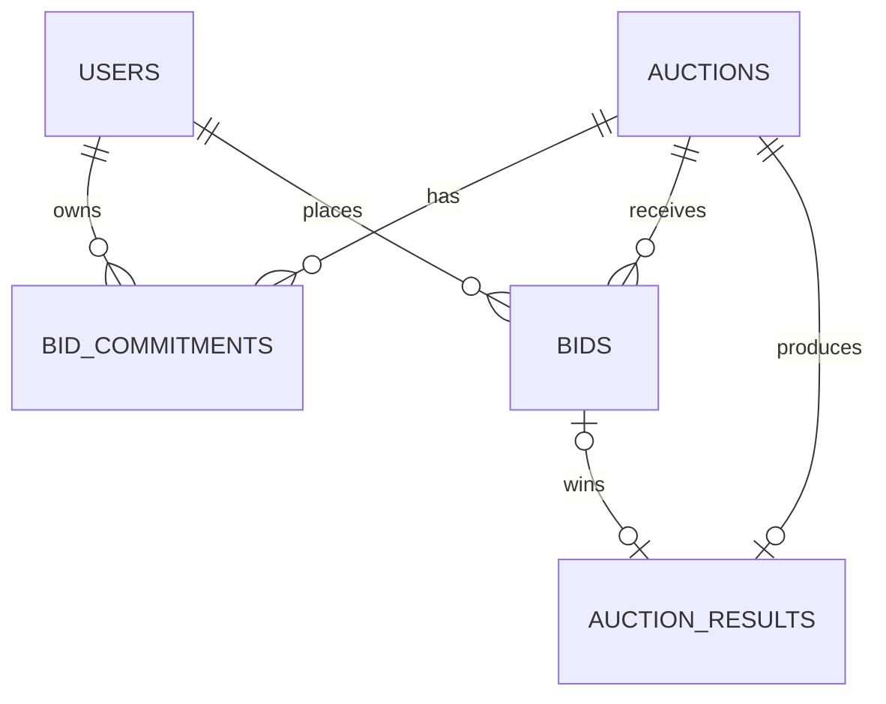

# Verify commitment, bid and result constraints (DB-05)

## Scope

Review commitment uniqueness, bid deduplication, stored precision, indexes and the winner relationship.

## Schema & Constraints

| Table or relationship | Key columns | Rule |
| --- | --- | --- |
| `bid_commitments` | `auction_id`, `user_id`, `status` | Required FKs, unique auction/user pair and a status CHECK. |
| Hold data | `max_amount`, `released_at`, `sandbox_reference` | Positive hold when present and partial payment-reference uniqueness. |
| `bids` | `auction_id`, `bidder_id`, `request_id`, `amount` | Required FKs, positive `NUMERIC(14,2)` and a globally unique request ID. |
| `auction_results` | `auction_id`, `winner_bid_id` | One result per auction; a non-null winner must belong to the same auction. |
| Indexes | Commitment by user/auction and bids by auction/time | Support the matching lookup paths. |

## Implementation

### 1. Protect duplicates and the winner relationship

The base SQL enforces the unique commitment pair and request identifier. The unique auction/bid key supports the composite result FK. A null winner supports an auction with no bids. [Report.MD 337–341](https://github.com/Abeerr0/mezyad/blob/e4fc24953b75d37f2f905df454fe82ecd1e65103/Stage_3/Report.MD#L337-L341) · [001_schema.sql 52–77](https://github.com/Abeerr0/mezyad/blob/e4fc24953b75d37f2f905df454fe82ecd1e65103/database/migrations/001_schema.sql#L52-L77)

### 2. Store hold details

Migration 004 stores hold and release metadata. Its partial index applies to rows with a hold amount. The bid handler checks commitment and amount before writing. [004_moyasar.sql 1–14](https://github.com/Abeerr0/mezyad/blob/e4fc24953b75d37f2f905df454fe82ecd1e65103/database/migrations/004_moyasar.sql#L1-L14) · [app.js 1398–1430](https://github.com/Abeerr0/mezyad/blob/e4fc24953b75d37f2f905df454fe82ecd1e65103/backend/src/app.js#L1398-L1430)

## Testing & Evidence

| Scenario | Expected result | Actual result | Evidence |
| --- | --- | --- | --- |
| Reuse a request UUID | Keep only one accepted bid | Recorded `409 DUPLICATE_REQUEST` and one bid. | [BE04_Testing.md 17–24](https://github.com/Abeerr0/mezyad/blob/e4fc24953b75d37f2f905df454fe82ecd1e65103/Stage_4/BE04_Testing.md#L17-L24) |
| Persist a verified test hold | Store successful status and held amount | Recorded `SUCCESS` with `max_amount = 2000.00` in test mode. | [BE14_Testing.md 17–26](https://github.com/Abeerr0/mezyad/blob/e4fc24953b75d37f2f905df454fe82ecd1e65103/Stage_4/BE14_Testing.md#L17-L26) |
| Insert a duplicate commitment or cross-auction winner | Reject the write | Not run. Both are covered by SQL tests. | [database.test.js 256–285](https://github.com/Abeerr0/mezyad/blob/e4fc24953b75d37f2f905df454fe82ecd1e65103/backend/tests/database.test.js#L256-L285) · [database.test.js 320–344](https://github.com/Abeerr0/mezyad/blob/e4fc24953b75d37f2f905df454fe82ecd1e65103/backend/tests/database.test.js#L320-L344) |

## Findings & Follow-up

Re-run the direct constraints on native PostgreSQL. The recorded hold used test mode.

[Stage 4 task requirements](https://app.notion.com/p/90d3ecedbaba461cbe3ce7933a409788?v=f0ebf28bea9144329e41627e5631ff57)
