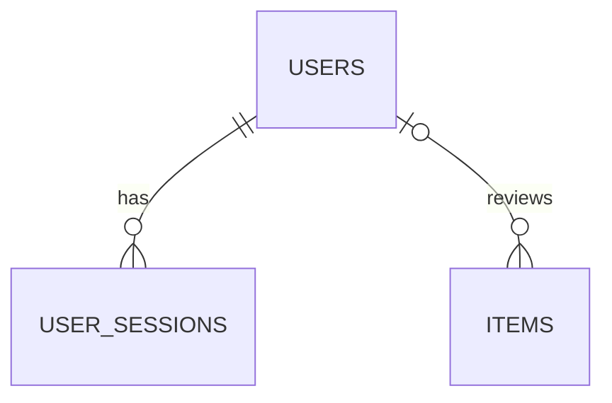

# Verify session storage and audit coverage (DB-06)

## Scope

Check session ownership, token expiry and the requested audit history.

## Schema & Constraints

| Table or relationship | Key columns | Rule |
| --- | --- | --- |
| `user_sessions` | `id`, `user_id`, `token_hash`, `expires_at` | UUID PK, required cascading user FK, unique hash and required expiry. |
| `items` review fields | `reviewed_by`, `reviewed_at`, `review_reason` | Optional reviewer FK and latest review values. |
| `audit_logs` | No matching table | No standalone audit table or event writes found in the reviewed source. |

## Implementation

### 1. Follow the session record

Login stores a token hash and expiry. Auth checks the stored hash and expiry. Logout deletes the matching row. [001_schema.sql 10–14](https://github.com/Abeerr0/mezyad/blob/e4fc24953b75d37f2f905df454fe82ecd1e65103/database/migrations/001_schema.sql#L10-L14) · [app.js 696–719](https://github.com/Abeerr0/mezyad/blob/e4fc24953b75d37f2f905df454fe82ecd1e65103/backend/src/app.js#L696-L719) · [auth.js 48–89](https://github.com/Abeerr0/mezyad/blob/e4fc24953b75d37f2f905df454fe82ecd1e65103/backend/src/auth.js#L48-L89) · [app.js 914–930](https://github.com/Abeerr0/mezyad/blob/e4fc24953b75d37f2f905df454fe82ecd1e65103/backend/src/app.js#L914-L930)

### 2. Identify the audit gap

The review query records the current reviewer, time and reason on the item. Resubmission clears the previous review fields. These fields cannot reconstruct past decisions. [app.js 972–1012](https://github.com/Abeerr0/mezyad/blob/e4fc24953b75d37f2f905df454fe82ecd1e65103/backend/src/app.js#L972-L1012) · [listings.js 186–196](https://github.com/Abeerr0/mezyad/blob/e4fc24953b75d37f2f905df454fe82ecd1e65103/backend/src/listings.js#L186-L196) · [Report.MD 312–325](https://github.com/Abeerr0/mezyad/blob/e4fc24953b75d37f2f905df454fe82ecd1e65103/Stage_3/Report.MD#L312-L325)

## Testing & Evidence

| Scenario | Expected result | Actual result | Evidence |
| --- | --- | --- | --- |
| Sign out and reuse the token | Reject protected access after logout | Recorded API result: logout succeeded, and the old token returned `401 UNAUTHORIZED`. | [BE07_Testing.md 19–24](https://github.com/Abeerr0/mezyad/blob/e4fc24953b75d37f2f905df454fe82ecd1e65103/Stage_4/BE07_Testing.md#L19-L24) |
| Inspect hash and force session expiry | Stored value differs from token; expired session is rejected | Not run. The DB integration test asserts both. | [sessions.test.js 40–85](https://github.com/Abeerr0/mezyad/blob/e4fc24953b75d37f2f905df454fe82ecd1e65103/backend/tests/sessions.test.js#L40-L85) |
| Read a separate audit trail | Retrieve the required historical events | Not run. The schema review found no audit table. | [001_schema.sql 2–77](https://github.com/Abeerr0/mezyad/blob/e4fc24953b75d37f2f905df454fe82ecd1e65103/database/migrations/001_schema.sql#L2-L77) |

## Findings & Follow-up

Confirm which events and retention rules the team expects before treating audit history as implemented.

[Stage 4 task requirements](https://app.notion.com/p/90d3ecedbaba461cbe3ce7933a409788?v=f0ebf28bea9144329e41627e5631ff57)
