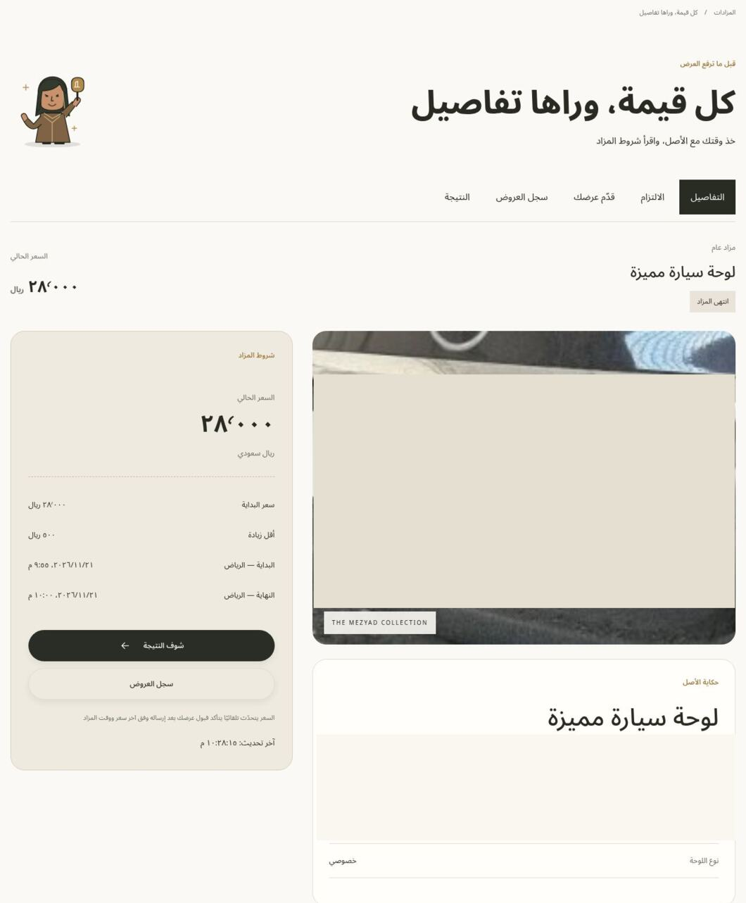

# Create the auction details page (FE-04)

**Status** Needs Fix

## What I handled

I handled the auction information screen, gallery, current price, status, and links to bidding, results, and bid history. The details page uses the selected auction ID from the route.

## Frontend files in flow order

1. `frontend/src/app/App.jsx` — Passes the auction ID from the route.
2. `frontend/src/features/auctions/pages/AuctionDetails/AuctionDetails.jsx` — Renders the gallery, item details, prices, and next actions.
3. `frontend/src/features/auctions/hooks/useMarket.js` — Loads details and refreshes the auction state.
4. `frontend/src/features/auctions/components/auction-components.jsx` — Provides loading and error states, summary, and navigation.
5. `frontend/src/features/auctions/pages/BidHistory/BidHistory.jsx` — Loads and displays bid rows on the separate history page.
6. `frontend/src/features/auctions/styles/auction-pages.css` — Adapts the detail grid for small screens.

## Implementation

### 1. Load the selected auction

The detail route passes the ID into `AuctionDetails`. That page calls `useAuction`, which requests `/auctions/{id}` and checks that the returned ID matches the requested one before displaying the record. [App.jsx 288–301](https://github.com/Abeerr0/mezyad/blob/3241ff4965d733aad039be05f279a97b5c2d71f5/frontend/src/app/App.jsx#L288-L301) · [AuctionDetails.jsx 19–37](https://github.com/Abeerr0/mezyad/blob/3241ff4965d733aad039be05f279a97b5c2d71f5/frontend/src/features/auctions/pages/AuctionDetails/AuctionDetails.jsx#L19-L37) · [useMarket.js 201–210](https://github.com/Abeerr0/mezyad/blob/3241ff4965d733aad039be05f279a97b5c2d71f5/frontend/src/features/auctions/hooks/useMarket.js#L201-L210)

```js
const a = await marketRequest("/auctions/" + encodeURIComponent(id), {
  token,
  signal,
});
```

### 2. Show the asset and its price

The gallery shows a selected image, offers thumbnails when more than one image is available, and shows an empty state when there are no photos. The page also shows the title, description, category fields, current price, starting price, minimum increment, and auction times. The detail grid becomes one column on smaller screens. [AuctionDetails.jsx 38–88](https://github.com/Abeerr0/mezyad/blob/3241ff4965d733aad039be05f279a97b5c2d71f5/frontend/src/features/auctions/pages/AuctionDetails/AuctionDetails.jsx#L38-L88) · [AuctionDetails.jsx 104–127](https://github.com/Abeerr0/mezyad/blob/3241ff4965d733aad039be05f279a97b5c2d71f5/frontend/src/features/auctions/pages/AuctionDetails/AuctionDetails.jsx#L104-L127) · [auction-components.jsx 112–133](https://github.com/Abeerr0/mezyad/blob/3241ff4965d733aad039be05f279a97b5c2d71f5/frontend/src/features/auctions/components/auction-components.jsx#L112-L133) · [auction-pages.css 521–529](https://github.com/Abeerr0/mezyad/blob/3241ff4965d733aad039be05f279a97b5c2d71f5/frontend/src/features/auctions/styles/auction-pages.css#L521-L529)

### 3. Refresh the data and show the next action

The Hook schedules another load four seconds after the current one finishes, pauses requests when the tab is hidden, and records the last successful update. If a refresh fails after a successful load, the shared state component keeps the last auction visible with an error. The page changes its main action for a closed auction, the owner, or an auction that has yet to start. [useMarket.js 110–115](https://github.com/Abeerr0/mezyad/blob/3241ff4965d733aad039be05f279a97b5c2d71f5/frontend/src/features/auctions/hooks/useMarket.js#L110-L115) · [useMarket.js 385–440](https://github.com/Abeerr0/mezyad/blob/3241ff4965d733aad039be05f279a97b5c2d71f5/frontend/src/features/auctions/hooks/useMarket.js#L385-L440) · [auction-components.jsx 44–73](https://github.com/Abeerr0/mezyad/blob/3241ff4965d733aad039be05f279a97b5c2d71f5/frontend/src/features/auctions/components/auction-components.jsx#L44-L73) · [AuctionDetails.jsx 128–162](https://github.com/Abeerr0/mezyad/blob/3241ff4965d733aad039be05f279a97b5c2d71f5/frontend/src/features/auctions/pages/AuctionDetails/AuctionDetails.jsx#L128-L162)

### 4. Connect the auction to its bids

The details screen links to Bid History with the same auction ID. The history screen enables bid loading through `useAuction`, asks the user to sign in, and renders the bid rows with amount and time. The bids API uses 20 rows per request. [AuctionDetails.jsx 148–153](https://github.com/Abeerr0/mezyad/blob/3241ff4965d733aad039be05f279a97b5c2d71f5/frontend/src/features/auctions/pages/AuctionDetails/AuctionDetails.jsx#L148-L153) · [App.jsx 310–312](https://github.com/Abeerr0/mezyad/blob/3241ff4965d733aad039be05f279a97b5c2d71f5/frontend/src/app/App.jsx#L310-L312) · [BidHistory.jsx 15–50](https://github.com/Abeerr0/mezyad/blob/3241ff4965d733aad039be05f279a97b5c2d71f5/frontend/src/features/auctions/pages/BidHistory/BidHistory.jsx#L15-L50) · [useMarket.js 211–223](https://github.com/Abeerr0/mezyad/blob/3241ff4965d733aad039be05f279a97b5c2d71f5/frontend/src/features/auctions/hooks/useMarket.js#L211-L223) · [auction-components.jsx 135–170](https://github.com/Abeerr0/mezyad/blob/3241ff4965d733aad039be05f279a97b5c2d71f5/frontend/src/features/auctions/components/auction-components.jsx#L135-L170)

## Result

The details page shows the asset, price, and status with periodic updates. Bid rows are available through the history route.

## What still needs work

The details page opens the Hook without the bids option. Users have to open Bid History to see the related bids. [AuctionDetails.jsx 19–21](https://github.com/Abeerr0/mezyad/blob/3241ff4965d733aad039be05f279a97b5c2d71f5/frontend/src/features/auctions/pages/AuctionDetails/AuctionDetails.jsx#L19-L21) · [AuctionDetails.jsx 148–153](https://github.com/Abeerr0/mezyad/blob/3241ff4965d733aad039be05f279a97b5c2d71f5/frontend/src/features/auctions/pages/AuctionDetails/AuctionDetails.jsx#L148-L153) · [useMarket.js 369–373](https://github.com/Abeerr0/mezyad/blob/3241ff4965d733aad039be05f279a97b5c2d71f5/frontend/src/features/auctions/hooks/useMarket.js#L369-L373) · [BidHistory.jsx 15–20](https://github.com/Abeerr0/mezyad/blob/3241ff4965d733aad039be05f279a97b5c2d71f5/frontend/src/features/auctions/pages/BidHistory/BidHistory.jsx#L15-L20)

## UI/UX

| Page or component | Frontend file | What the user sees and does |
| --- | --- | --- |
| Auction details page | `AuctionDetails.jsx` | The user checks the asset image, description, and specifications. The price and terms panel groups the information needed to decide what to do next. |
| Auction summary and tabs | `auction-components.jsx` | A summary shows price and auction status. Tabs keep the related actions in one place, and the loading and error states explain when details are unavailable. |
| Bid history page | `BidHistory.jsx` | The user opens the separate history view to see bid amounts and times. The page uses pagination for longer histories. |
| Closed-auction action | `AuctionDetails.jsx`, `App.jsx` | For a closed auction, the primary action points to the result. The Bid History action remains available beside it. |
| Current price and update feedback | `useMarket.js` | The page refreshes auction data and keeps the last available view when a later request fails. The update label gives context for the displayed price. |
| Small-screen layout | `auction-pages.css` | The image and terms panels stack on narrow screens so the user can read both without a side-by-side layout. |

### Auction details screenshot



*Closed-auction state, price and terms, result action, and the link to bid history. The plate number is obscured.*

## How I handled edge cases

- The polling loop waits until the current request finishes before scheduling the next one. The cleanup cancels the timer and aborts the request, which keeps an old auction from updating the page after the user opens a different one. [useMarket.js 398–450](https://github.com/Abeerr0/mezyad/blob/3241ff4965d733aad039be05f279a97b5c2d71f5/frontend/src/features/auctions/hooks/useMarket.js#L398-L450) · [App.jsx 288–301](https://github.com/Abeerr0/mezyad/blob/3241ff4965d733aad039be05f279a97b5c2d71f5/frontend/src/app/App.jsx#L288-L301)
- The page handles a failed first request separately from a failed refresh. A first failure shows an error panel. A refresh failure keeps the last auction visible and adds an error notice, which lets the user read the asset details while they wait. [useMarket.js 385–396](https://github.com/Abeerr0/mezyad/blob/3241ff4965d733aad039be05f279a97b5c2d71f5/frontend/src/features/auctions/hooks/useMarket.js#L385-L396) · [useMarket.js 415–433](https://github.com/Abeerr0/mezyad/blob/3241ff4965d733aad039be05f279a97b5c2d71f5/frontend/src/features/auctions/hooks/useMarket.js#L415-L433) · [auction-components.jsx 44–73](https://github.com/Abeerr0/mezyad/blob/3241ff4965d733aad039be05f279a97b5c2d71f5/frontend/src/features/auctions/components/auction-components.jsx#L44-L73)

## Testing & Evidence

The earlier integration run used React in jsdom with a running API and a temporary PostgreSQL database. The report records an isolated run and leaves merged browser E2E coverage open. [FE13_Aseel_Testing.md 3–6](https://github.com/Abeerr0/mezyad/blob/3241ff4965d733aad039be05f279a97b5c2d71f5/Stage_4/FE13_Aseel_Testing.md#L3-L6) · [FE13_Aseel_Testing.md 31–36](https://github.com/Abeerr0/mezyad/blob/3241ff4965d733aad039be05f279a97b5c2d71f5/Stage_4/FE13_Aseel_Testing.md#L31-L36)

| Scenario | Result | Evidence |
| --- | --- | --- |
| Details show the matching description and images; switching auctions and refresh | Pass · prior integration run on the tested revision | [fe13-abeer.txt 9–14](https://github.com/Abeerr0/mezyad/blob/3241ff4965d733aad039be05f279a97b5c2d71f5/Stage_4/evidence/fe13-abeer.txt#L9-L14) |
| Initial request fails | Pass · prior simulated React response check | [as08-states.txt 7–8](https://github.com/Abeerr0/mezyad/blob/3241ff4965d733aad039be05f279a97b5c2d71f5/Stage_4/evidence/as08-states.txt#L7-L8) |
| Open the selected closed auction and view the price and result action | Observed · live desktop page | Live desktop review |

### Browser checks still to run

| Scenario | What to check | Code |
| --- | --- | --- |
| The auction has several images | Select a thumbnail and confirm that the large image changes and the selected button is marked. | [AuctionDetails.jsx 38–68](https://github.com/Abeerr0/mezyad/blob/3241ff4965d733aad039be05f279a97b5c2d71f5/frontend/src/features/auctions/pages/AuctionDetails/AuctionDetails.jsx#L38-L68) |
| The first load succeeds and the next request fails | The last known price stays visible with a refresh error. | [useMarket.js 415–433](https://github.com/Abeerr0/mezyad/blob/3241ff4965d733aad039be05f279a97b5c2d71f5/frontend/src/features/auctions/hooks/useMarket.js#L415-L433) · [auction-components.jsx 63–72](https://github.com/Abeerr0/mezyad/blob/3241ff4965d733aad039be05f279a97b5c2d71f5/frontend/src/features/auctions/components/auction-components.jsx#L63-L72) |
| The auction closes | The primary action leads to the result and the history link remains available. | [AuctionDetails.jsx 128–153](https://github.com/Abeerr0/mezyad/blob/3241ff4965d733aad039be05f279a97b5c2d71f5/frontend/src/features/auctions/pages/AuctionDetails/AuctionDetails.jsx#L128-L153) |

## Suggested improvement

Add a short list of recent bids to the details screen for signed-in viewers. Reuse `BidRows` and keep the full history link for pagination. Give this smaller list its own error state so a bid request failure does not block the asset details. [useMarket.js 404–430](https://github.com/Abeerr0/mezyad/blob/3241ff4965d733aad039be05f279a97b5c2d71f5/frontend/src/features/auctions/hooks/useMarket.js#L404-L430) · [BidHistory.jsx 15–50](https://github.com/Abeerr0/mezyad/blob/3241ff4965d733aad039be05f279a97b5c2d71f5/frontend/src/features/auctions/pages/BidHistory/BidHistory.jsx#L15-L50) · [auction-components.jsx 135–170](https://github.com/Abeerr0/mezyad/blob/3241ff4965d733aad039be05f279a97b5c2d71f5/frontend/src/features/auctions/components/auction-components.jsx#L135-L170)

[Stage 4 task requirements in Notion](https://app.notion.com/p/90d3ecedbaba461cbe3ce7933a409788?v=f0ebf28bea9144329e41627e5631ff57)
