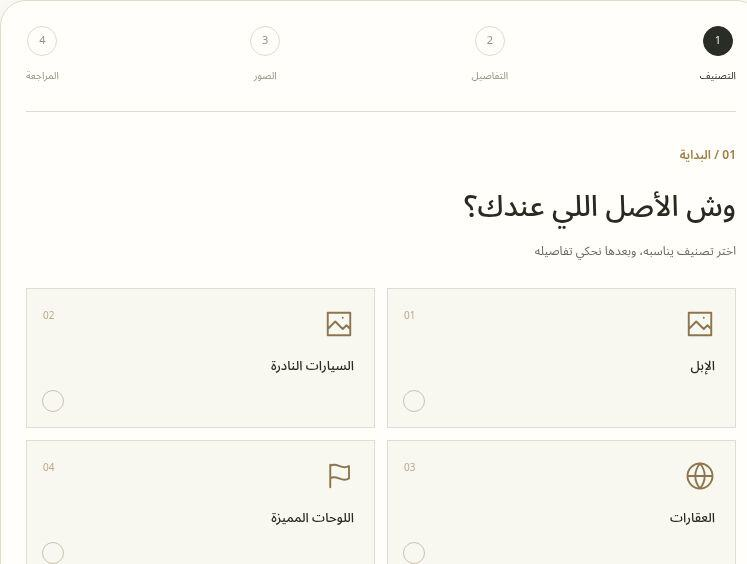

# Create the listing form and image upload (FE-05)

**Status** Needs Fix

## What I handled

I handled the shared listing form for creating an ad and resubmitting a rejected ad. The form takes the seller through category selection, details, images, and a final review before submission.

## Frontend files in flow order

1. `frontend/src/app/App.jsx` — Routes to create and edit.
2. `frontend/src/features/listings/pages/CreateListing/CreateListing.jsx` — Opens a new form inside the seller account.
3. `frontend/src/features/listings/pages/EditListing/EditListing.jsx` — Finds the rejected listing and opens the prefilled form.
4. `frontend/src/features/account/components/account-components.jsx` — Handles account access and resource states.
5. `frontend/src/features/listings/components/ListingEditor/ListingEditor.jsx` — Owns the steps, field validation, image previews, and submit state.
6. `frontend/src/features/listings/data/listing-fields.js` — Defines category-specific fields and rules.
7. `frontend/src/shared/api/client.js` — Checks image count, type, and size.
8. `frontend/src/features/account/hooks/useWorkspace.js` — Sends the listing and images and checks the saved result.
9. `frontend/src/features/listings/components/ListingEditor/ListingEditor.css` — Stacks dynamic fields on smaller screens.

## Implementation

### 1. Open the right form

Create uses an empty editor within the signed-in account. Edit finds the listing in the account’s loaded items and opens the same editor only when the listing is rejected. The editor starts on the details step, prefills the saved values, keeps the existing category, and shows the rejection reason. [App.jsx 331–336](https://github.com/Abeerr0/mezyad/blob/3241ff4965d733aad039be05f279a97b5c2d71f5/frontend/src/app/App.jsx#L331-L336) · [CreateListing.jsx 10–22](https://github.com/Abeerr0/mezyad/blob/3241ff4965d733aad039be05f279a97b5c2d71f5/frontend/src/features/listings/pages/CreateListing/CreateListing.jsx#L10-L22) · [EditListing.jsx 11–34](https://github.com/Abeerr0/mezyad/blob/3241ff4965d733aad039be05f279a97b5c2d71f5/frontend/src/features/listings/pages/EditListing/EditListing.jsx#L11-L34) · [account-components.jsx 47–67](https://github.com/Abeerr0/mezyad/blob/3241ff4965d733aad039be05f279a97b5c2d71f5/frontend/src/features/account/components/account-components.jsx#L47-L67) · [account-components.jsx 128–145](https://github.com/Abeerr0/mezyad/blob/3241ff4965d733aad039be05f279a97b5c2d71f5/frontend/src/features/account/components/account-components.jsx#L128-L145) · [ListingEditor.jsx 12–48](https://github.com/Abeerr0/mezyad/blob/3241ff4965d733aad039be05f279a97b5c2d71f5/frontend/src/features/listings/components/ListingEditor/ListingEditor.jsx#L12-L48) · [ListingEditor.jsx 194–201](https://github.com/Abeerr0/mezyad/blob/3241ff4965d733aad039be05f279a97b5c2d71f5/frontend/src/features/listings/components/ListingEditor/ListingEditor.jsx#L194-L201) · [ListingEditor.jsx 253–264](https://github.com/Abeerr0/mezyad/blob/3241ff4965d733aad039be05f279a97b5c2d71f5/frontend/src/features/listings/components/ListingEditor/ListingEditor.jsx#L253-L264)

### 2. Build and validate the category fields

The selected category determines which inputs and dropdowns are required. The form checks the title, description, required category fields, numeric ranges, and extra specification pairs before advancing. The category field grid and custom specification inputs stack on smaller screens. [ListingEditor.jsx 44–45](https://github.com/Abeerr0/mezyad/blob/3241ff4965d733aad039be05f279a97b5c2d71f5/frontend/src/features/listings/components/ListingEditor/ListingEditor.jsx#L44-L45) · [ListingEditor.jsx 86–110](https://github.com/Abeerr0/mezyad/blob/3241ff4965d733aad039be05f279a97b5c2d71f5/frontend/src/features/listings/components/ListingEditor/ListingEditor.jsx#L86-L110) · [ListingEditor.jsx 210–225](https://github.com/Abeerr0/mezyad/blob/3241ff4965d733aad039be05f279a97b5c2d71f5/frontend/src/features/listings/components/ListingEditor/ListingEditor.jsx#L210-L225) · [ListingEditor.jsx 265–344](https://github.com/Abeerr0/mezyad/blob/3241ff4965d733aad039be05f279a97b5c2d71f5/frontend/src/features/listings/components/ListingEditor/ListingEditor.jsx#L265-L344) · [listing-fields.js 3–101](https://github.com/Abeerr0/mezyad/blob/3241ff4965d733aad039be05f279a97b5c2d71f5/frontend/src/features/listings/data/listing-fields.js#L3-L101) · [ListingEditor.css 61–72](https://github.com/Abeerr0/mezyad/blob/3241ff4965d733aad039be05f279a97b5c2d71f5/frontend/src/features/listings/components/ListingEditor/ListingEditor.css#L61-L72)

### 3. Select and preview the images

The seller can drag images in or pick them from the device. Create requires one to six images. JPG, PNG, and WebP are allowed, up to 5 MiB per image. Edit can keep the original images or replace the full set. The editor creates temporary preview URLs and revokes them when the selection changes or the editor closes. [ListingEditor.jsx 44–70](https://github.com/Abeerr0/mezyad/blob/3241ff4965d733aad039be05f279a97b5c2d71f5/frontend/src/features/listings/components/ListingEditor/ListingEditor.jsx#L44-L70) · [ListingEditor.jsx 416–488](https://github.com/Abeerr0/mezyad/blob/3241ff4965d733aad039be05f279a97b5c2d71f5/frontend/src/features/listings/components/ListingEditor/ListingEditor.jsx#L416-L488) · [client.js 169–181](https://github.com/Abeerr0/mezyad/blob/3241ff4965d733aad039be05f279a97b5c2d71f5/frontend/src/shared/api/client.js#L169-L181)

```jsx
useEffect(() => {
  const urls = files.map((file) => URL.createObjectURL(file));
  setPreviews(urls);
  return () => urls.forEach((url) => URL.revokeObjectURL(url));
}, [files]);
```

### 4. Review and submit

The last step shows the title, description, fields, and image count, and requires confirmation. The workspace sends the values and images as `FormData` using POST for create and PATCH for edit. It checks that the returned listing is pending review before updating the account list. If the response cannot confirm the save, the editor points the seller to their listings before another attempt. [ListingEditor.jsx 125–155](https://github.com/Abeerr0/mezyad/blob/3241ff4965d733aad039be05f279a97b5c2d71f5/frontend/src/features/listings/components/ListingEditor/ListingEditor.jsx#L125-L155) · [ListingEditor.jsx 491–570](https://github.com/Abeerr0/mezyad/blob/3241ff4965d733aad039be05f279a97b5c2d71f5/frontend/src/features/listings/components/ListingEditor/ListingEditor.jsx#L491-L570) · [useWorkspace.js 259–289](https://github.com/Abeerr0/mezyad/blob/3241ff4965d733aad039be05f279a97b5c2d71f5/frontend/src/features/account/hooks/useWorkspace.js#L259-L289)

```js
const form = new FormData();
form.set("title", input.title);
form.set("description", input.description);
form.set("categoryId", input.categoryId);
form.set("categoryFields", JSON.stringify(input.categoryFields));
files.forEach((file) => form.append("images", file));
const saved = await call(
  "/items" + (existing ? "/" + encodeURIComponent(existing.id) : ""),
  {
    method: existing ? "PATCH" : "POST",
    body: form,
  },
);
```

## Result

Create and rejected-listing edit share the same editor and validation. One field merge case can still overwrite user input.

## What still needs work

A custom specification can have the same name as a category field. The merge applies category fields last, so it silently replaces the custom value. [ListingEditor.jsx 71–100](https://github.com/Abeerr0/mezyad/blob/3241ff4965d733aad039be05f279a97b5c2d71f5/frontend/src/features/listings/components/ListingEditor/ListingEditor.jsx#L71-L100) · [ListingEditor.jsx 367–385](https://github.com/Abeerr0/mezyad/blob/3241ff4965d733aad039be05f279a97b5c2d71f5/frontend/src/features/listings/components/ListingEditor/ListingEditor.jsx#L367-L385)

## UI/UX

| Page or component | Frontend file | What the user sees and does |
| --- | --- | --- |
| Create listing page | `CreateListing.jsx`, `App.jsx` | A signed-in seller starts a new listing. The first screen shows the four-step progress indicator and asks for an asset category. |
| Edit rejected listing page | `EditListing.jsx` | The seller opens a rejected listing with its saved values and review reason already visible, then can correct it and resubmit. |
| Category and details steps | `ListingEditor.jsx`, `listing-fields.js` | The editor changes the fields to fit the category. For example, a vehicle and a plate ask for different details. |
| Images step | `ListingEditor.jsx`, `client.js` | The seller can choose or drag in files, preview the selection, and remove unwanted photos. Validation checks the count, format, and size. |
| Review and send step | `ListingEditor.jsx`, `useWorkspace.js` | The seller reviews the listing and confirms it before submission. The response determines whether success or recovery feedback appears. |
| Account access and loading | `account-components.jsx` | The account layout handles the signed-out prompt and shows loading or error feedback while listing data becomes available. |
| Small-screen form layout | `ListingEditor.css` | Category fields and extra specification inputs stack on narrow screens. |

### Create listing page screenshot



*The first editor step shows the category choices and the full set of steps. The capture is cropped to the editor.*

## How I handled edge cases

- New photos are checked as a combined selection before the editor updates its state. If adding a file pushes the total over the limit, the previous photos remain selected. In edit mode, clearing all new photos restores the original previews. [ListingEditor.jsx 44–70](https://github.com/Abeerr0/mezyad/blob/3241ff4965d733aad039be05f279a97b5c2d71f5/frontend/src/features/listings/components/ListingEditor/ListingEditor.jsx#L44-L70) · [ListingEditor.jsx 456–488](https://github.com/Abeerr0/mezyad/blob/3241ff4965d733aad039be05f279a97b5c2d71f5/frontend/src/features/listings/components/ListingEditor/ListingEditor.jsx#L456-L488) · [client.js 169–181](https://github.com/Abeerr0/mezyad/blob/3241ff4965d733aad039be05f279a97b5c2d71f5/frontend/src/shared/api/client.js#L169-L181)
- The UI checks for a listing ID and `PENDING_REVIEW` before it updates the account list. Edit also checks that the response matches the listing being edited. This keeps an uncertain response from showing a success message or replacing the wrong row. [useWorkspace.js 259–289](https://github.com/Abeerr0/mezyad/blob/3241ff4965d733aad039be05f279a97b5c2d71f5/frontend/src/features/account/hooks/useWorkspace.js#L259-L289) · [ListingEditor.jsx 135–154](https://github.com/Abeerr0/mezyad/blob/3241ff4965d733aad039be05f279a97b5c2d71f5/frontend/src/features/listings/components/ListingEditor/ListingEditor.jsx#L135-L154) · [ListingEditor.jsx 562–570](https://github.com/Abeerr0/mezyad/blob/3241ff4965d733aad039be05f279a97b5c2d71f5/frontend/src/features/listings/components/ListingEditor/ListingEditor.jsx#L562-L570)

## Testing & Evidence

The earlier integration run used React in jsdom with a running API and a temporary PostgreSQL database. The report records an isolated run and leaves merged browser E2E coverage open. [FE13_Aseel_Testing.md 3–6](https://github.com/Abeerr0/mezyad/blob/3241ff4965d733aad039be05f279a97b5c2d71f5/Stage_4/FE13_Aseel_Testing.md#L3-L6) · [FE13_Aseel_Testing.md 31–36](https://github.com/Abeerr0/mezyad/blob/3241ff4965d733aad039be05f279a97b5c2d71f5/Stage_4/FE13_Aseel_Testing.md#L31-L36)

| Scenario | Result | Evidence |
| --- | --- | --- |
| Submit listing details and an image as multipart data | Pass · prior integration run | [fe13-abeer.txt 4–5](https://github.com/Abeerr0/mezyad/blob/3241ff4965d733aad039be05f279a97b5c2d71f5/Stage_4/evidence/fe13-abeer.txt#L4-L5) · [fe13-abeer.txt 11–11](https://github.com/Abeerr0/mezyad/blob/3241ff4965d733aad039be05f279a97b5c2d71f5/Stage_4/evidence/fe13-abeer.txt#L11-L11) |
| Reject missing or corrupt images without saving a listing | Pass · prior integration run | [fe13-abeer.txt 4–4](https://github.com/Abeerr0/mezyad/blob/3241ff4965d733aad039be05f279a97b5c2d71f5/Stage_4/evidence/fe13-abeer.txt#L4-L4) |
| Open the seller editor after sign-in | Observed · live browser; category step displayed | Live desktop review |
| Complete upload and submission on the current deployed page | Not run · the live review stopped at the editor | Prior coverage: [fe13-abeer.txt 11–11](https://github.com/Abeerr0/mezyad/blob/3241ff4965d733aad039be05f279a97b5c2d71f5/Stage_4/evidence/fe13-abeer.txt#L11-L11) |

### Browser checks still to run

| Scenario | What to check | Code |
| --- | --- | --- |
| Create with six valid photos and then add a seventh | The form shows a validation error and keeps the six valid selections. | [ListingEditor.jsx 61–70](https://github.com/Abeerr0/mezyad/blob/3241ff4965d733aad039be05f279a97b5c2d71f5/frontend/src/features/listings/components/ListingEditor/ListingEditor.jsx#L61-L70) · [client.js 169–181](https://github.com/Abeerr0/mezyad/blob/3241ff4965d733aad039be05f279a97b5c2d71f5/frontend/src/shared/api/client.js#L169-L181) |
| Edit a rejected listing without selecting new photos | The editor shows the existing images and sends the PATCH request without new image parts. | [ListingEditor.jsx 44–48](https://github.com/Abeerr0/mezyad/blob/3241ff4965d733aad039be05f279a97b5c2d71f5/frontend/src/features/listings/components/ListingEditor/ListingEditor.jsx#L44-L48) · [ListingEditor.jsx 416–424](https://github.com/Abeerr0/mezyad/blob/3241ff4965d733aad039be05f279a97b5c2d71f5/frontend/src/features/listings/components/ListingEditor/ListingEditor.jsx#L416-L424) · [useWorkspace.js 259–271](https://github.com/Abeerr0/mezyad/blob/3241ff4965d733aad039be05f279a97b5c2d71f5/frontend/src/features/account/hooks/useWorkspace.js#L259-L271) |
| The save response does not confirm the expected listing | The editor shows an error and links to My Listings so the user can check the record first. | [useWorkspace.js 272–281](https://github.com/Abeerr0/mezyad/blob/3241ff4965d733aad039be05f279a97b5c2d71f5/frontend/src/features/account/hooks/useWorkspace.js#L272-L281) · [ListingEditor.jsx 150–154](https://github.com/Abeerr0/mezyad/blob/3241ff4965d733aad039be05f279a97b5c2d71f5/frontend/src/features/listings/components/ListingEditor/ListingEditor.jsx#L150-L154) · [ListingEditor.jsx 562–570](https://github.com/Abeerr0/mezyad/blob/3241ff4965d733aad039be05f279a97b5c2d71f5/frontend/src/features/listings/components/ListingEditor/ListingEditor.jsx#L562-L570) |

## Suggested improvement

Check custom specification names against the selected category's required field names before opening the review step. Show the conflicting name next to the input so the seller can rename it before submission. [ListingEditor.jsx 71–101](https://github.com/Abeerr0/mezyad/blob/3241ff4965d733aad039be05f279a97b5c2d71f5/frontend/src/features/listings/components/ListingEditor/ListingEditor.jsx#L71-L101) · [ListingEditor.jsx 367–385](https://github.com/Abeerr0/mezyad/blob/3241ff4965d733aad039be05f279a97b5c2d71f5/frontend/src/features/listings/components/ListingEditor/ListingEditor.jsx#L367-L385)

[Stage 4 task requirements in Notion](https://app.notion.com/p/90d3ecedbaba461cbe3ce7933a409788?v=f0ebf28bea9144329e41627e5631ff57)
