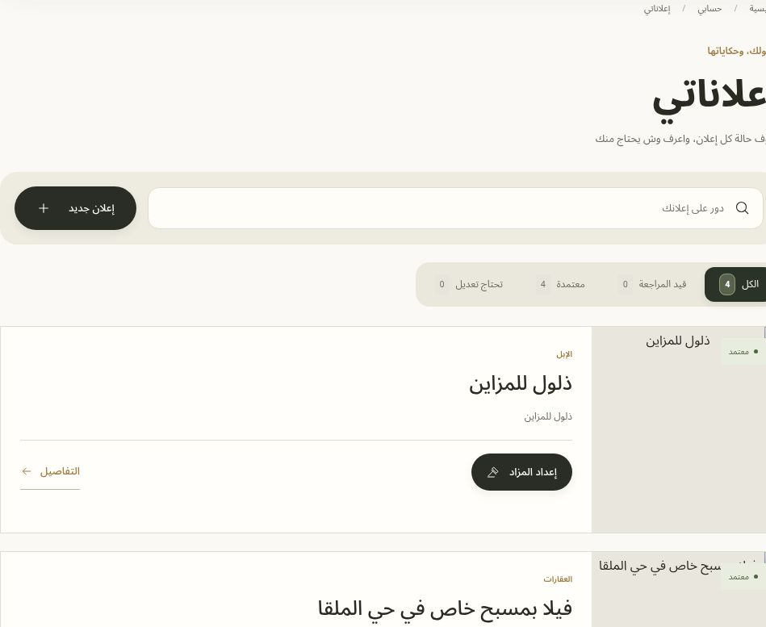

# Create the My Listings page (FE-06)

**Status** Implemented

## Scope

My Listings gives the seller one place to check review status, see the reviewer’s feedback, and act on an existing listing. The UI uses the listings loaded for the signed-in workspace.

## Implementation

### 1. Load the seller’s records

The route passes the selected status and item to My Listings. Workspace requests the signed-in user’s items, and the page can open a listing directly from an item link in Activity. Search matches the title and combines with the selected status. [App.jsx 325–335](https://github.com/Abeerr0/mezyad/blob/99b8d4acbbeeea9b678ca555759ef84eb1775b01/frontend/src/app/App.jsx#L325-L335) · [useWorkspace.js 104–145](https://github.com/Abeerr0/mezyad/blob/99b8d4acbbeeea9b678ca555759ef84eb1775b01/frontend/src/features/account/hooks/useWorkspace.js#L104-L145) · [MyListings.jsx 14–21](https://github.com/Abeerr0/mezyad/blob/99b8d4acbbeeea9b678ca555759ef84eb1775b01/frontend/src/features/listings/pages/MyListings/MyListings.jsx#L14-L21)

### 2. Show the right next step

Pending listings show a waiting label. Approved listings link to auction setup with the item ID. Rejected listings show the reviewer’s reason and link to Edit Listing. If a search or filter has no matches, the page offers to reset it. If the account has no listings, it offers to create one. [MyListings.jsx 22–45](https://github.com/Abeerr0/mezyad/blob/99b8d4acbbeeea9b678ca555759ef84eb1775b01/frontend/src/features/listings/pages/MyListings/MyListings.jsx#L22-L45) · [MyListings.jsx 99–124](https://github.com/Abeerr0/mezyad/blob/99b8d4acbbeeea9b678ca555759ef84eb1775b01/frontend/src/features/listings/pages/MyListings/MyListings.jsx#L99-L124) · [MyListings.jsx 159–176](https://github.com/Abeerr0/mezyad/blob/99b8d4acbbeeea9b678ca555759ef84eb1775b01/frontend/src/features/listings/pages/MyListings/MyListings.jsx#L159-L176)

### 3. Open, edit and follow up

The detail dialog shows the full record and keeps the appropriate action at the bottom. Edit Listing opens a rejected record found in the current workspace. After a confirmed save, workspace replaces the old item with the returned record in pending review. [MyListings.jsx 183–227](https://github.com/Abeerr0/mezyad/blob/99b8d4acbbeeea9b678ca555759ef84eb1775b01/frontend/src/features/listings/pages/MyListings/MyListings.jsx#L183-L227) · [EditListing.jsx 11–34](https://github.com/Abeerr0/mezyad/blob/99b8d4acbbeeea9b678ca555759ef84eb1775b01/frontend/src/features/listings/pages/EditListing/EditListing.jsx#L11-L34) · [useWorkspace.js 259–289](https://github.com/Abeerr0/mezyad/blob/99b8d4acbbeeea9b678ca555759ef84eb1775b01/frontend/src/features/account/hooks/useWorkspace.js#L259-L289)

## UI/UX

| Page or component | Frontend file | What the user sees and does |
| --- | --- | --- |
| My Listings | `MyListings.jsx` | Search by title and select a review-status tab. Counts show how many listings are in each state. |
| Listing details | `MyListings.jsx` | Open a card to see its status, photos, description and specifications. A rejected listing shows its reason in the card and the dialog. |
| Correct and resubmit | `EditListing.jsx`, `ListingEditor.jsx` | Open the saved listing, fix the requested details and send it back for review. |
| Account and layout | `account-components.jsx`, `MyListings.css` | Keep account navigation and loading feedback in the shared layout. Arrange the listing controls and cards for smaller screens. |

### Page screenshot

*My Listings with title search, review-status tabs, listing cards and the action available for an approved listing.*

## Testing & Evidence

| Scenario | Result | Evidence |
| --- | --- | --- |
| Open My Listings and see review filters and listing actions | Observed on deployed desktop | Screenshot above |
| Keep seller records isolated and resubmit a rejected listing | Pass in the recorded integration run | [fe13-abeer.txt 6](https://github.com/Abeerr0/mezyad/blob/99b8d4acbbeeea9b678ca555759ef84eb1775b01/Stage_4/evidence/fe13-abeer.txt#L6) |
| Resubmit without replacing the image | Pass in the recorded component/API run | [fe13-abeer.txt 12](https://github.com/Abeerr0/mezyad/blob/99b8d4acbbeeea9b678ca555759ef84eb1775b01/Stage_4/evidence/fe13-abeer.txt#L12) |

## Suggested follow-up

Recheck the rejected, pending and approved actions on the same browser build. Test an item link when moving between two records on the listings route because the dialog selection is initialized from the route.

[Stage 4 task requirements](https://app.notion.com/p/90d3ecedbaba461cbe3ce7933a409788?v=f0ebf28bea9144329e41627e5631ff57)
