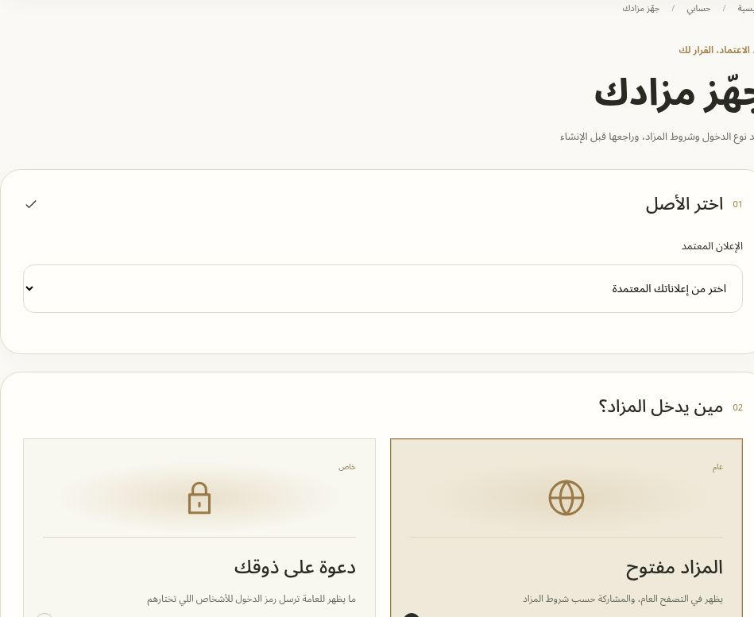

# Create the auction setup form (FE-07)

**Status** Implemented

## Scope

This report documents the auction setup implementation. The Notion task has no named assignee. The seller starts from an approved listing, chooses the auction type, sets the prices and dates, and reviews the terms before creating it.

## Implementation

### 1. Start from an approved listing

My Listings passes the item ID into the setup route. The form filters the workspace records to approved items and checks the seller’s existing auctions for the same item. If no approved listing exists, it offers a way back to My Listings. [MyListings.jsx 32–39](https://github.com/Abeerr0/mezyad/blob/99b8d4acbbeeea9b678ca555759ef84eb1775b01/frontend/src/features/listings/pages/MyListings/MyListings.jsx#L32-L39) · [CreateAuction.jsx 13–32](https://github.com/Abeerr0/mezyad/blob/99b8d4acbbeeea9b678ca555759ef84eb1775b01/frontend/src/features/auctions/pages/CreateAuction/CreateAuction.jsx#L13-L32) · [CreateAuction.jsx 134–145](https://github.com/Abeerr0/mezyad/blob/99b8d4acbbeeea9b678ca555759ef84eb1775b01/frontend/src/features/auctions/pages/CreateAuction/CreateAuction.jsx#L134-L145)

### 2. Check and review the terms

The page checks positive money values, an end after the start, and an end in the future. Its first submit opens a review. The review groups the item, visibility, prices and times, and provides an edit action before final confirmation. [CreateAuction.jsx 30–60](https://github.com/Abeerr0/mezyad/blob/99b8d4acbbeeea9b678ca555759ef84eb1775b01/frontend/src/features/auctions/pages/CreateAuction/CreateAuction.jsx#L30-L60) · [CreateAuction.jsx 295–346](https://github.com/Abeerr0/mezyad/blob/99b8d4acbbeeea9b678ca555759ef84eb1775b01/frontend/src/features/auctions/pages/CreateAuction/CreateAuction.jsx#L295-L346)

### 3. Create the auction and show the result

The confirmed request sends numeric prices and ISO timestamps. Workspace checks that the returned auction belongs to the selected item before adding it to the account list. Private success shows the returned code when available. A missing code or uncertain response tells the seller how to check what happened before creating another auction. [CreateAuction.jsx 61–78](https://github.com/Abeerr0/mezyad/blob/99b8d4acbbeeea9b678ca555759ef84eb1775b01/frontend/src/features/auctions/pages/CreateAuction/CreateAuction.jsx#L61-L78) · [useWorkspace.js 320–342](https://github.com/Abeerr0/mezyad/blob/99b8d4acbbeeea9b678ca555759ef84eb1775b01/frontend/src/features/account/hooks/useWorkspace.js#L320-L342) · [CreateAuction.jsx 98–132](https://github.com/Abeerr0/mezyad/blob/99b8d4acbbeeea9b678ca555759ef84eb1775b01/frontend/src/features/auctions/pages/CreateAuction/CreateAuction.jsx#L98-L132) · [CreateAuction.jsx 349–356](https://github.com/Abeerr0/mezyad/blob/99b8d4acbbeeea9b678ca555759ef84eb1775b01/frontend/src/features/auctions/pages/CreateAuction/CreateAuction.jsx#L349-L356)

## UI/UX

| Page or component | Frontend file | What the user sees and does |
| --- | --- | --- |
| Auction setup | `CreateAuction.jsx` | Pick an approved listing. The listing selected in My Listings can be carried into the form. |
| Public or private auction | `CreateAuction.jsx` | Two choices explain who can enter. A private auction has an invitation-code flow after creation. |
| Terms and review | `CreateAuction.jsx` | Enter starting price, minimum increment, start and end. Review the formatted details before confirming. |
| Creation result | `InteractionUI.jsx`, `useWorkspace.js` | The confirmation leads to Activity. The invitation ticket displays a returned code for a private auction. |

### Page screenshot

*Auction setup with the approved-listing selector and public/private visibility choices.*

## Testing & Evidence

| Scenario | Result | Evidence |
| --- | --- | --- |
| Open the form with the approved listing and visibility controls | Observed on deployed desktop | Screenshot above |
| Create from an approved listing and prevent duplicate auction creation | Pass in the recorded integration run | [fe13-abeer.txt 8](https://github.com/Abeerr0/mezyad/blob/99b8d4acbbeeea9b678ca555759ef84eb1775b01/Stage_4/evidence/fe13-abeer.txt#L8) |
| Create or share a private invitation on the deployed site | Not run | Form inspected without submission |

## Suggested follow-up

On a disposable test listing, check the review-to-confirm path, the time-zone presentation and the private invitation result.

[Stage 4 task requirements](https://app.notion.com/p/90d3ecedbaba461cbe3ce7933a409788?v=f0ebf28bea9144329e41627e5631ff57)
