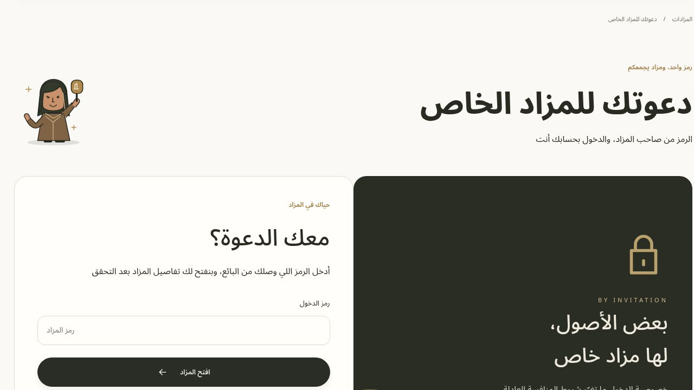

# Create the private auction code page (FE-08)

**Status** Implemented

## Scope

The private auction page lets a signed-in visitor enter a seller’s invitation code and opens the auction confirmed by the API.

## Implementation

### 1. Gate the entry form

App mounts the private access page and passes the market workspace. SignInGate presents a login link to visitors without a user ID and preserves the route so they can return. [App.jsx 300–305](https://github.com/Abeerr0/mezyad/blob/99b8d4acbbeeea9b678ca555759ef84eb1775b01/frontend/src/app/App.jsx#L300-L305) · [PrivateAccess.jsx 38–57](https://github.com/Abeerr0/mezyad/blob/99b8d4acbbeeea9b678ca555759ef84eb1775b01/frontend/src/features/auctions/pages/PrivateAccess/PrivateAccess.jsx#L38-L57) · [auction-components.jsx 75–90](https://github.com/Abeerr0/mezyad/blob/99b8d4acbbeeea9b678ca555759ef84eb1775b01/frontend/src/features/auctions/components/auction-components.jsx#L75-L90)

### 2. Submit one code check

The form trims the code, rejects empty input and uses a ref to avoid duplicate submissions. The market hook sends the code to the access endpoint using the session token. The input and button are disabled while the check is running. [PrivateAccess.jsx 18–36](https://github.com/Abeerr0/mezyad/blob/99b8d4acbbeeea9b678ca555759ef84eb1775b01/frontend/src/features/auctions/pages/PrivateAccess/PrivateAccess.jsx#L18-L36) · [PrivateAccess.jsx 63–88](https://github.com/Abeerr0/mezyad/blob/99b8d4acbbeeea9b678ca555759ef84eb1775b01/frontend/src/features/auctions/pages/PrivateAccess/PrivateAccess.jsx#L63-L88) · [useMarket.js 241–256](https://github.com/Abeerr0/mezyad/blob/99b8d4acbbeeea9b678ca555759ef84eb1775b01/frontend/src/features/auctions/hooks/useMarket.js#L241-L256)

### 3. Open the confirmed auction

The API result must contain a granted access flag and an auction ID. The UI navigates to Details with that ID. On a rejected request, it stays on the form, displays the error and allows another attempt. The form also explains that entry and bid eligibility are separate steps. [useMarket.js 250–260](https://github.com/Abeerr0/mezyad/blob/99b8d4acbbeeea9b678ca555759ef84eb1775b01/frontend/src/features/auctions/hooks/useMarket.js#L250-L260) · [PrivateAccess.jsx 25–36](https://github.com/Abeerr0/mezyad/blob/99b8d4acbbeeea9b678ca555759ef84eb1775b01/frontend/src/features/auctions/pages/PrivateAccess/PrivateAccess.jsx#L25-L36) · [PrivateAccess.jsx 81–94](https://github.com/Abeerr0/mezyad/blob/99b8d4acbbeeea9b678ca555759ef84eb1775b01/frontend/src/features/auctions/pages/PrivateAccess/PrivateAccess.jsx#L81-L94)

## UI/UX

| Page or component | Frontend file | What the user sees and does |
| --- | --- | --- |
| Private auction entry | `PrivateAccess.jsx` | A short explanation and a single left-to-right code field make the next action clear. The code box starts empty. |
| Sign-in prompt | `auction-components.jsx` | Signed-out visitors see a sign-in action that carries the return destination. |
| Checking and denial | `PrivateAccess.jsx`, `useMarket.js` | The submit button shows progress while the request runs. An invalid or denied response appears near the field. |
| Granted access | `PrivateAccess.jsx`, `App.jsx` | A confirmed response opens the auction details using the returned ID. |

### Page screenshot

*The private-auction invitation page with an empty code field and the action to open the auction.*

## Testing & Evidence

| Scenario | Result | Evidence |
| --- | --- | --- |
| Open the signed-in invitation form | Observed on deployed desktop | Screenshot above |
| Deny a wrong code and open the matching ID for an accepted code | Pass in the recorded component/API run | [fe13-abeer.txt 13](https://github.com/Abeerr0/mezyad/blob/99b8d4acbbeeea9b678ca555759ef84eb1775b01/Stage_4/evidence/fe13-abeer.txt#L13) |
| Reject anonymous or owner entry and recover from simulated network failure | Pass in the recorded run | [fe13-abeer.txt 13](https://github.com/Abeerr0/mezyad/blob/99b8d4acbbeeea9b678ca555759ef84eb1775b01/Stage_4/evidence/fe13-abeer.txt#L13) |

## Suggested follow-up

Retest the full invitation path in a browser using a dedicated test auction and a regular bidder account.

[Stage 4 task requirements](https://app.notion.com/p/90d3ecedbaba461cbe3ce7933a409788?v=f0ebf28bea9144329e41627e5631ff57)
