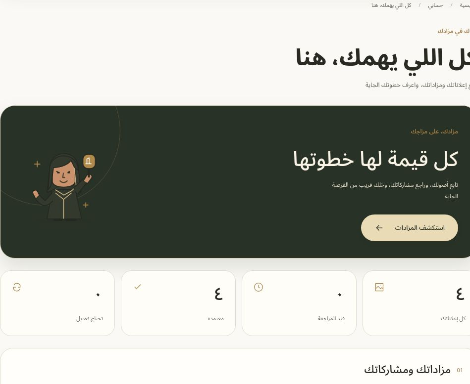
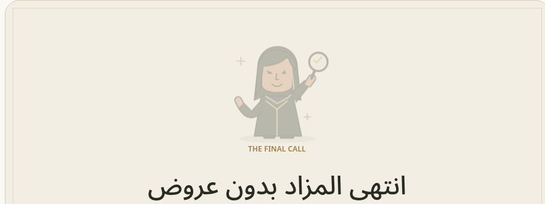

# Create My Activity and Auction Result views (FE-10)

**Status** Implemented with a navigation gap

## Scope

Activity summarizes listing and auction work. Auction Result presents the outcome for a selected auction. My Auctions and the full bid history have separate task coverage.

## Implementation

### 1. Summarize activity

Listing totals are derived from the signed-in workspace. Each status tile links to the corresponding My Listings filter. A separate notice appears when an item needs correction, and the recent section shows up to three listings with their status. [Activity.jsx 18–35](https://github.com/Abeerr0/mezyad/blob/99b8d4acbbeeea9b678ca555759ef84eb1775b01/frontend/src/features/activity/pages/Activity/Activity.jsx#L18-L35) · [Activity.jsx 56–85](https://github.com/Abeerr0/mezyad/blob/99b8d4acbbeeea9b678ca555759ef84eb1775b01/frontend/src/features/activity/pages/Activity/Activity.jsx#L56-L85) · [Activity.jsx 154–194](https://github.com/Abeerr0/mezyad/blob/99b8d4acbbeeea9b678ca555759ef84eb1775b01/frontend/src/features/activity/pages/Activity/Activity.jsx#L154-L194)

### 2. Connect an auction to its result

The activity section has active, scheduled and closed filters. Clicking an auction sends it to App’s detail route. The result route has its own auction ID and loads that record through the market hook. The activity row uses Details as the intermediate screen. [Activity.jsx 87–151](https://github.com/Abeerr0/mezyad/blob/99b8d4acbbeeea9b678ca555759ef84eb1775b01/frontend/src/features/activity/pages/Activity/Activity.jsx#L87-L151) · [App.jsx 207–210](https://github.com/Abeerr0/mezyad/blob/99b8d4acbbeeea9b678ca555759ef84eb1775b01/frontend/src/app/App.jsx#L207-L210) · [App.jsx 313–326](https://github.com/Abeerr0/mezyad/blob/99b8d4acbbeeea9b678ca555759ef84eb1775b01/frontend/src/app/App.jsx#L313-L326)

### 3. Explain the outcome

The result page distinguishes the auction’s closed state from the presence of the actual result record. It shows a winning price only when a winning bid exists. It also displays the closure time when available and gives participants a path to bid history. [AuctionResult.jsx 21–34](https://github.com/Abeerr0/mezyad/blob/99b8d4acbbeeea9b678ca555759ef84eb1775b01/frontend/src/features/auctions/pages/AuctionResult/AuctionResult.jsx#L21-L34) · [AuctionResult.jsx 55–82](https://github.com/Abeerr0/mezyad/blob/99b8d4acbbeeea9b678ca555759ef84eb1775b01/frontend/src/features/auctions/pages/AuctionResult/AuctionResult.jsx#L55-L82) · [AuctionResult.jsx 88–101](https://github.com/Abeerr0/mezyad/blob/99b8d4acbbeeea9b678ca555759ef84eb1775b01/frontend/src/features/auctions/pages/AuctionResult/AuctionResult.jsx#L88-L101)

## UI/UX

| Page or component | Frontend file | What the user sees and does |
| --- | --- | --- |
| Activity dashboard | `Activity.jsx`, `Activity.css` | Scan listing counts, open the matching filtered list and spot an item that needs correction. |
| Auction activity | `Activity.jsx` | Filter the auction list by status. Open an auction from its title row and follow the next action from its details. |
| Auction result | `AuctionResult.jsx` | See whether the auction is still open, waiting for an outcome, closed without bids, or has a winning amount. |
| Loading and updates | `account-components.jsx`, `useMarket.js` | Shared components display loading or failure while keeping each page in its normal layout. |

### Page screenshot

*The Activity dashboard with listing counters and the entry to the user’s auction and participation section.*

### Auction result screenshot

*The result page shows the closed-without-bids state for the viewed auction.*

## Testing & Evidence

| Scenario | Result | Evidence |
| --- | --- | --- |
| Open Activity and inspect listing counters | Observed on deployed desktop | Screenshot above |
| Drive running, pending-result, no-bid and winner states end to end | Not run in this review | [AuctionResult.jsx 21–34](https://github.com/Abeerr0/mezyad/blob/99b8d4acbbeeea9b678ca555759ef84eb1775b01/frontend/src/features/auctions/pages/AuctionResult/AuctionResult.jsx#L21-L34) |
| Check Activity within the previous FE-13 run | Outside that run’s stated scope | [FE13_Aseel_Testing.md 37](https://github.com/Abeerr0/mezyad/blob/99b8d4acbbeeea9b678ca555759ef84eb1775b01/Stage_4/FE13_Aseel_Testing.md#L37) |

## Suggested follow-up

Add a direct Result action on closed activity rows or confirm with the team that opening Details first is the intended flow.

[Stage 4 task requirements](https://app.notion.com/p/90d3ecedbaba461cbe3ce7933a409788?v=f0ebf28bea9144329e41627e5631ff57)
