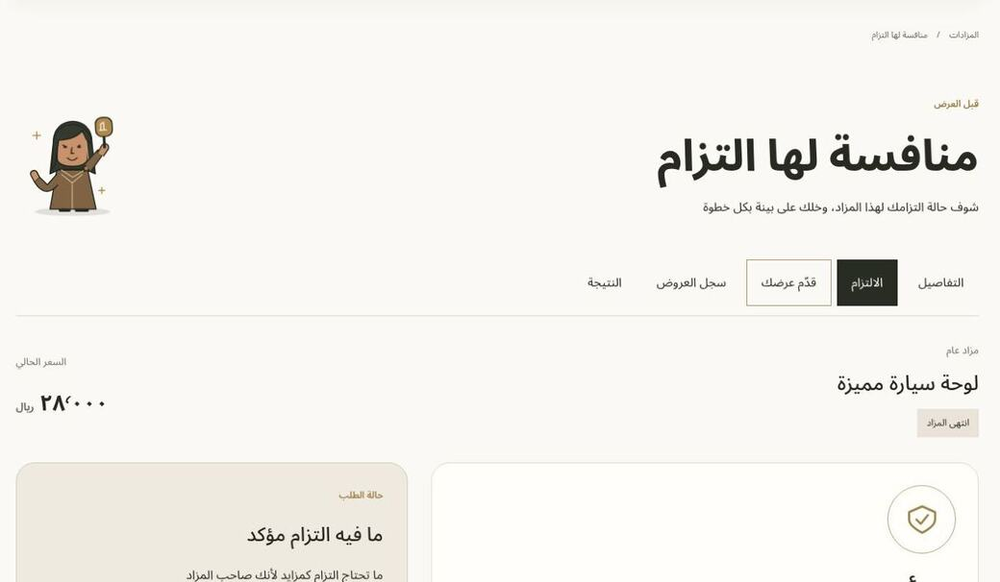
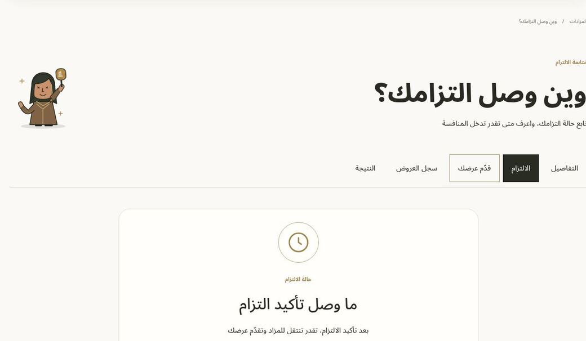

# Build the commitment, checkout and bank-status views (FE-18)

**Status** Implemented for test-mode checkout

## Scope

The auction commitment flow shows the bidder what a hold means, opens checkout when eligible and routes them using the verified commitment status.

## Implementation

### 1. Start from the auction

The commitment page loads auction and commitment data in the same view. It shows the next action according to eligibility and current status. Starting checkout carries the auction ID through the existing payment route. [Commitment.jsx 20–43](https://github.com/Abeerr0/mezyad/blob/206b127eeb10af66ac115684d2531439a1405766/frontend/src/features/payments/pages/Commitment/Commitment.jsx#L20-L43) · [Commitment.jsx 47–145](https://github.com/Abeerr0/mezyad/blob/206b127eeb10af66ac115684d2531439a1405766/frontend/src/features/payments/pages/Commitment/Commitment.jsx#L47-L145)

### 2. Prepare the authorization

Checkout checks that the bidder is signed in, has accepted the terms and is eligible for the auction. It requires a test publishable key and checks the hold amount against the current minimum. The SDK is set up for a manual card authorization in SAR. [MoyasarCheckout.jsx 135–209](https://github.com/Abeerr0/mezyad/blob/206b127eeb10af66ac115684d2531439a1405766/frontend/src/features/payments/components/MoyasarCheckout/MoyasarCheckout.jsx#L135-L209)

### 3. Verify the outcome and route the bidder

App reads the provider return parameters and opens the payment view with both IDs. Checkout verifies the payment reference through the market hook and shows confirmed, failed or pending feedback. The Bank Status page uses the returned status to decide whether to continue to Bid or back to Commitment. [App.jsx 65–83](https://github.com/Abeerr0/mezyad/blob/206b127eeb10af66ac115684d2531439a1405766/frontend/src/app/App.jsx#L65-L83) · [MoyasarCheckout.jsx 100–132](https://github.com/Abeerr0/mezyad/blob/206b127eeb10af66ac115684d2531439a1405766/frontend/src/features/payments/components/MoyasarCheckout/MoyasarCheckout.jsx#L100-L132) · [useMarket.js 261–275](https://github.com/Abeerr0/mezyad/blob/206b127eeb10af66ac115684d2531439a1405766/frontend/src/features/auctions/hooks/useMarket.js#L261-L275) · [BankStatus.jsx 32–77](https://github.com/Abeerr0/mezyad/blob/206b127eeb10af66ac115684d2531439a1405766/frontend/src/features/payments/pages/BankStatus/BankStatus.jsx#L32-L77)

## UI/UX

| Page or component | Frontend file | What the user sees and does |
| --- | --- | --- |
| Commitment overview | `Commitment.jsx` | Read the verification steps, see existing commitment status and open checkout from the auction. |
| Test checkout | `MoyasarCheckout.jsx`, `MoyasarCheckout.css` | Review the amount and terms, then complete the provider’s card-verification flow when eligible. |
| Bank status | `BankStatus.jsx` | See whether confirmation has arrived and return to bidding only when the commitment is confirmed. |
| Provider return | `App.jsx`, `useMarket.js` | Use the returned auction and payment references to request commitment verification. |

### Page screenshot

*Commitment page before confirmation. This capture shows the explanation and status for an ended auction.*

### Related screen

*Bank Status shows that no confirmation has been received for the viewed auction.*

## Testing & Evidence

| Scenario | Result | Evidence |
| --- | --- | --- |
| Open Commitment and Bank Status | Observed on deployed desktop | Captures above |
| Complete test authorization and confirm the bid separately | Pass in the team’s Moyasar test-mode browser run | [E2E_Report.md 61–72](https://github.com/Abeerr0/mezyad/blob/206b127eeb10af66ac115684d2531439a1405766/Stage_4/E2E_Report.md#L61-L72) |
| Release a losing test hold | Pass in the team’s public-auction run | [E2E_Report.md 48–59](https://github.com/Abeerr0/mezyad/blob/206b127eeb10af66ac115684d2531439a1405766/Stage_4/E2E_Report.md#L48-L59) |

## Suggested follow-up

Retest the return path and the pending-to-confirmed transition in a controlled test auction. Record the result without including card information or provider references.

[Stage 4 task requirements](https://app.notion.com/p/90d3ecedbaba461cbe3ce7933a409788?v=f0ebf28bea9144329e41627e5631ff57)
