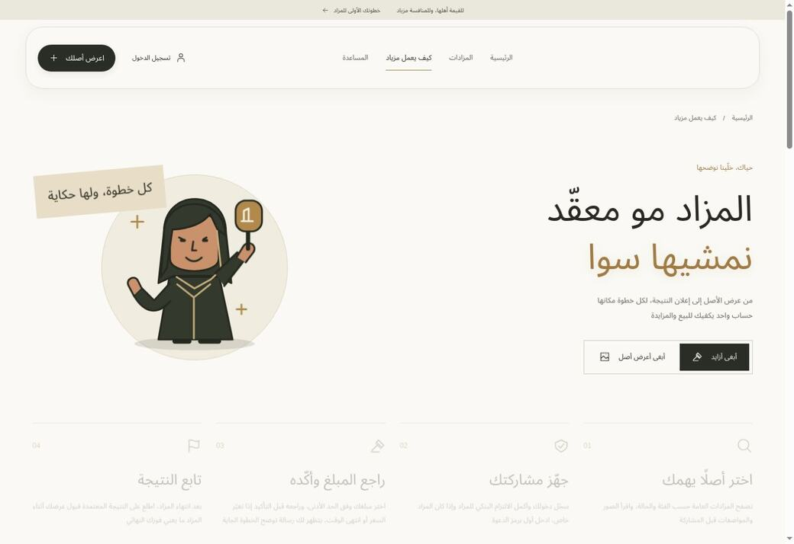
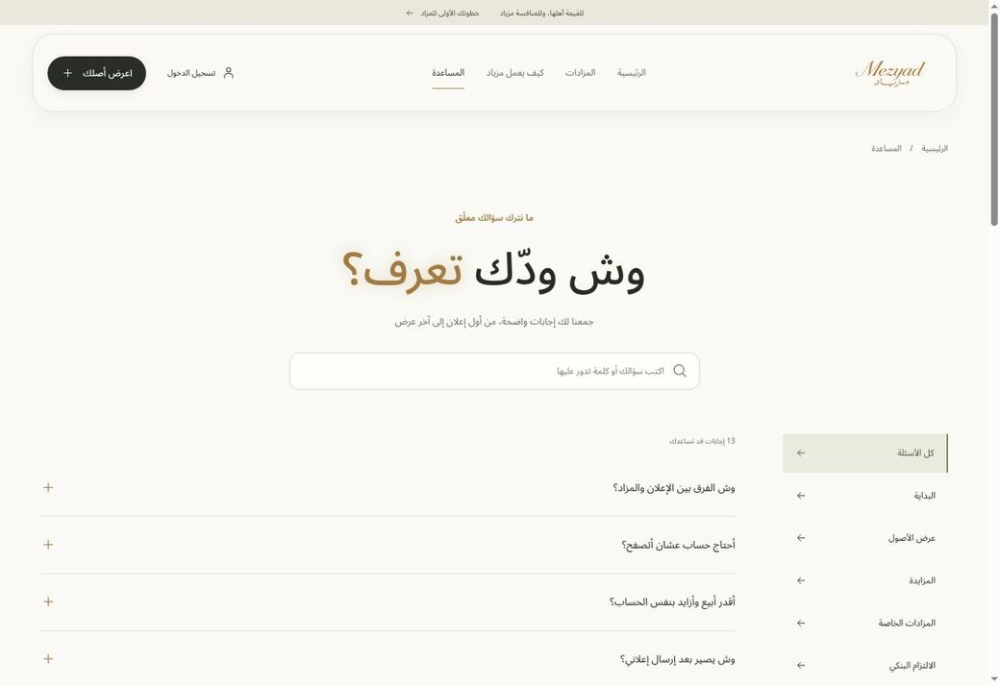

# Build the user guide and help center (FE-19)

**Status** Implemented

## Scope

The Guide explains the seller and bidder journeys in order. The Help page lets visitors look up one specific question by topic or search.

## Implementation

### 1. Show role-specific steps

Guide starts with the bidder journey and uses pressed-state buttons to switch to seller. The selected role drives the illustration and the step cards, while the step descriptions come from the shared data module. [Guide.jsx 8–9](https://github.com/Abeerr0/mezyad/blob/206b127eeb10af66ac115684d2531439a1405766/frontend/src/features/support/pages/Guide/Guide.jsx#L8-L9) · [Guide.jsx 30–72](https://github.com/Abeerr0/mezyad/blob/206b127eeb10af66ac115684d2531439a1405766/frontend/src/features/support/pages/Guide/Guide.jsx#L30-L72) · [site-data.js 126–172](https://github.com/Abeerr0/mezyad/blob/206b127eeb10af66ac115684d2531439a1405766/frontend/src/shared/data/site-data.js#L126-L172)

### 2. Connect explanations to actions

The comparison explains why the public catalog can show one type and why a private auction needs a code. It provides the exploration or invitation action from the same section. The commitment explanation links to the relevant help topic. [Guide.jsx 74–122](https://github.com/Abeerr0/mezyad/blob/206b127eeb10af66ac115684d2531439a1405766/frontend/src/features/support/pages/Guide/Guide.jsx#L74-L122)

### 3. Make the FAQ searchable and linkable

Help resolves the topic from its route and matches the search string against question and answer text. The count updates with results, and native details elements reveal individual answers. The no-results view offers a way to reset the search and topic. [App.jsx 348–351](https://github.com/Abeerr0/mezyad/blob/206b127eeb10af66ac115684d2531439a1405766/frontend/src/app/App.jsx#L348-L351) · [Help.jsx 7–23](https://github.com/Abeerr0/mezyad/blob/206b127eeb10af66ac115684d2531439a1405766/frontend/src/features/support/pages/Help/Help.jsx#L7-L23) · [Help.jsx 55–104](https://github.com/Abeerr0/mezyad/blob/206b127eeb10af66ac115684d2531439a1405766/frontend/src/features/support/pages/Help/Help.jsx#L55-L104)

## UI/UX

| Page or component | Frontend file | What the user sees and does |
| --- | --- | --- |
| Guide | `Guide.jsx` | Switch between bidder and seller steps and read a short explanation of each stage. |
| Public/private comparison | `Guide.jsx` | Understand who can enter each type and use the relevant link or invitation action. |
| Help Center | `Help.jsx` | Filter questions by topic, search question and answer text and expand individual answers. |
| Help content | `site-data.js` | Provide the written question groups and journey steps displayed in the two views. |

### Page screenshot

*Guide showing the role switcher and the start of the journey steps.*

### Related screen

*Help Center with the search field and controls for browsing question categories.*

## Testing & Evidence

| Scenario | Result | Evidence |
| --- | --- | --- |
| Open the Guide and Help Center | Observed on deployed desktop | Captures above |
| Switch both journeys and check instructions and links | Checked in source; full browser run pending | [Guide.jsx 30–72](https://github.com/Abeerr0/mezyad/blob/206b127eeb10af66ac115684d2531439a1405766/frontend/src/features/support/pages/Guide/Guide.jsx#L30-L72) |
| Search within a topic and reset after zero results | Checked in source; full browser run pending | [Help.jsx 17–23](https://github.com/Abeerr0/mezyad/blob/206b127eeb10af66ac115684d2531439a1405766/frontend/src/features/support/pages/Help/Help.jsx#L17-L23) · [Help.jsx 68–104](https://github.com/Abeerr0/mezyad/blob/206b127eeb10af66ac115684d2531439a1405766/frontend/src/features/support/pages/Help/Help.jsx#L68-L104) |

## Suggested follow-up

Verify representative Arabic searches with and without a topic. Check the accordion and role switcher with the keyboard on a narrow viewport.

[Stage 4 task requirements](https://app.notion.com/p/90d3ecedbaba461cbe3ce7933a409788?v=f0ebf28bea9144329e41627e5631ff57)
