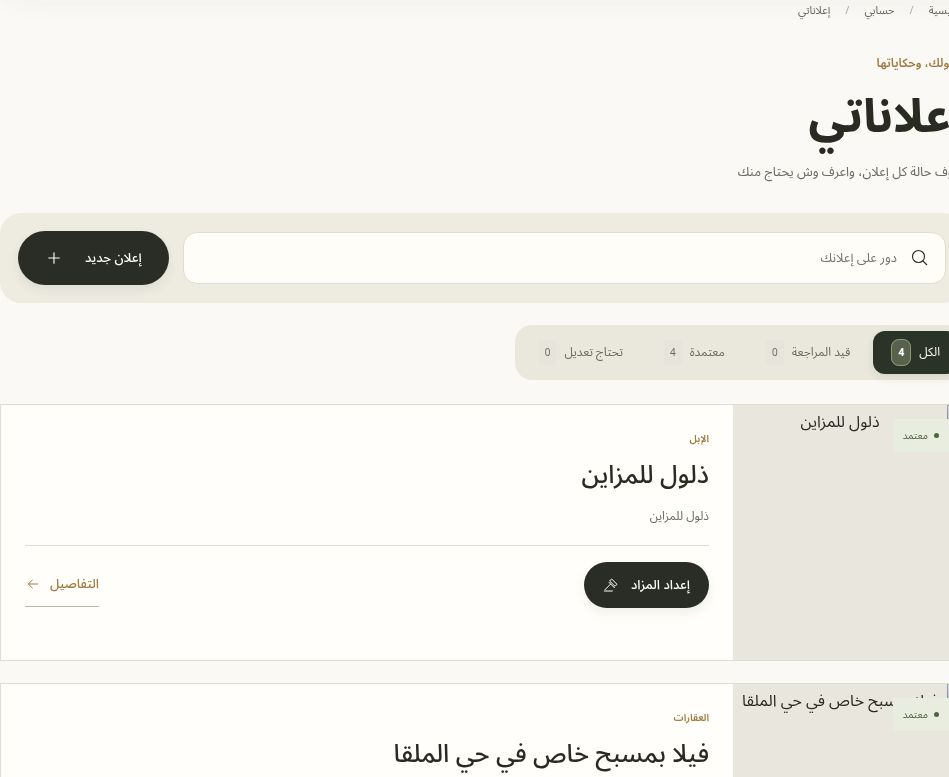

# Integrate frontend data and session handling (FE-20)

**Status** Implemented

## Scope

The frontend uses shared request, account and market helpers to connect UI views to the existing API. This task covers how the frontend consumes the API and manages sessions and refreshes.

## Implementation

### 1. Share the request boundary

The client sends the bearer token when present, keeps FormData intact and serializes JSON bodies. It checks the content type and response data envelope before returning a result. The caller receives a different error for network failure, a rejected request or a write whose outcome is uncertain. [client.js 53–132](https://github.com/Abeerr0/mezyad/blob/206b127eeb10af66ac115684d2531439a1405766/frontend/src/shared/api/client.js#L53-L132)

### 2. Maintain the session and account state

Login validates the returned session, stores it in sessionStorage and exposes it to workspace. Logout clears it after the API call. Protected workspace calls clear a session on 401. Account data loads with the session token and uses an abort controller during cleanup. [useWorkspace.js 64–103](https://github.com/Abeerr0/mezyad/blob/206b127eeb10af66ac115684d2531439a1405766/frontend/src/features/account/hooks/useWorkspace.js#L64-L103) · [useWorkspace.js 104–161](https://github.com/Abeerr0/mezyad/blob/206b127eeb10af66ac115684d2531439a1405766/frontend/src/features/account/hooks/useWorkspace.js#L104-L161) · [useWorkspace.js 178–199](https://github.com/Abeerr0/mezyad/blob/206b127eeb10af66ac115684d2531439a1405766/frontend/src/features/account/hooks/useWorkspace.js#L178-L199)

### 3. Keep catalog and market data fresh

The shared refresh hook schedules a check every two minutes and skips hidden tabs and active form or dialog contexts. Catalog fetches ignore an aborted or superseded response. Auction detail uses a separate loop and schedules the next request after the current one finishes, with optional bid and commitment reads. [useAutoRefresh.js 5–33](https://github.com/Abeerr0/mezyad/blob/206b127eeb10af66ac115684d2531439a1405766/frontend/src/shared/hooks/useAutoRefresh.js#L5-L33) · [App.jsx 93–103](https://github.com/Abeerr0/mezyad/blob/206b127eeb10af66ac115684d2531439a1405766/frontend/src/app/App.jsx#L93-L103) · [App.jsx 128–205](https://github.com/Abeerr0/mezyad/blob/206b127eeb10af66ac115684d2531439a1405766/frontend/src/app/App.jsx#L128-L205) · [useMarket.js 368–455](https://github.com/Abeerr0/mezyad/blob/206b127eeb10af66ac115684d2531439a1405766/frontend/src/features/auctions/hooks/useMarket.js#L368-L455)

## UI/UX

| Page or component | Frontend file | What the user sees and does |
| --- | --- | --- |
| Sign-in and session | `useWorkspace.js` | Start a session, restore it in the same tab and clear it on logout or an unauthorized account request. |
| Catalog and account data | `App.jsx`, `useWorkspace.js` | Load catalog filters and account records with clear loading and request feedback. |
| Auction data and refresh | `useMarket.js`, `useAutoRefresh.js` | Refresh auction data and skip scheduled refreshes in conditions defined by each helper. |
| Request feedback | `client.js` | Map response codes and connection failures to understandable UI messages. |

### Page screenshot

*My Listings as a visible consumer of authenticated workspace data. The screenshot illustrates the interface served by the integration.*

## Testing & Evidence

| Scenario | Result | Evidence |
| --- | --- | --- |
| Account signs in and requires sign-in again after logout | Pass in the team’s recorded browser run | [E2E_Report.md 23–33](https://github.com/Abeerr0/mezyad/blob/206b127eeb10af66ac115684d2531439a1405766/Stage_4/E2E_Report.md#L23-L33) |
| Frontend distinguishes empty data from network failure | Pass in the prior simulated response run | [AS08_States.md 9–20](https://github.com/Abeerr0/mezyad/blob/206b127eeb10af66ac115684d2531439a1405766/Stage_4/AS08_States.md#L9-L20) |
| Restore session after refresh and check timer cleanup across navigation | Dedicated browser check pending | [useWorkspace.js 64–86](https://github.com/Abeerr0/mezyad/blob/206b127eeb10af66ac115684d2531439a1405766/frontend/src/features/account/hooks/useWorkspace.js#L64-L86) · [useMarket.js 424–451](https://github.com/Abeerr0/mezyad/blob/206b127eeb10af66ac115684d2531439a1405766/frontend/src/features/auctions/hooks/useMarket.js#L424-L451) |

## Suggested follow-up

Add a regression test that reloads a signed-in tab, then expires its session. Separately check that background refresh does not interrupt editing or retain an obsolete route request.

[Stage 4 task requirements](https://app.notion.com/p/90d3ecedbaba461cbe3ce7933a409788?v=f0ebf28bea9144329e41627e5631ff57)
