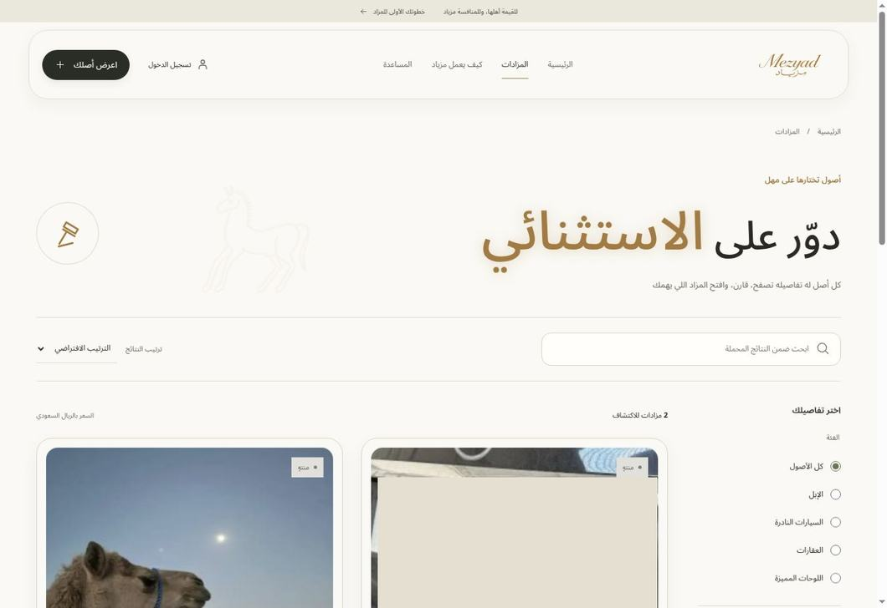

# Build shared frontend components and design styles (FE-21)

**Status** Implemented

## Scope

The shared UI gives forms, auction cards, dialogs and feedback a consistent structure. Shared styling supports Arabic typography, branded surfaces and layouts that reflow on smaller screens.

## Implementation

### 1. Reuse controls across features

Shared Button and Icon provide common action primitives. AuctionCard combines images, status, pricing and a details action. The shared exports keep these components available to pages without scattering their implementation. [Button.jsx 4–10](https://github.com/Abeerr0/mezyad/blob/206b127eeb10af66ac115684d2531439a1405766/frontend/src/shared/ui/Button.jsx#L4-L10) · [Icon.jsx 1–40](https://github.com/Abeerr0/mezyad/blob/206b127eeb10af66ac115684d2531439a1405766/frontend/src/shared/ui/Icon.jsx#L1-L40) · [AuctionCard.jsx 5–102](https://github.com/Abeerr0/mezyad/blob/206b127eeb10af66ac115684d2531439a1405766/frontend/src/shared/ui/AuctionCard.jsx#L5-L102) · [index.jsx 1–10](https://github.com/Abeerr0/mezyad/blob/206b127eeb10af66ac115684d2531439a1405766/frontend/src/shared/ui/index.jsx#L1-L10)

### 2. Give forms and data consistent behavior

PasswordField stores visibility locally. The dialog uses native dialog behavior and restores focus when it closes. StatePanel provides loading and retry states, and the formatters handle currency amounts and Riyadh dates. [PasswordField.jsx 11–34](https://github.com/Abeerr0/mezyad/blob/206b127eeb10af66ac115684d2531439a1405766/frontend/src/shared/ui/PasswordField.jsx#L11-L34) · [Modal.jsx 4–39](https://github.com/Abeerr0/mezyad/blob/206b127eeb10af66ac115684d2531439a1405766/frontend/src/shared/ui/Modal.jsx#L4-L39) · [StatePanel.jsx 5–36](https://github.com/Abeerr0/mezyad/blob/206b127eeb10af66ac115684d2531439a1405766/frontend/src/shared/ui/StatePanel.jsx#L5-L36) · [formatters.js 1–19](https://github.com/Abeerr0/mezyad/blob/206b127eeb10af66ac115684d2531439a1405766/frontend/src/shared/ui/formatters.js#L1-L19)

### 3. Carry typography, responsive layout and motion through the site

Shared typography defines the Arabic font. The layout changes at breakpoints so the catalog tools and cards remain usable on narrower screens. The stylesheet also includes reduced-motion behavior for users who prefer it. [typography.css 1–22](https://github.com/Abeerr0/mezyad/blob/206b127eeb10af66ac115684d2531439a1405766/frontend/src/shared/styles/typography.css#L1-L22) · [global.css 1539–1598](https://github.com/Abeerr0/mezyad/blob/206b127eeb10af66ac115684d2531439a1405766/frontend/src/shared/styles/global.css#L1539-L1598) · [global.css 1751–1798](https://github.com/Abeerr0/mezyad/blob/206b127eeb10af66ac115684d2531439a1405766/frontend/src/shared/styles/global.css#L1751-L1798) · [global.css 1934–1949](https://github.com/Abeerr0/mezyad/blob/206b127eeb10af66ac115684d2531439a1405766/frontend/src/shared/styles/global.css#L1934-L1949)

## UI/UX

| Page or component | Frontend file | What the user sees and does |
| --- | --- | --- |
| Action controls | `Button.jsx`, `Icon.jsx` | Recognize common actions through consistent button styling and icons. |
| Auction cards and illustrations | `AuctionCard.jsx`, `Auctioneer.jsx` | See a consistent card structure for featured and catalog items and reuse branded characters where they clarify a state or action. |
| Form and dialog controls | `PasswordField.jsx`, `Modal.jsx` | Toggle password visibility and use focused dialogs with close behavior. |
| Feedback and formatting | `StatePanel.jsx`, `formatters.js` | Recognize loading and failed requests, and read prices and times in consistent formats. |
| Shared CSS and exports | `global.css`, `typography.css`, `index.jsx` | Use common styles and imports across features, with responsive layout and motion preferences. |

### Page screenshot

*The catalog demonstrates shared cards, status markers, icon styles and the common typography. The plate identifier is obscured.*

## Testing & Evidence

| Scenario | Result | Evidence |
| --- | --- | --- |
| Shared auction card and image render | Pass in the recorded component/API run | [fe13-abeer.txt 9–14](https://github.com/Abeerr0/mezyad/blob/206b127eeb10af66ac115684d2531439a1405766/Stage_4/evidence/fe13-abeer.txt#L9-L14) |
| Loading, empty and failed requests are distinguishable | Pass in the prior simulated React run | [AS08_States.md 9–20](https://github.com/Abeerr0/mezyad/blob/206b127eeb10af66ac115684d2531439a1405766/Stage_4/AS08_States.md#L9-L20) |
| Keyboard focus, reduced motion and responsive layout across all shared components | Dedicated visual and accessibility checks pending | [Modal.jsx 4–26](https://github.com/Abeerr0/mezyad/blob/206b127eeb10af66ac115684d2531439a1405766/frontend/src/shared/ui/Modal.jsx#L4-L26) · [global.css 1934–1949](https://github.com/Abeerr0/mezyad/blob/206b127eeb10af66ac115684d2531439a1405766/frontend/src/shared/styles/global.css#L1934-L1949) |

## Suggested follow-up

Run a focused visual and keyboard review for the common components across phone and desktop widths. Include a dialog open/close cycle, a missing image and a network error.

[Stage 4 task requirements](https://app.notion.com/p/90d3ecedbaba461cbe3ce7933a409788?v=f0ebf28bea9144329e41627e5631ff57)
