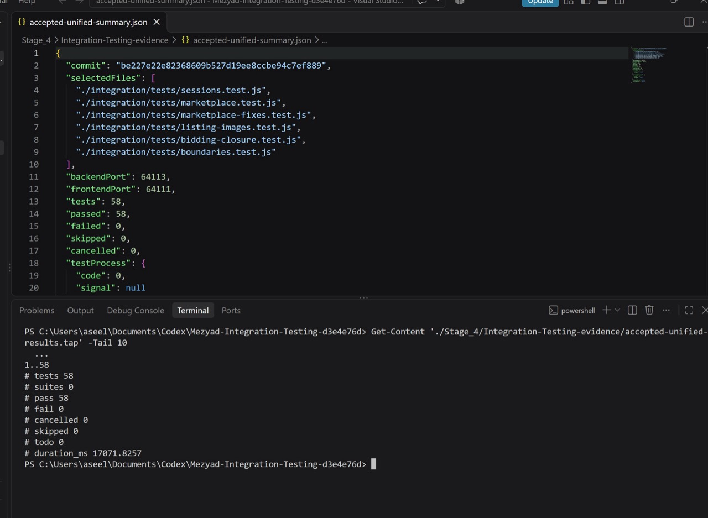
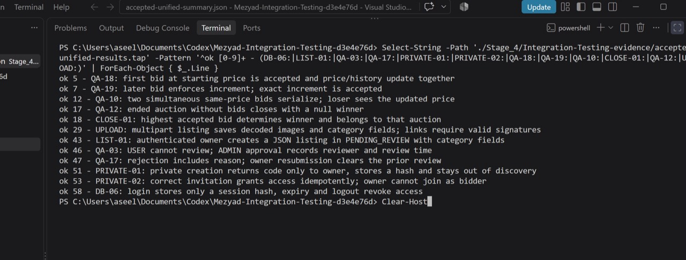
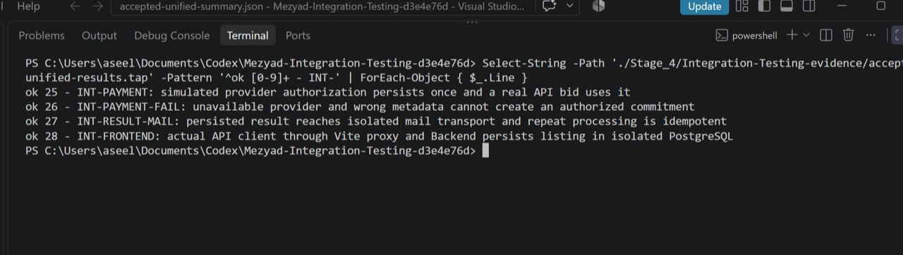

# Mezyad Integration Testing Report

Prepared by: Aseel Al-Zahrani  
Project: Mezyad  
Stage: Stage 4  
Date: November 24, 2026

## 1. Introduction

Integration testing is an essential part of software testing that ensures different system components work together correctly.

In Mezyad, integration testing was performed to verify communication between the frontend, backend, database, and supporting services across the main auction workflows.

## 2. What is Integration Testing?

Integration testing is a software testing technique used to verify interactions between connected system components.

Unlike unit testing, which focuses on individual components, integration testing checks whether multiple components exchange data and work together as expected.

## 3. Objective

Verify that Mezyad’s integrated components communicate correctly, enforce business rules, and maintain consistent data throughout the main auction workflows.

## 4. How Integration Testing Works

The integration testing process included the following steps:

1. Prepare an isolated testing environment.
2. Configure the frontend, backend, and test database.
3. Prepare independent test accounts and test data.
4. Execute requests through connected system components.
5. Compare actual responses and stored data with expected results.
6. Investigate test failures and correct test preparation issues.
7. Perform a final unified execution and document the results.

## 5. Test Environment

Testing was performed locally using an independent copy of the Mezyad project.

| Component | Configuration |
| --- | --- |
| Branch | Development |
| Application commit | be227e2 |
| Frontend | React and Vite |
| Backend | Node.js and Express |
| Database | Isolated PostgreSQL database |
| Testing tool | Node.js test runner |
| Payment integration | Moyasar — isolated simulation |
| Email integration | Isolated mail transport |
| Development environment | Visual Studio Code |

The commit identifies the application version under test. Integration test preparation and supporting test files were added locally to the independent copy.

The testing environment was isolated from the team’s shared database and original project. No real payments or external emails were sent during testing.

## 6. Integration Testing in Mezyad

The following areas were covered:

* Authentication and authorization.
* Email verification and session management.
* User and administrator permissions.
* Listing creation and image uploads.
* Listing rejection, editing, resubmission, and approval.
* Public and private auctions.
* Private auction access and invitation codes.
* Bid validation and concurrent bidding.
* Financial commitment and payment authorization.
* Auction closure and winner determination.
* Auction result notification processing.
* Frontend API client, backend, and database communication.

## 7. Results Summary

| ID | Test area | Status |
| --- | --- | --- |
| INT-01 | Authentication and session management | Pass |
| INT-02 | User and administrator authorization | Pass |
| INT-03 | Listing management and image uploads | Pass |
| INT-04 | Public and private auctions | Pass |
| INT-05 | Bidding and concurrency | Pass |
| INT-06 | Financial commitment integration | Pass |
| INT-07 | Auction closure and results | Pass |
| INT-08 | Email notification integration | Pass |
| INT-09 | Frontend, backend, and database integration | Pass |

The identifiers INT-01 through INT-09 are report categories used to organize test coverage. They do not represent the individual names of the 58 executed tests.

### Final Test Run

| Metric | Result |
| --- | --- |
| Total tests | 58 |
| Passed | 58 |
| Failed | 0 |
| Skipped | 0 |
| Cancelled | 0 |
| Pass rate | 100% |
| Test process exit code | 0 |
| Service process exit code | 0 |

All 58 integration tests passed in a single unified execution. The test runner and testing services exited normally.

## 8. Test Scenarios

### INT-01: Authentication and Session Management

Preconditions: Authentication services and an isolated test database are available.

Test coverage:

* Account authentication and email verification.
* Session storage and access.
* Session expiration and logout.

Expected: Valid authentication establishes an authorized session. Expired or revoked sessions cannot access protected resources.

Actual result: Authentication, email verification, session management, and logout tests passed.

### INT-02: User and Administrator Authorization

Preconditions: User and administrator test accounts are available.

Test coverage:

* Attempt administrator review operations using a regular user account.
* Perform authorized listing review operations.
* Verify recorded review information.

Expected: Unauthorized users cannot perform administrator operations. Authorized review operations are recorded correctly.

Actual result: User restrictions and administrator review operations passed the integration tests.

### INT-03: Listing Management and Image Uploads

Preconditions: Authenticated test accounts and listing data are available.

Test coverage:

* Listing creation and category information.
* Listing image uploads.
* Listing rejection and rejection reasons.
* Listing editing and resubmission.
* Administrator approval.

Expected: Listing information, images, and review states remain consistent across the relevant system components.

Actual result: All covered listing management and image upload tests passed.

These operations were verified through separate integration tests rather than a single complete workflow involving the same listing.

### INT-04: Public and Private Auctions

Preconditions: Auction test data and independent test accounts are available.

Test coverage:

* Public and private auction behavior.
* Private auction visibility.
* Invitation code validation.
* Auction access permissions.

Expected: Private auctions are protected from unauthorized access. Invalid invitation codes are rejected without granting access.

Actual result: Public and private auction tests passed. Invalid invitation codes submitted through /auctions/access returned 403 INVALID_CODE without granting access.

### INT-05: Bidding and Concurrency

Preconditions: Active auctions and eligible bidder accounts are available.

Test coverage:

* Valid bid submission.
* Minimum bid increment validation.
* Concurrent bidding requests.
* Auction price and bid history consistency.

Expected: Valid bids are accepted, invalid bids are rejected, and concurrent requests maintain consistent auction data.

Actual result: Bid validation, concurrent bidding, and auction data consistency tests passed.

### INT-06: Financial Commitment Integration

Preconditions: An isolated Moyasar simulation and eligible bidder accounts are available.

Test coverage:

* Simulated payment authorization.
* Financial commitment storage and bidding integration.
* Invalid payment metadata.
* Missing Moyasar API key configuration.

Expected: Valid simulated authorization supports bidding. Invalid payment information is rejected, and missing payment configuration prevents the operation.

Actual result: Financial commitment and bidding integration tests passed. Invalid payment metadata was rejected with 403 PAYMENT_MISMATCH. Removing the Moyasar API key configuration resulted in a 503 response.

The missing configuration test did not simulate or verify an actual outage of the external Moyasar service.

### INT-07: Auction Closure and Results

Preconditions: Auctions with and without bids are available in the test database.

Test coverage:

* Auction closure with accepted bids.
* Winner determination.
* Auction closure without bids.
* Repeated auction closure processing.

Expected: The highest accepted bid determines the winner. Auctions without bids close without a winner, and repeated processing maintains consistent results.

Actual result: Auction closure, winner determination, and no-bid result tests passed.

### INT-08: Email Notification Integration

Preconditions: An isolated mail transport and an auction without bids are available.

Test coverage:

* Process the result of an auction that closed without bids.
* Verify the seller’s result notification through the isolated mail transport.
* Verify protection against duplicate notification processing.

Expected: The seller’s result notification is processed through the isolated mail transport without duplicate notifications.

Actual result: Seller notification processing and duplicate prevention passed.

This test does not establish actual external email delivery or verify winner email notifications.

### INT-09: Frontend, Backend, and Database Integration

Preconditions: The frontend proxy, backend, and isolated PostgreSQL database are available.

Test coverage:

* Execute a request using the actual frontend API client within Node.js.
* Route the request through the Vite proxy to the backend.
* Verify listing data persistence in PostgreSQL.

Expected: The frontend API client communicates successfully with the backend, and listing data is stored correctly in the database.

Actual result: Integration between the frontend API client, Vite proxy, backend, and isolated PostgreSQL database passed.

This test verifies API-level integration and does not include interaction with React pages in a browser.

## 9. What We Learned

During integration testing, we learned that:

* Individual components must be tested together to verify their interactions.
* Isolated testing environments protect shared project data.
* Independent test accounts prevent interference between test scenarios.
* Test expectations must match the current API contract.
* Concurrent operations require verification to maintain data consistency.
* External services can be simulated to verify internal integration safely.
* A unified test execution helps identify dependencies between test scenarios.
* Successful integration testing requires reliable test preparation and proper resource cleanup.

## 10. Screenshots

### Figure 1: Final Integration Test Results

The final unified execution shows 58 passed tests, zero failures, zero skipped tests, and successful exit codes.

### Figure 2: Core Mezyad Integration Scenarios

Selected successful integration tests covering authentication, authorization, listing management, auctions, bidding, and auction closure.

### Figure 3: System and Service Integration

Successful integration tests covering simulated financial commitment, isolated seller notification processing, and frontend API client, backend, and database communication.

## 11. Supporting Evidence

The following files contain the final unified execution evidence:

* [Complete test results](Integration-Testing-evidence/accepted-unified-results.tap)
* [Execution summary](Integration-Testing-evidence/accepted-unified-summary.json)
* [Test execution command](Integration-Testing-evidence/accepted-unified-command.txt)

## 12. Scope and Limitations

* The results apply to the application code at Development commit be227e2 and the locally prepared integration test suite.
* Moyasar and email integration were tested using isolated simulations.
* Live payment transactions and external email delivery were not verified.
* Open Banking was outside the agreed testing scope because the project uses Moyasar.
* Browser-based React page interactions were outside the scope of the API-level integration test.
* Passing all executed tests does not guarantee that the entire application is free of defects.

## 13. Conclusion

Integration testing successfully verified the tested interactions between Mezyad’s main system components and supporting services within an isolated environment.

All 58 integration tests passed in the final unified execution, with zero failed, skipped, or cancelled tests. The test runner and testing services exited successfully.

These results provide evidence that the tested component interactions and auction workflows operate as expected within the defined integration testing scope.