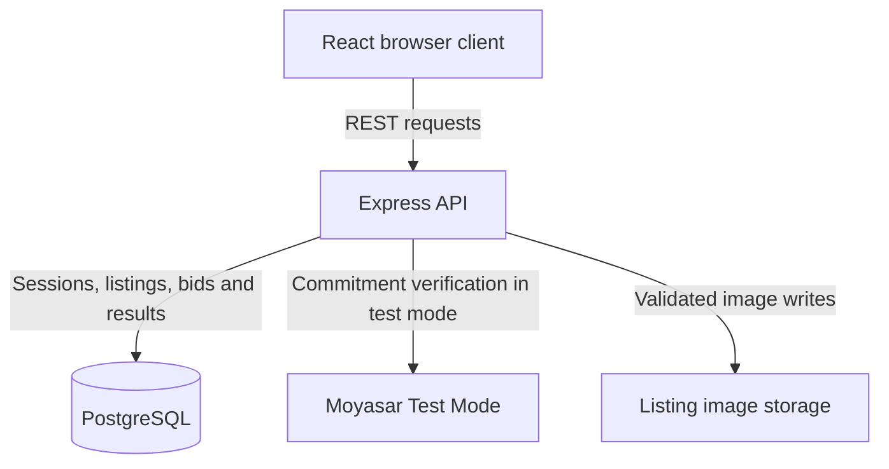
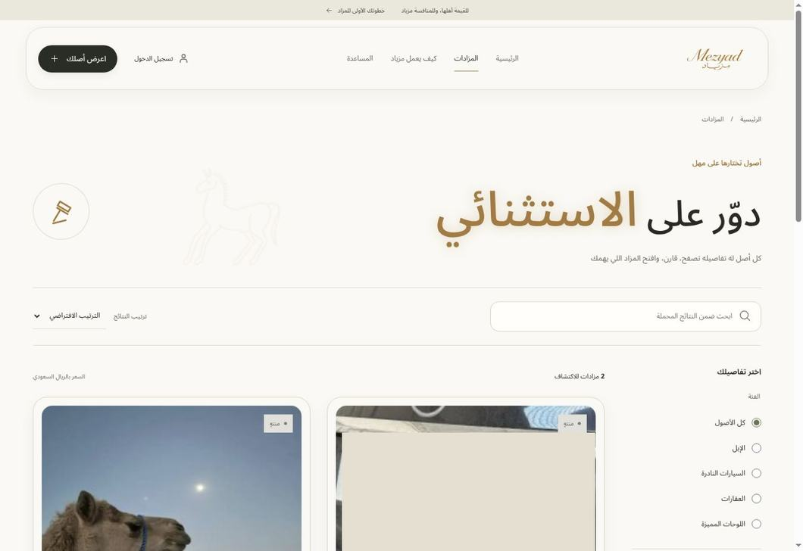
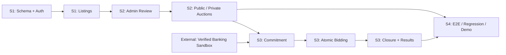
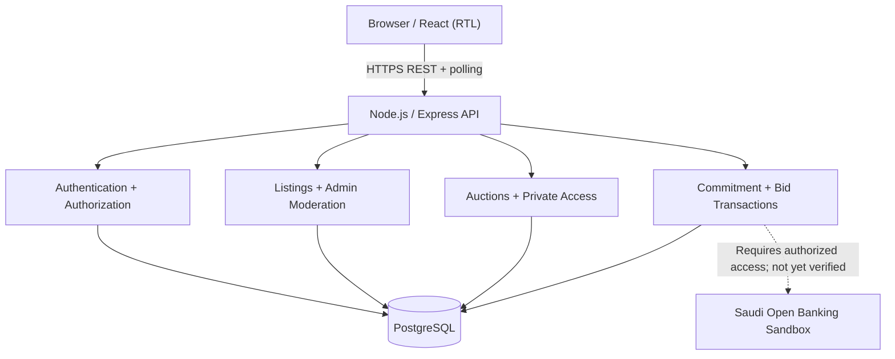
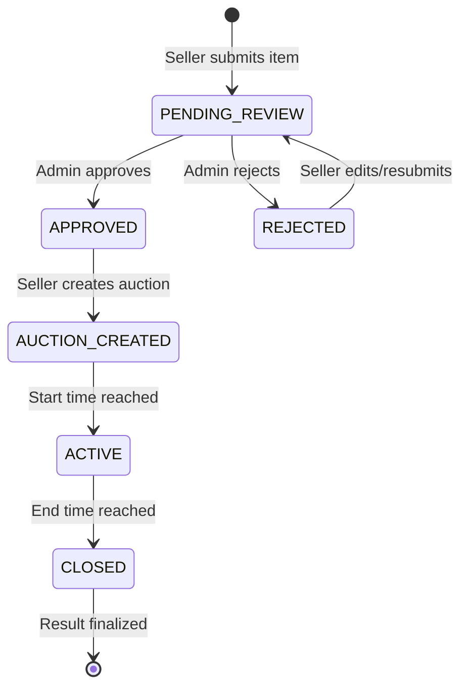
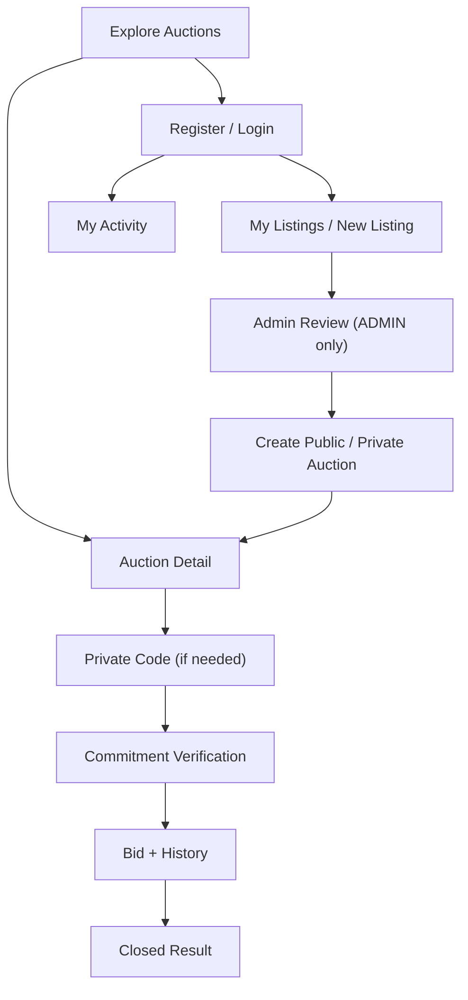

# Mezyad | Stage 4 Delivery Report

**Holberton School · Portfolio Project · MVP Development and Execution**

| Project information | Details |
| --- | --- |
| Product | Mezyad, an Arabic digital auction platform for public and invitation-only auctions |
| Team | Abeer Al-Saiari, Ghadi Al-Zahrani, Aseel Al-Zahrani, Tala Al-Hudaibi |
| Live MVP | [mezyad1.com](https://mezyad1.com/) |
| Source and design baseline | [Development branch](https://github.com/Abeerr0/mezyad/tree/Development) · [Stage 3 technical report](../Stage_3/Report.MD) |
| Stage 4 navigation | [Stage 4 README](README.md) · [Task reports and screenshots](Abeer-Task-Reports/) |

## Executive Summary

Mezyad connects three workflows. A seller submits an asset listing for review. An administrator approves it or returns it with a reason. An eligible bidder can take part in the resulting auction and follow its outcome. A single User account can sell and bid on different auctions.

Ghadi Al-Zahrani’s deployed-browser report records five passing journeys covering account access, listing resubmission, public and private auctions, and closure without bids. The commitment steps in that run used Moyasar Test Mode. Abeer Al-Saiari’s reports trace the implementation across the React interface, Express endpoints and PostgreSQL. They identify which conclusions come from code review, prior testing and deployed observations. [Ghadi’s browser test report](E2E_Report.md) · [Abeer’s task reports](Abeer-Task-Reports/)

| Delivery area | Read in this report |
| --- | --- |
| Task 0 · Plan and define sprints | [Sprint plan, ownership and dependencies](#task-0-sprint-planning) |
| Task 1 · Execute development tasks | [Implemented workflows and source control](#task-1-development-and-source-control) |
| Task 2 · Monitor progress and adjust | [Progress and decisions](#task-2-progress-and-adjustments) |
| Task 3 · Conduct sprint reviews and retrospectives | [Demos and review records](#task-3-sprint-reviews-and-retrospectives) |
| Task 4 · Final integration and QA testing | [Test results, evidence and defects](#task-4-integration-and-qa) |
| Task 5 · Final deliverables | [Delivery checklist and evidence](#task-5-deliverables) |
| Deployment and demo | [Live site, hosting and domain](#deployment-and-demo) |
| Earlier report | [Original implementation snapshot](#original-implementation-snapshot) |

### Project Records in Notion

The task board tracks assignments and status. The weekly workspace holds the team’s Stage 4 progress records.

- [Stage 4 task board](https://app.notion.com/p/90d3ecedbaba461cbe3ce7933a409788?v=f0ebf28bea9144329e41627e5631ff57&source=copy_link)
- [Stage 4 weekly workspace link](https://app.notion.com/p/Mezyad-Stage-4-4020bc42a08081198a73f34924d1cb71?source=copy_link)

## Task 0 Sprint Planning

The plan called for four one-week iterations. The checkpoints below are relative to the sprint sequence. Calendar dates and individual commitment dates should be taken from the team’s records when documented.

| Sprint | Planned outcome | Planned contributors | Dependency and acceptance checkpoint |
| --- | --- | --- | --- |
| S1 · Foundation | Create the PostgreSQL schema and seed data, set up the app, and deliver registration, login and initial listings. Begin provider research. | Abeer and Tala on database work, Abeer and Ghadi on API work, Abeer on user-facing screens, Aseel on the admin interface | Schema and connection setup precede authenticated actions. Demonstrate sign-in and a saved listing. |
| S2 · Marketplace | Review listings, create auctions from approved items, and support private invitations. | Abeer and Ghadi on API work, Abeer on user-facing screens, Aseel on the admin interface, Tala on QA | S1 sessions and listings precede admin review. Demonstrate approval, auction creation and private access checks. |
| S3 · Bid integrity | Connect commitment verification, bid eligibility, history and closure. | Abeer and Ghadi on API work, Abeer and Tala on bid integrity, Tala and Aseel on QA | S2 auctions and provider test access precede the full bidding journey. Check valid and rejected bids and the saved outcome. |
| S4 · Integration | Exercise public and private journeys, review defects and prepare the demo. | Entire team, with Tala and Aseel listed as QA leads in the plan | Integrate the preceding workflows. Collect repeatable browser scenarios and defect evidence. |

The plan treats accounts, listings, moderation, public and private auctions, commitment, bid integrity and results as **Must**. Usability improvements, accessibility and broader regression coverage are **Should**. Additional UX polish follows the core flows. Real transfers, escrow, KYC, anti-sniping and real-time push updates were deferred for this MVP. [Stage 3 baseline](../Stage_3/Report.MD) · [Notion task board](https://app.notion.com/p/90d3ecedbaba461cbe3ce7933a409788?v=f0ebf28bea9144329e41627e5631ff57&source=copy_link)

| Responsibility | What the role covers | Evidence to reference |
| --- | --- | --- |
| Project Manager | Sprint goals, assignments, dependencies, deadlines and decisions when work changes. | Notion task board and dated team records. |
| Source Control Manager | Branch coordination, review and integration evidence. | Development history and the relevant PR or review for each delivery. |
| Quality Assurance | Expected outcomes, test execution, defect triage and retest evidence. | E2E report, technical test reports and Bug Tracker. |
| Technical contributors | Frontend, backend and database implementation, with task-level acceptance evidence. | Task assignment records and relevant task reports. |

The table describes responsibilities. Named formal PM and SCM assignments should come from the team records.

## Task 1 Development and Source Control

### Implemented Workflows

| Workflow | What was delivered | Detailed reports |
| --- | --- | --- |
| Account access | Registration, email verification and sign-in connect the UI to the session API. | Abeer’s [FE-01](Abeer-Task-Reports/FE-01.md), [FE-02](Abeer-Task-Reports/FE-02.md) and [DB-06](Abeer-Task-Reports/DB-06.md) · Ghadi’s [E2E-01](E2E_Report.md#e2e-01-registration-verification-sign-in-and-sign-out) |
| Listings and moderation | The seller submits an item and images. Review metadata records approval or rejection. The owner can revise a rejected item and return it to pending review. | Abeer’s [FE-05](Abeer-Task-Reports/FE-05.md), [FE-06](Abeer-Task-Reports/FE-06.md), [BE-01](Abeer-Task-Reports/BE-01.md), [BE-02](Abeer-Task-Reports/BE-02.md) and [BE-03](Abeer-Task-Reports/BE-03.md) · Ghadi’s [E2E-02](E2E_Report.md#e2e-02-listing-rejection-edit-resubmission-and-approval) |
| Auction creation and access | Approved items can become public or private auctions. The public catalogue and private invitation path apply different access rules. | Abeer’s [FE-03](Abeer-Task-Reports/FE-03.md), [FE-08](Abeer-Task-Reports/FE-08.md) and [DB-04](Abeer-Task-Reports/DB-04.md) · [Auction creation report](Abeer-Task-Reports/FE-07.md) · [API contracts](FE11_API_Contracts.md) |
| Commitment and bidding | The checkout and bank-status views communicate the test authorization state. Eligible bids use the current minimum, update the saved price and enter the history. | Abeer’s [FE-12](Abeer-Task-Reports/FE-12.md), [FE-18](Abeer-Task-Reports/FE-18.md), [BE-04](Abeer-Task-Reports/BE-04.md) and [DB-09](Abeer-Task-Reports/DB-09.md) · Ghadi’s [Moyasar testing report](BE14_Testing.md) |
| Closure and activity | Auction closure records the result, including cases with no winner. Users can navigate to their activity, auctions and bid history. | Abeer’s [FE-10](Abeer-Task-Reports/FE-10.md) and [FE-17](Abeer-Task-Reports/FE-17.md) · [Closure testing](BE15_Testing.md) · Ghadi’s [E2E-05](E2E_Report.md#e2e-05-auction-closes-without-bids) |

### Technical Flow



The database retains the ten core Stage 3 tables. The setup script applies the base schema, later migrations and the category seed. The bid API locks the auction row and saves the accepted bid and price update in the same transaction. The table constraints and the application rules are documented separately in the database reports. [Schema comparison](Abeer-Task-Reports/DB-01.md) · [Setup and seed](Abeer-Task-Reports/DB-07.md) · [Concurrent price updates](Abeer-Task-Reports/DB-09.md)

### Source Control and Traceability

The planned SCM flow is a feature branch, a pull request, a teammate review and integration after checks. The Development history provides commit-level evidence. Link the specific PR, review or CI result where it exists. A commit shows that a change was recorded. A linked review or test result establishes the corresponding acceptance evidence. [Development commits](https://github.com/Abeerr0/mezyad/commits/Development/) · [Pull requests](https://github.com/Abeerr0/mezyad/pulls)

## Task 2 Progress and Adjustments

| Change or blocker | Team response | Evidence and remaining scope |
| --- | --- | --- |
| An official banking sandbox was still pending in the earlier snapshot. | Ghadi documented the provider search and the configuration used to exercise bid rules separately. The later implementation verified commitments through Moyasar Test Mode. | The later report records test authorization outcomes. Access to a separate official Open Banking sandbox is a distinct question. [Earlier provider status](BE14_Status.md) · [Later sandbox tests](BE14_Testing.md) |
| Image handling and listing corrections needed a complete implementation path. | The backend added type and size checks, normalized storage and coordinated image references with listing writes. The deployed E2E exercise later covered rejected listing correction and approval. | Abeer’s [BE-03](Abeer-Task-Reports/BE-03.md) · Ghadi’s [listing E2E](E2E_Report.md#e2e-02-listing-rejection-edit-resubmission-and-approval) |
| An approved test commitment did not appear on the bid screen. | The API path used by the frontend was corrected and the flow was retested locally. | The Bug Tracker records the reproduction, fix commit and local retest. [Bug Tracker](Bug_Tracker.md) |
| Two offers could contend for the same current price. | The implementation serializes writes with a lock on the auction row. The team tracker records a local test-mode check with two equal bids. | The tracker records one accepted offer and one rejection after the minimum changed. Abeer’s later DB-09 review marks its own native PostgreSQL rerun as **Not run**. [Bug Tracker](Bug_Tracker.md) · [DB-09](Abeer-Task-Reports/DB-09.md) |

## Task 3 Sprint Reviews and Retrospectives

| Sprint | Planned demonstration | Available technical evidence |
| --- | --- | --- |
| S1 · Foundation | Register, verify email, sign in and submit an item. | Ghadi’s [account E2E](E2E_Report.md#e2e-01-registration-verification-sign-in-and-sign-out) and Abeer’s [listing API report](Abeer-Task-Reports/BE-01.md). |
| S2 · Marketplace | Review a listing, create an auction and enforce invitation-only access. | Ghadi’s [listing E2E](E2E_Report.md#e2e-02-listing-rejection-edit-resubmission-and-approval) and [private-auction E2E](E2E_Report.md#e2e-04-private-auction-access-bidding-and-result). |
| S3 · Bid integrity | Verify a test commitment, submit competing offers and confirm the outcome. | Ghadi’s [Moyasar test-mode report](BE14_Testing.md), Abeer’s [bid rules](Abeer-Task-Reports/BE-04.md) and the [concurrency evidence notes](Abeer-Task-Reports/DB-09.md). |
| S4 · Integration | Demonstrate public and private journeys, retest fixes and review release readiness. | Ghadi’s [deployed-browser report](E2E_Report.md) and the [Bug Tracker](Bug_Tracker.md). |

The demo evidence above describes what was tested. For a formal review, attach the dated team record with attendees, demonstrated revision, outcome and action owner. For a retrospective, record what to start, stop and continue, and add an owner, due date and way to verify the improvement. Meeting dates, attendance and retrospective decisions are pending evidence in this summary. [Weekly workspace](https://app.notion.com/p/Mezyad-Stage-4-4020bc42a08081198a73f34924d1cb71?source=copy_link)

## Task 4 Integration and QA

### Deployed Browser Results

Ghadi Al-Zahrani recorded these manual cases on the deployed site. Authorization steps used Moyasar Test Mode. The result applies to the scenarios in the report. [Test environment and full results](E2E_Report.md)

| Scenario | Recorded result |
| --- | --- |
| E2E-01 · Account access | **Pass.** Incorrect code rejected, correct code verified the account and sign-out restored the access gate. |
| E2E-02 · Listing correction | **Pass.** The listing was rejected, corrected, resubmitted and approved. |
| E2E-03 · Public auction | **Pass.** A below-minimum bid was rejected, two valid bids were recorded and the losing test hold was released. |
| E2E-04 · Private auction | **Pass.** Wrong code was rejected, valid code opened access and the test authorization, bid and closing result were confirmed. |
| E2E-05 · No bids | **Pass.** The auction closed without a winner and the seller received a matching result email. |

### Additional Checks and Limits

| Evidence layer | What it supports | Source |
| --- | --- | --- |
| Frontend integration | Earlier React component checks used jsdom, an API and temporary PostgreSQL. They cover their stated scope and revisions. | Abeer’s [FE-13](Abeer-Task-Reports/FE-13.md) · [Run log](evidence/fe13-abeer.txt) |
| UI feedback | Earlier simulated responses checked distinct loading, empty and network error states. | [AS-08 report](AS08_States.md) · [State checks](evidence/as08-states.txt) |
| Backend and database | The test inventory maps listing fields, images, sessions, setup and bid behavior to test files and existing results. Tests pending a rerun are labeled. | Abeer’s [BE-05](Abeer-Task-Reports/BE-05.md), [DB-07](Abeer-Task-Reports/DB-07.md) and [DB-09](Abeer-Task-Reports/DB-09.md) |
| Provider and closure | Earlier manual tests record test-hold outcomes, bid rejection and winner or no-winner closure. | [Commitment tests](BE14_Testing.md) · [Closure tests](BE15_Testing.md) |
| Defect verification | The tracker keeps reproduction, environment, fix and retest details. Use it to check outstanding items before stating release acceptance. | [Bug Tracker](Bug_Tracker.md) |

The repository includes backend and frontend lockfiles. Database setup is exposed through the backend’s `npm run db:setup` command. `npm run test:postgres` requires native PostgreSQL and a disposable `TEST_DATABASE_URL` ending in `_test`. Building the frontend is separate from running the browser journeys. [Backend scripts](../backend/package.json) · [Setup script](../backend/scripts/setup-db.js) · [PostgreSQL test runner](../backend/scripts/test-postgres.js) · [Frontend scripts](../frontend/package.json)

## Task 5 Deliverables

| Deliverable | Where to review it |
| --- | --- |
| Sprint goals, responsibilities and dependencies | [Sprint planning](#task-0-sprint-planning) and [Notion records](#project-records-in-notion) |
| Delivery, scope changes and SCM evidence | [Development and source control](#task-1-development-and-source-control) and [Progress and adjustments](#task-2-progress-and-adjustments) |
| Reviews and retrospectives | [Review evidence and meeting records](#task-3-sprint-reviews-and-retrospectives) |
| Test outcomes, defects and issue follow-up | [Integration and QA](#task-4-integration-and-qa) and [Bug Tracker](Bug_Tracker.md) |
| Detailed implementation evidence | [Abeer’s frontend, backend and database reports](Abeer-Task-Reports/) and [Ghadi’s end-to-end report](E2E_Report.md) |
| Platform delivery and demo | [Deployment and demo](#deployment-and-demo) |

## Deployment and Demo

| Item | Documentation |
| --- | --- |
| Public site | [https://mezyad1.com/](https://mezyad1.com/) |
| Render hosting | The team reports using Render. Add the service types, deployed branch or revision, build and start steps, database linkage and deployment screenshot from the team’s settings. |
| GoDaddy domain | The team reports using GoDaddy for the domain. Add the DNS record types, HTTPS verification and a screenshot with private settings excluded. |
| Post-deployment checks | Ghadi’s browser report documents the live product journeys and the payment test mode. [E2E evidence](E2E_Report.md) |

### Product Screens

| Screen | What the capture shows |
| --- | --- |
| [Auction catalogue](Abeer-Task-Reports/screenshots/FE-03.jpg) | Search, category filtering and the public auction cards. See [FE-03](Abeer-Task-Reports/FE-03.md) for the behavior and known edge case. |
| [Listing editor](Abeer-Task-Reports/screenshots/FE-05.jpg) | The category step and the listing progress indicator. See [FE-05](Abeer-Task-Reports/FE-05.md) for form and upload evidence. |
| [Auction result](Abeer-Task-Reports/screenshots/FE-10-result.jpg) | The closed-without-bids result. See [FE-10](Abeer-Task-Reports/FE-10.md) and the corresponding [browser case](E2E_Report.md#e2e-05-auction-closes-without-bids). |



*Catalogue view from the deployed desktop interface. The E2E report provides the separate evidence for auction access and acceptance.*

---

## Original Implementation Snapshot

The original report follows. Its dated observations provide the planning and implementation baseline. Use the sections above and their linked evidence for the later delivery status.

---

# MEZYAD
## STAGE 4 — MVP DEVELOPMENT & SPRINT EXECUTION
**Holberton School | Portfolio Project | Engineering Delivery Report**

| Project | Mezyad — Digital Auction Platform |
|---|---|
| Team | Abeer Al-Saiari · Ghadi Al-Zahrani · Aseel Al-Zahrani · Tala Al-Hudaibi |
| Source of truth | [Stage 3 Technical Report](../Stage_3/Report.MD) |
| Repository | [Mezyad on GitHub](https://github.com/Abeerr0/mezyad) |
| Reporting snapshot | 12 October 2026 |
| Stage | Implementation started — acceptance pending |

> **Reading guide.** This is the main submission document, organized by **Tasks 0–5**. It answers what the team planned, what the repository currently contains, how the work is structured, what constitutes proof of completion, and what remains. **Committed code is not equivalent to tested functionality; templates are not real meeting minutes.** Where no verifiable evidence exists, the report identifies the gap rather than inventing it.

### Executive summary

Mezyad is an auction platform where one registered user can list an asset for sale and bid on other users' auctions. Administrators moderate submitted listings before auction creation. Auctions can be public or private; private participation requires a valid access grant. The bid flow requires commitment verification, minimum-price checks, transactional concurrency control, an immutable bid record, and consistent closure/winner determination. The project intentionally excludes real money movement.

The implementation repository now includes a PostgreSQL ten-table migration, Express routes, token-session authentication, a preliminary React interface, initial automated health-test source, and Stage 4 delivery artifacts. The current system is **not yet an accepted end-to-end MVP**: complete React journeys, secure image uploads, verified banking sandbox integration, live-database QA and sprint meeting evidence remain outstanding.

**Defect evidence:** [Bugs](Bug_Tracker.md).

---

# TASK 0 — PLAN AND DEFINE SPRINTS

## 0.1 Sprint strategy

The team follows **four one-week sprints** consistent with Stage 3 §8.1. Each sprint has a business outcome, acceptance scenario, owner, dependency and review gate. Calendar start/end dates require team confirmation; “Week 1” etc. describe relative sequencing, not invented past dates.

| Sprint | Goal | Deliverable / demo scenario | Primary ownership | Gate |
|---|---|---|---|---|
| **S1: Foundation** | Make persistence and account identity possible | Apply PostgreSQL schema; register, log in and save a listing | Abeer + Tala (DB), Abeer + Ghadi (API), Abeer (user-facing UI), Aseel (admin UI) | Clean migration + tested authenticated request |
| **S2: Marketplace** | Connect moderation to auction publication | Seller submits → admin reviews → approved listing becomes public/private auction | Abeer + Ghadi (API), Abeer (user-facing UI), Aseel (admin UI), Tala (QA) | Unauthorized admin access denied; private code enforced |
| **S3: Bid integrity** | Ensure eligible bids are correct under concurrency | Verified commitment → bid → history → closure/result | Abeer + Ghadi (API), Abeer + Tala (DB), Tala + Aseel (QA) | Competing bids serialized, duplicate request rejected, correct winner |
| **S4: Integration** | Prove complete, usable workflows | Public/private browser E2E, negative tests, bug fixes, demo | Entire team; Tala + Aseel QA lead | Reproducible test report, no critical defects |

### Sprint dependency map



## 0.2 MoSCoW prioritization

| Priority | Requirements | Decision rationale |
|---|---|---|
| **Must** | Auth + User/Admin access, listings, approval, public/private auctions, code-gated private access, verified commitment, safe bidding, closure/results, React flows, PostgreSQL, tests | Core auction journey and Stage 3 contract |
| **Must / externally blocked** | Real authorized Saudi Open Banking sandbox operation | Requires actual provider access and confirmed API; cannot be simulated as a successful integration |
| **Should** | Clear UI states, input feedback, accessibility, pagination, automated regression depth | Reliability and demonstrability |
| **Could** | Additional UX refinement | After Must features |
| **Won't this stage** | Anti-sniping, Redis, WebSockets, escrow, real transfers, real KYC, blockchain, handover | Not part of the approved Stage 3 MVP |

## 0.3 Backlog, assignment and acceptance

The table lists the behavior required to accept each story and the evidence needed to verify it.

| Story | Definition of accepted behavior | Evidence required |
|---|---|---|
| **US-AUTH** | A user can register, authenticate, log out; unauthorized admin calls fail | 401/403/409 API tests and session checks |
| **US-LIST** | User creates a listing; rejected listing can be edited and resubmitted; invalid images rejected | API, DB and upload negative tests |
| **US-AUCT** | Only approved items can become auctions; private code gates visibility | Admin→seller→bidder integration test |
| **US-COMMIT** | Commitment succeeds **only** after genuine authorized provider verification | Redacted official sandbox request/response and stored state |
| **US-BID** | Minimum increments, ownership, duplicate requests, expiry and concurrency enforced | Parallel-request and DB transaction logs |
| **US-RESULT** | Closure yields one stable result, including no-bid case | Repeat-close tests and DB assertions |

**Definition of Ready:** acceptance criterion stated; dependencies identified; assigned owner; design/API contract understood.  
**Definition of Done:** code merged, review evidence, actual successful test run, acceptance demonstration, no known critical defect, tracker updated. An unexecuted test is **not** “passed.”

---

# TASK 1 — EXECUTE DEVELOPMENT TASKS

## 1.1 Technical architecture



**Stack contract:** React + Vite; Express REST; PostgreSQL; polling instead of real-time sockets. No Redis, MySQL or additional seller/bidder entity. `users` has `USER` and `ADMIN` roles; the same user can be a seller on one auction and a bidder on another.

## 1.2 Database implementation

[SQL migration](../database/migrations/001_schema.sql) defines the Stage 3 ten-table model:

| Table | Purpose | Relationship / integrity focus |
|---|---|---|
| `users` | Identity, hashed credentials and role | Referenced by sessions, items, commitments and bids |
| `user_sessions` | Hashed active session tokens and expiry | Belongs to user |
| `categories` | Supported asset classifications | Referenced by items |
| `items` | Seller-owned assets and moderation state | Seller and category FKs |
| `item_images` | Listing image references | Belongs to item |
| `auctions` | Time window, visibility, price, status | References approved item |
| `private_auction_access` | Explicit private-access grants | Auction and user references |
| `bid_commitments` | Eligibility/commitment records | Auction and bidder references |
| `bids` | Accepted monetary offers | Auction, bidder and unique request identity |
| `auction_results` | Finalized winner/no-winner outcome | Auction and winning-bid integrity |

[Category seed](../database/seeds/001_categories.sql) is included. **Source review is not evidence that the migration has executed successfully**; clean-database verification is a required QA gate.

## 1.3 API implementation and business rules

The main [Express application](../backend/src/app.js) includes registration/login/logout, categories, listing creation/update, moderation, public/private auction routes, private access, bid commitment handling, bid history, bid submission, auction detail/closure and My Activity. [Auth middleware](../backend/src/auth.js) checks sessions and administrative access; [database adapter](../backend/src/db.js) uses PostgreSQL.

### Auction state / ownership



The diagram is the **intended lifecycle**; precise persisted enum names and route transition behavior must be verified against SQL/API during integration testing.

### Bid processing design

```mermaid
sequenceDiagram
  actor B as Bidder
  participant UI as React
  participant API as Express
  participant DB as PostgreSQL
  B->>UI: Submit amount + requestId
  UI->>API: POST /auctions/:id/bids
  API->>DB: BEGIN; lock auction row FOR UPDATE
  DB-->>API: Current price, time, status
  Note over API,DB: Validate auth, ownership, private access,<br/>verified commitment, price and deadline
  alt Invalid or duplicate
    API->>DB: ROLLBACK / safe duplicate response
    API-->>UI: Structured error
  else Valid
    API->>DB: INSERT accepted bid; update auction price
    API->>DB: COMMIT
    API-->>UI: Accepted bid / current state
  end
```

**Why transactional locking?** Two simultaneous bidders must not both be accepted against the same stale current price. **Why requestId?** A retry must not create duplicate accepted bids. **Why server time?** A browser countdown cannot determine legal bid acceptance. These controls are present at source level but **concurrency and timing behavior have not yet been proven by live tests**.

### Banking dependency and truthful failure behavior

The Stage 3 commitment step requires a genuine Saudi Open Banking sandbox integration. Provider identity, credentials and exact supported API operation have not been established. The current commitment route fails closed (service unavailable) rather than manufacturing a successful bank confirmation. Consequently **the full bidding journey is blocked** until an authorized provider flow is integrated and tested. Do not interpret an HTTP mock as evidence of real banking integration.

## 1.4 Frontend implementation

[React source](../frontend/src/main.jsx) contains an Arabic right-to-left starter interface, public auction discovery, periodic polling, basic account forms and auction detail. [Styles](../frontend/src/style.css) establish the initial visual treatment. These are **initial screens**, not a complete frontend. Seller listing forms, admin review dashboard, private access UI, commitment flow, bid submission, My Activity and robust error/empty states require completion.

### Intended frontend route map



This diagram describes **remaining implementation scope**, not a claim that every page exists.

## 1.5 Source control and traceability

Initial implementation and documentation were introduced in [Pull Request #1](https://github.com/Abeerr0/mezyad/pull/1) and merged into `main`. Subsequent report corrections are committed directly to `main` for the user's urgent submission. This proves source history; it does **not** prove peer review or CI success. Future development should use task branches and reviewed PRs. The Stage 3 report remains unchanged.

---

# TASK 2 — MONITOR PROGRESS AND ADJUST

## 2.1 Decisions, escalation and corrective action

| Risk | Trigger | Action | Owner |
|---|---|---|---|
| Bank sandbox unavailable | Provider access/docs not confirmed by sprint checkpoint | Escalate to mentor/provider; document blocker; retain fail-closed behavior | Abeer + Ghadi |
| Bid race condition | Parallel requests produce inconsistent price/winner | Stop release; reproduce with concurrent test; fix transaction | Abeer + Tala |
| Incomplete React screens | Cannot demo a complete workflow | Prioritize Must screens before polish | Abeer (user-facing screens), Aseel (admin interface) |
| Unsafe image input | Unsupported/oversized upload accepted | Reject input and add negative tests | Backend + QA |
| Scope drift | Unapproved stack/feature introduced | Compare with Stage 3 and obtain team approval | Entire team |

---

# TASK 3 — CONDUCT SPRINT REVIEWS AND RETROSPECTIVES

## 3.1 Review structure

A sprint review is a **demonstration against acceptance criteria**, not a statement that a sprint was successful. Each review must capture: meeting date, participants, sprint goal, exact commit, demonstrated scenario, expected versus actual outcome, mentor/stakeholder feedback, accepted/rejected stories, follow-up owner.

| Sprint | Demonstration script | Acceptance decision |
|---|---|---|
| S1 | Register → login → submit listing → verify database row | Pending executed demo |
| S2 | Admin approves → seller creates public/private auction → private code check | Pending executed demo |
| S3 | Verify commitment → two competing bids → close → inspect result | Blocked by sandbox; remaining test evidence pending |
| S4 | End-to-end browser journey including failure states and regression | Pending executed demo |

## 3.2 Retrospective structure

For each sprint, discuss **Start / Stop / Continue**, identify one or more specific improvements, and assign an owner and verification date. Examples of **proposed discussion topics**, not historical team quotes: keep database migrations small; stop merging without test evidence; continue explicit API error contracts; add concurrent-bid tests before the demo.

---

# TASK 4 — FINAL INTEGRATION AND QA TESTING

## 4.1 Test pyramid

| Level | Targets | Tool / evidence |
|---|---|---|
| Static and build | Node syntax, React bundle | `npm run check`, `npm run build`; logs |
| Unit | Auth helpers, validators, state calculations | Node test runner; assertions |
| API integration | HTTP status, permissions, DB writes | Test DB + HTTP client |
| Database/concurrency | Transactions, uniqueness, rollback, winner | PostgreSQL concurrent clients |
| Browser E2E | Public/private user journeys, loading/errors | Browser screenshots/video and reproducible steps |
| Security/negative | Private leakage, upload type/size, replay, expired token | Negative tests and defect records |

## 4.2 Stage 3 QA traceability matrix

The exact QA identifiers are defined in [Stage 3 §8.4](../Stage_3/Report.MD).

| Test ID | Scenario | Expected outcome | Evidence status |
|---|---|---|---|
| QA-01 | Duplicate registration email | 409; no duplicate account | Not executed |
| QA-02 | Wrong password | 401; no session | Not executed |
| QA-03 | Non-admin tries moderation | 403 | Not executed |
| QA-03A | Seller bids on own auction | Rejected | Not executed |
| QA-03B | User sells and bids elsewhere | Both roles permitted for same user | Not executed |
| QA-04 | Auction from unapproved listing | Rejected | Not executed |
| QA-05 | Invalid private code | Access denied | Not executed |
| QA-06 | Direct private GET/bid without grant | No private data or bid | Not executed |
| QA-07 | Sandbox error/timeout | Clear failure; no false approval | Not executed |
| QA-08 | Below-minimum bid | Rejected; unchanged price | Not executed |
| QA-09 | Same requestId twice | At most one accepted bid | Not executed |
| QA-10 | Two simultaneous bids | Serializable, consistent outcome | Not executed |
| QA-11 | Bid at/after endTime | Rejected by server | Not executed |
| QA-12 | Close with no bids | Closed without winner | Not executed |
| QA-13 | Repeat closure | One stable result | Not executed |
| QA-14 | Empty/loading/error UI | Clear states | Not executed |
| QA-15 | Public auction E2E | Correct final outcome | Not executed |
| QA-16 | Private auction E2E | Correct access/bidding rules | Not executed |
| QA-17 | Edit/re-submit rejected listing | Returns to pending review | Not executed |
| QA-18 | First bid equals starting price | Accepted if eligible | Not executed |
| QA-19 | Later bid below required increment | Rejected | Not executed |
| QA-20 | Winner bid belongs to another auction | Cannot record as winner | Not executed |
| QA-21 | Own listing + bids elsewhere in activity | Both appear | Not executed |
| QA-22 | Unsafe image upload | Rejected safely | Not executed; feature missing |
| QA-23 | Auction expires without page visit | Late bids rejected; next access finalizes | Not executed |

**Critical QA interpretation:** “Not executed” does not mean “failed”; it means there is no credible execution evidence. A feature missing in code, such as image upload, is a known implementation gap rather than an invented observed runtime defect.

## 4.3 Reproducible execution instructions

```bash
# Prerequisites: Node.js, npm, PostgreSQL, correctly populated .env
psql "$DATABASE_URL" -f database/migrations/001_schema.sql
psql "$DATABASE_URL" -f database/seeds/001_categories.sql

cd backend
npm install
npm run check
npm test
npm run dev

# In another terminal, from repo root:
cd frontend
npm install
npm run build
npm run dev
```

These commands are **not claimed as executed**. `npm install` is used because the repository has no committed lockfiles; do not present `npm ci` as reproducible until lockfiles exist. For complete testing, add isolated test data, reset scripts, deterministic clocks, concurrency cases, and test evidence.

## 4.4 Bug triage and release gate

Classify defects as **Critical** (authorization, data corruption, false financial approval), **High** (core flow broken), **Medium** (recoverable functional/UX problem) or **Low** (cosmetic). Record reproducible steps, expected/actual behavior, environment, owner, fix commit and retest evidence in [Bug Tracker](Bug_Tracker.md).

**Release gate:** no open Critical/High defects, Must stories accepted, successful migration and test logs, documented bank integration outcome, and successful public/private browser journeys. **Current gate: NOT MET.**

---

# TASK 5 — FINAL DELIVERABLES

| Required deliverable | Direct evidence | Honest status |
|---|---|---|
| Sprint Planning | Task 0 above | Documented; calendar dates awaiting confirmation |
| Sprint Reviews | Task 3 above | Procedure and scripts prepared; actual minutes pending |
| Retrospectives | Task 3 above | Procedure prepared; actual sessions pending |
| Source repository | [GitHub main](https://github.com/Abeerr0/mezyad) | Available |
| SCM / commits | [Merged PR #1](https://github.com/Abeerr0/mezyad/pull/1) | Source history available; peer review not established |
| Bugs | [Bug Tracker](Bug_Tracker.md) | Known implementation gaps documented separately from tested defects |
| QA results | Task 4 above | Test plan; full execution evidence pending |
| Backend | [app.js](../backend/src/app.js) | Initial source committed |
| Frontend | [main.jsx](../frontend/src/main.jsx) | Partial React source committed |
| Database | [Schema](../database/migrations/001_schema.sql) | Migration source committed |
| Production | Deployment URL | Not deployed / not verified |
| Task score | Mentor/evaluator result | Not yet assigned |

## Submission readiness: explicit next actions

1. **Finish:** listing image validation, seller/admin/private/commitment/bid/activity UI.
2. **Verify:** PostgreSQL migration, Express API and React build in a real environment.
3. **Resolve external dependency:** official Saudi sandbox access and actual supported operation; do not fabricate success.
4. **Test:** execute QA-01 through QA-23; attach command outputs, dates, screenshots and commit SHAs.
5. **Document reality:** enter genuine stand-ups, sprint reviews, retrospectives and mentor feedback.
6. **Release:** deploy only after acceptance gates pass; publish real URL only then.

---

### Appendix A — File navigation

| Folder/file | Why it exists |
|---|---|
| `Stage_4/Report.MD` | Single authoritative task-by-task Stage 4 submission |
| `Stage_4/Bug_Tracker.md` | Defect triage and retest trail |
| `backend/` | Express service and tests |
| `frontend/` | React browser client |
| `database/` | PostgreSQL migration and seed |

### Appendix B — Technical guardrails

PostgreSQL, ten Stage 3 tables, REST polling, one user identity for both selling/bidding, `USER`/`ADMIN` roles, no real money, no fabricated bank success, no anti-sniping in current MVP. **Stage_3/Report.MD remains unchanged.**
